# aHand Core v2 — design (as built on branch `core-v2`)

Status: proposed with [ADR-0015](../70-decisions/0015-core-v2.md); binding for the implementation on branch `core-v2` @ 8811082; the owner accepts or reverses the §18 decisions at the ADR freeze. This is the synthesis design of 2026-11-01 with the errata recorded during the contracts, periphery and review steps applied so that every listing matches the code; the measured gas table is the last section. The traceability ledger behind it is [core-v2-requirements.md](core-v2-requirements.md).

Date 2026-11-01 · baseline core-v2 @ d6bb8c9 (H29/D33) · inputs: REQUIREMENTS.md (H1–H33, D1–D52, Q1–Q40, U1–U28, S1–S35, N1–N31), CODE-MAP.md, `AHandCore.sol` / `AHandTypes.sol` / `AHandSignals.sol`, `docs/`, the four lens designs under `designs/` and the three judge verdicts. Toolchain: Foundry, solc 0.8.35, evm cancun, via-IR, OpenZeppelin 5.6.1 vendored under `contracts/lib` (verified present: `ReentrancyGuardTransient`, `EIP712` + `IERC5267`, `ECDSA.tryRecoverCalldata`, `SafeERC20`, `Math.mulDiv`, `SafeCast.toUint40`, `IERC1271`).

**Provenance.** Base = the winning lens *modular-extensible* (three seams, `IAHandFacts`, generic versioned `settlementHash`, `Granted(h,a)` proof, `pushExact` rollback frame, `kind/position` on payout events, 30 % ceiling, ADR-0005/0007 bounds). Grafted where the judges asked: from *security-invariants* the `InsufficientGas` starvation guard, `ZeroCapability(i)`, `NoChange` on setters, allowlist boundary rejecting `address(0)`/`address(this)` at constructor **and** setter, the expiry-race note, the I1–I28-style invariant table; from *idiomatic-gas* the slot-0 packing (`closedAt` shares the status word, so the terminal time costs nothing), OZ `EIP712` (ERC-5267 for free), `ECDSA.tryRecoverCalldata`, the fixed 32-byte ERC-1271 out buffer with a `uint256` magic constant, the `eth_estimateGas` analysis and SDK budget formula; from *minimal-immutable* `occAllocations` in the commitment (readers never re-derive floor math), the "every stored field exists because …" discipline and the cited "deliberately NOT in Core" table. Fixed, per the verdicts: the empty-acceptance-bytes rule that would have broken Safe's approved-hash consent is dropped (S11 decided together with Q3, §6.4); the terminal time (`closedAt`) no longer costs a third SSTORE; `PUSH_GAS` raised to 200 000 pending the gas table; ADR-0015 written (Appendix C) so every supersession lands as an ADR, not a silent exception (H30). **Final-editor pass (refutations applied):** the payer-side debit is measured at entry (S3's four observations implemented, not merely stated); `pushExact` is explicitly outside the lock; the self-only frame is named as a widening of the hard invariants H8/H2 that only the owner can grant (§16 #28) with the inline alternative stated; the ownerless mode (ADR-0012:55 rejected it) and the Signals-side mutable valuation map (D26/N9/H15) are removed; `HandFacts` carries every Raise-time fact; absolute slot numbers account for the inherited OZ storage; calldata is named as the binding route limit; sequence diagrams for shake/give/reclaim/withdraw/materialize and a Mermaid consent matrix are added; every remaining open Q has its own §16 row. Nothing in H1–H33 or D1–D52 is reopened; every open Q carries an explicit row in §16 (owner decisions win over assistant defaults; simplicity wins ties).

Reading order: §1 → §2 → §9 (the extension mechanism) → the rest is the Core itself. Implementers: §3 → §4 → §5 → §6 → §7 → Appendix A.

---

## 1. Overview and principles

Core v2 is one immutable contract that does exactly four things with money — `raise`, `thank`, `reclaim`, `withdraw` (H8) — and one thing with facts: it records, in a form a later contract can verify without an indexer, what was escrowed, what was consented to and what was paid (D24, H19, D21). Every other concern (receipts, Up/Down, valuation, disputes, pools, tips, boards, agents, voting) is composition *around* those facts, never a call Core makes (H2, H21).

| # | Principle | Meaning in code | Source |
|---|---|---|---|
| P1 | **Closed money surface, open fact surface** | Only the four entry points move tokens (plus one self-only rollback frame, §5.3, that moves tokens only on their instruction — frame kept, H8'/H2' restated under the owner's delegation, §18 #2). Everything else is `view`/`pure`. Facts are exposed through a narrow stable interface (`IAHandFacts`) plus wide, ordered events. | H8, H2, D24, Q33 |
| P2 | **Core calls nobody it does not have to** | External calls: the Hand's token (`balanceOf`, `transfer`, `transferFrom`) and signer contracts via gas-capped `staticcall` (ERC-1271). No hooks, registry, delegatecall, oracle, Signals, arbiter. Settlement never waits on periphery (ADR-0008 removal test). | H2, N10, H21 |
| P3 | **Extension by composition, never by permission** | A scenario attaches as (a) a participant holding a role, (b) opaque typed data riding an existing commitment, or (c) a reader of authenticated facts. Core never learns an extension exists. | D21, D23, D32, Q1 |
| P4 | **Facts are versioned, interpretations are replaceable** | A generic `settlementHash` under a versioned tag, a stored terminal time, and an interface readers bind to by contract address. Signals v2/v3 are interpreters; none is canonical to Core. | M7, M8, M11, H21, D16 |
| P5 | **Nominal units, exact deltas, isolated failure** | Core promises raw token units. Every deposit is measured as an exact delta on both the payer and custody; every push as an exact custody delta inside its own reverting frame; a failing push parks exactly its own share; a Raiser cannot starve pushes into deferral; nobody's share is haircut, redirected or rescued. | D7, H3, H4, H10, S1–S3, Q2, Q12 |
| P6 | **Every line justified** | No constant without an owner decision or an in-force ADR behind it; no reserved surface; no speculative generality (`ThankPermit`, `tokenEnabled`, `usdScale`, `MAX_SHAKES`, `MIN/MAX_EXPIRY` are gone). | D36, D2, D3, D17, Q8, Q10, Q17, S28 |

What changes versus d6bb8c9 (each item traces to §15 and Appendix C): any ERC-20 per Hand with `uint256` pools (D7, D1, S4); no hop cap, `uint256` positions (D3, S6); donation optional incl. 0 % (D4) with the 30 % maximum kept (D34); zero-reward Hands (D8); a generic settlement commitment with per-hop allocations + a stored terminal time + a narrow facts getter instead of the Signals-v1-shaped hash (M7/M8/M20 for D21/D22, S15, S16, S22); exact-delta rollback pushes with a gas-starvation guard (S1/S2, Q12); payer-side deposit check (S3); `tokenEnabled`, `usdScale`, `decimals()`, `MAX_SHAKES`, `MIN/MAX_EXPIRY`, `ThankPermit`, `_settle(raiserAuthority)` removed (D2, D7, D17, Q8, Q10, Q17); hop-indexed errors and a `Hop[]`/`Terminal` thank ABI (S26); OZ `EIP712`/`ReentrancyGuardTransient` instead of hand-written Yul (S28); EIP-712 domain version "3" (Q18).

What does not change: the lifecycle, the consent matrix, route binding, the replay domain, push-with-pull fallback with the `PayoutAllocated → PayoutPushed|PayoutDeferred` vocabulary and order, bounded prospective policyAdmin, one atomic Thank, reclaim 100 % (H5, H6, H10–H15, H20).

---

## 2. Contracts and boundaries

### 2.1 Files

| File | Kind | Immutable? | Role |
|---|---|---|---|
| `AHandCore.sol` | contract | yes, no admin over logic (H1) | escrow, route verification, settlement, facts |
| `AHandTypes.sol` | enums, structs, errors, `IAHandFacts` | frozen shapes | the ABI every reader and signer agrees on |
| `AHandSig.sol` | library | frozen type strings (H13) | EIP-712 struct hashes, `handRef`, `routeHash`, `digest`; `domainSeparator(core)` mirror for vectors |
| `AHandFacts.sol` | library | frozen recipes | `AHandMath` (the one floor formula) and `AHandSettlement` (the versioned `settlementHash` recipe) |
| `AHandSignalsV2.sol` | periphery (reference implementation, §9.4) | immutable per deployment, replaceable by redeploy (D32 framing) | receipts, Up/Down; reads `IAHandFacts` one-way (H21); declares its own `UpContext` and errors (I-30: Types carries no surface Core does not use) |
| probes (`contracts/test/probes/`, compiled as test contracts, never deployed as protocol — §18 #11) | `PolicyRaiser`, `FundingVault`, `PolicyCapability`, `TipDistributor`, `SplitterGiver`, `GovernorSuccessor`, `GiveTimestamper`, `EnvelopeVerifier`; the Safe-like signer is `test/mocks/SafeLikeSigner.sol` | — | the §9.6 conformance set, exercised by `test/AHandV2.extensions.t.sol` |

`AHandWitness.sol` is out of scope (D20, D48, N15). No deploy step may wire a periphery address into Core: Core has no such slot (I-18).

### 2.2 Boundary diagram

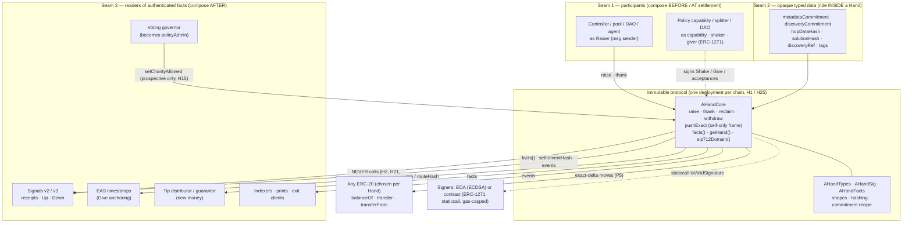

The crossed link states the one rule that makes every other rule enforceable: **Core never calls Signals or any reader**. Readers pull; Core never pushes.

### 2.3 What is immutable, what is periphery

| Immutable (changing it = a new Core deployment, D32, M17) | Periphery (deploy any time, Core unaware) |
|---|---|
| lifecycle and windows (H5, H6); four entry points + the self-only rollback frame (H8'/H2' restated, §18 #2, Appendix C); conservation and rounding order (H3); custody and deficit semantics (§5); route authority and consent matrix (H11, H12); EIP-712 domain/type strings and `handRef`/`routeHash` (H13); the `settlementHash` recipe and `IAHandFacts` (§3.4–3.5); event shapes and order (§11); the only product bounds that survive: `MAX_CHARITY_BPS = 3000` (D34), `MAX_PUBLIC_TAGS = 8`, `MAX_DISCOVERY_REF = 128` (ADR-0005/0007, H30) | Signals vN (receipts, Up curve, Down, valuation policy); controllers/arbiters/pools/guarantors; policy capabilities; app hops (D30); EAS schemas (Q19); tip modules (Q25); voting (D22, Q16); prints (D39); SDK envelopes, wire format and gas preflight (Q22); charity-list curation process (D18, Q21) |

The policyAdmin is the one mutable knob and it only gates *future* donation Hands (§10).

---

## 3. Data model and storage layout

### 3.1 Enums (order frozen; stored and compared numerically)

```solidity
enum Status         { None, Active, Settled, Reclaimed }                   // H5 — unchanged
enum Visibility     { Public, Preview, Dark }                               // H24 / ADR-0007 — unchanged
enum AllocationKind { Charity, ShakerMargin, GiverResidual, RaiserRefund }  // reason tag on every payout event — unchanged
```

No member is added to a frozen enum in v2: new payout shapes live outside Core (§9), so v1 and v2 readers decode identically (M9 cons).

### 3.2 Signed artifacts (EIP-712; field order frozen; type strings byte-identical to v1, §6.3)

```solidity
struct Shake {                        // signed by the parent capability (H11)
    uint256 handId;
    address childCapability;          // bearer or personal; Core cannot tell (H26); non-zero (ZeroCapability(i))
    address shaker;                   // 0 = anonymous (zero margin only)                     (H12)
    uint16  parentClaimBps;           // == childClaimBps of the previous hop (10 000 at root)
    uint16  childClaimBps;            // margin = parent − child, never grows
    bytes32 hopDataHash;              // app-opaque typed envelope (Seam 2, §9.2); 0 = none
    uint40  deadline;                 // now ≤ deadline ≤ expiry
}
struct ShakerAcceptance { bytes32 shakeHash; }    // explicit shaker only (H12)
struct Give {                         // signed by the terminal capability
    uint256 handId;
    bytes32 routeHash;                // exact route, no tail substitution (H12)
    address giver;
    bytes32 solutionHash;             // ADR-0013 salted commitment, computed off-chain (D19)
    uint16  finalClaimBps;            // == terminal claim of the route
    uint40  deadline;
}
struct GiverAcceptance { bytes32 giveHash; }      // ALWAYS required (H12)
```

Identical to the baseline (H29): the shapes already carry the two opaque slots the extension model needs (`hopDataHash`, `solutionHash`, M1). `ThankPermit` is deleted (Q10, D17, S28).

### 3.3 Calldata carriers

```solidity
struct Hop {                          // one per route hop, in route order
    Shake shake;
    bytes capabilitySig;              // by the expected capability (root, then the previous hop's child)
    bytes shakerAcceptanceSig;        // consent bytes of an explicit shaker; MUST be empty for anonymous/self hops (H12)
}
struct Terminal {
    Give  give;
    bytes capabilitySig;              // by the terminal capability
    bytes giverAcceptanceSig;         // by give.giver, always
}
struct RaiseParams {
    address    token;                 // any ERC-20 (D7); address(0) iff amount == 0 (Q11, §16 #7)
    uint256    amount;                // raw units; no cap (D1, H18, S4)
    uint40     expiry;                // > block.timestamp; no product window (Q8)
    address    charityRecipient;      // allowlisted iff charityBps > 0; address(0) iff charityBps == 0 (D4)
    uint16     charityBps;            // 0 ≤ bps ≤ MAX_CHARITY_BPS = 3000 (D4, D34)
    uint16     minGiverClaimBps;      // 1 ≤ floor ≤ 10 000 (H11)
    address    rootCapability;        // non-zero
    Visibility visibility;
    bytes32    metadataCommitment;    // mandatory (H24); the per-Hand typed envelope (§9.2)
    bytes32    discoveryCommitment;   // zero iff Dark
}
```

`Hop[]`/`Terminal` remove the `LengthMismatch` error class entirely and cost nothing extra in calldata for explicit hops (the positional design already carried empty `bytes` for the others). Signature bytes are `bytes calldata`, so `ECDSA.tryRecoverCalldata` verifies without copying (S10: the SDK frames variable-length signature bytes).

### 3.4 Hand storage (8 hand-packed slots) and the facts view

```solidity
struct Hand {
    // slot 0 — identity + lifecycle word, 256 bits exactly: written at raise; at the terminal transition two field writes
    //          land on this one slot (one 2 900 write + one 100 dirty write — "one SSTORE" only if the packed word is written once)
    address    raiser;            // 160  funder, Thank authority, refund destination (H31, H6, D23)
    uint40     expiry;            // 200  final (H6)
    uint40     closedAt;          // 240  0 while Active; block.timestamp of thank OR reclaim; closedAt != 0 ⇔ terminal (M8, S15)
    Visibility visibility;        // 248
    Status     status;            // 256
    // slot 1 — money terms (192 bits; 64 idle bits documented as unused forever — no reserved field, S28)
    address    token;             // per Hand (D7); address(0) iff pool == 0 (Q11)
    uint16     charityBps;        // 0..3000 (D4, D34)
    uint16     minGiverClaimBps;  // 1..10 000 (H11)
    // slot 2
    uint256    pool;              // P, exact measured deposit, written once, never zeroed; liability keys on status (H5, H20)
    // slot 3 — left zero (no write) when charityBps == 0
    address    charityRecipient;
    // slot 4
    address    rootCapability;
    // slot 5
    bytes32    metadataCommitment;   // mandatory (H24)
    // slot 6 — left zero (no write) in Dark
    bytes32    discoveryCommitment;
    // slot 7 — zero until thank; stays zero on reclaim: settlementHash != 0 ⇔ Settled (H5); recipe §3.5
    bytes32    settlementHash;
}
```

Why each stored field exists: `raiser, expiry, status, token, pool, charityBps, charityRecipient, minGiverClaimBps, rootCapability` are read by `thank`/`reclaim`; `visibility, metadataCommitment, discoveryCommitment` are Raiser-committed facts a future contract must be able to read (events are not readable on-chain, U19); `closedAt` is the terminal time any valuation/late-delivery reader needs (S15, Q4) and is free because it shares the status word; `settlementHash` is the single authenticated settlement fact. `giver`, the route and per-hop facts are **not** stored (one cold SSTORE each would be pure cost): they are bound by `settlementHash` and re-supplied by the caller from events, exactly as `occShakers` is today (S:231). Changes against the frozen 7-slot baseline and why: `creditedReward uint96` → `pool uint256` (S4, D1); `usdScaleAtRaise` removed (D7, N29); `thankSignalSourceHash` → generic `settlementHash` (M7, S16); `closedAt` added into slot 0 (M8, S15); `rewardToken` → `token`; `charityBps`/`minGiverClaimBps` moved to slot 1 to make room. One extra slot per raise versus the baseline (the `uint256` pool). Implementation note: write the Hand field by field and skip zero fields (`charityRecipient` at 0 %, `discoveryCommitment` in Dark, `pool` on a zero-pot Hand, `settlementHash`) — a zero-over-zero SSTORE is *not* free (2 100 cold access + 100 no-op = 2 200 gas), which is exactly why each skipped slot saves ≈ 2.2k. Slot 1 is never skippable: `minGiverClaimBps ≥ 1` writes it even for a zero-pot Hand (`token == 0`). As built, `raise` binds the calldata fields of each packed word (`expiry`, `visibility`; `token`, `charityBps`, `minGiverClaimBps`) to locals before storing: a calldata read carries its own validation branch, and stores on either side of one never merge into one SSTORE. Measured: the counter plus seven Hand slots, each written exactly once (slot 7, `settlementHash`, is `thank`'s).

Two read surfaces, both `view`, both free of external calls:

```solidity
/// Full snapshot for apps, SDK and tests; ABI-coupled to THIS Core's layout (as today).
function getHand(uint256 handId) external view returns (Hand memory);

/// The STABLE read interface readers bind to (M20, Q33, S22). A later Core may re-layout Hand
/// and still implement IAHandFacts; a Signals written against it survives the re-layout.
/// It carries EVERY Raise-time and terminal fact — money terms AND the Raiser-committed envelopes —
/// so no Seam-2/Seam-3 reader ever needs the layout-coupled getHand (five extra words in a view
/// return, zero storage cost). Pinned by I-25.
interface IAHandFacts {
    struct HandFacts {
        Status     status;
        address    raiser;
        address    token;
        uint256    pool;
        uint16     charityBps;
        address    charityRecipient;
        uint16     minGiverClaimBps;
        address    rootCapability;
        uint40     expiry;
        uint40     closedAt;
        Visibility visibility;
        bytes32    metadataCommitment;
        bytes32    discoveryCommitment;
        bytes32    settlementHash;
    }
    function facts(uint256 handId) external view returns (HandFacts memory);
}
```

`getHand` stays for apps/SDK/tests only; a contract that binds to `getHand` is Core-version-bound by choice, never by necessity.

### 3.5 Settlement commitment (versioned, generic; replaces the Signals-v1-shaped `thankCommitment`)

```solidity
library AHandMath {
    uint16 internal constant BPS = 10_000;   // uint16 so that AHandCore.BPS_DENOMINATOR (uint16) is defined as AHandMath.BPS without a cast; mulDiv widens it
    /// floor(amount · bps / 10 000), exact for any uint256 amount (OZ Math.mulDiv) — the ONE floor formula (S4, Q33)
    function cut(uint256 amount, uint256 bps) internal pure returns (uint256) { return Math.mulDiv(amount, bps, BPS); }
}

library AHandSettlement {
    bytes32 internal constant SETTLEMENT_TAG = keccak256("aHand.settlement.v2");   // M9 versioning; v3 = new tag

    struct SettlementPreimage {           // everything a second contract may need to verify (Q13 "flat")
        uint256   handId;
        address   raiser;
        address   giver;
        address   token;
        address   charityRecipient;
        uint256   pool;                   // P
        uint256   charityAllocation;      // C
        uint256   giverAllocation;        // G = D − Σ A_i
        bytes32   routeHash;
        bytes32   giveHash;
        bytes32   solutionHash;
        uint40    closedAt;
        address[] occShakers;             // route order, zeros preserved (D13 per-occurrence facts)
        uint16[]  occClaimDeltas;         // route order margins δ_i
        uint256[] occAllocations;         // route order A_i = floor(D·δ_i/1e4): readers NEVER re-derive floor math (Q33)
    }

    function commitment(address core, SettlementPreimage memory p) internal view returns (bytes32) {
        // The three array hashes are computed into locals first: inlined into a test contract under
        // via-IR the 18-argument encode with the hashes inline is "stack too deep by 1 slot". Same
        // bytes hashed, same settlementHash; Signals v2 calls this library instead of re-inlining it.
        bytes32 shakersHash     = keccak256(abi.encodePacked(p.occShakers));
        bytes32 deltasHash      = keccak256(abi.encodePacked(p.occClaimDeltas));
        bytes32 allocationsHash = keccak256(abi.encodePacked(p.occAllocations));
        return keccak256(abi.encode(
            SETTLEMENT_TAG, block.chainid, core, p.handId,
            p.raiser, p.giver, p.token, p.charityRecipient,
            p.pool, p.charityAllocation, p.giverAllocation,
            p.routeHash, p.giveHash, p.solutionHash, p.closedAt,
            shakersHash, deltasHash, allocationsHash
        ));
    }
}
```

Encoding rule the off-chain hasher must copy: `abi.encodePacked` of a dynamic array pads **every element to 32 bytes** (array elements are never tightly packed), so `occShakers` hashes as `n` 32-byte words, `occClaimDeltas` as `n` words of `uint16` left-padded, `occAllocations` as `n` words — packing 20-/2-byte elements produces a different hash. `GenVectors.t.sol` ships at least one non-empty-route vector (and one with a zero shaker in the middle) to pin this (§11 recipe, U27).

Published list of on-chain-verifiable facts (S16, U19): chain, core, handId, raiser, giver, token, charityRecipient, P, C, G, D (= P − C), every hop's shaker, margin **and allocation** in order, routeHash (hence the ordered shakeHashes once re-supplied), giveHash, solutionHash, terminal time. Facts deliberately *not* in the preimage: `charityBps`, `minGiverClaimBps`, `expiry`, `rootCapability`, `visibility`, both commitments (immutable per Hand, readable via `facts()`/`getHand`), `policyRevision` (a Raise-time fact in `Raised`), any USD value (N29, Q4). Everything else (metadata, discovery payloads, hop-data preimages) is opaque by design and a client duty to retain (M1 cons).

Why flat and not Merkle (Q13): the consumers in sight (Signals v2 receipts, valuation, EAS flags, voting weight) need the whole preimage anyway; an index contract can build Merkle proofs over the full preimage later without a Core change. Why commit `C`, `G` and `A_i` although they are derivable: so the triplicated-formula smell (C:408, C:652, S:225) is closed by *consumption*, not by a second implementation; `AHandMath.cut` exists for Core only.

### 3.6 Other storage and constants

```solidity
uint256 public handsCount;                                         // ids from 1, monotonic (H5)
address public policyAdmin;  address public pendingPolicyAdmin;  uint64 public policyRevision;   // H15 (pendingPolicyAdmin + policyRevision pack into one slot, 224 bits)
mapping(uint256 => Hand)                        private _hands;
mapping(address => bool)                        public  charityAllowed;   // prospective allowlist (D18); never contains 0 or address(this) (S35)
mapping(address => mapping(address => uint256)) public  claims;           // claims[token][beneficiary] (H10)
// transient: OZ ReentrancyGuardTransient slot (H8)

uint16  public constant BPS_DENOMINATOR   = AHandMath.BPS;   // 10 000, the literal exists once
uint16  public constant MAX_CHARITY_BPS   = 3_000;      // D34 («30% максимум»), no setter; §16 #4
uint256 public constant MAX_PUBLIC_TAGS   = 8;          // ADR-0005 (H30)
uint256 public constant MAX_DISCOVERY_REF = 128;        // ADR-0007 (H30)
uint256 public constant ERC1271_GAS       = 350_000;    // H14; per-signature cap (S25, §6.4)
uint256 public constant PUSH_GAS          = 200_000;    // frame budget per push (§5.3); to be measured per token (D3/Q22)
uint256 public constant PUSH_RESERVE      = 30_000;     // what the parent needs after a frame: claims SSTORE + event + call overhead (§5.3)
```

Absolute slots (inherited storage comes first: `AHandCore is IAHandFacts, EIP712, ReentrancyGuardTransient`): OZ 5.6.1 `EIP712` declares two storage strings, `_nameFallback` (slot 0) and `_versionFallback` (slot 1), used only when name/version exceed 31 bytes — "aHand"/"3" never do, so both stay permanently empty but occupy their slots; `ReentrancyGuardTransient` uses transient storage only. Core's own state therefore starts at slot **2**: `handsCount` 2, `policyAdmin` 3, `pendingPolicyAdmin`+`policyRevision` 4, `_hands` 5, `charityAllowed` 6, `claims` 7. The two empty OZ slots are not reserved fields of ours (P6/S28 unaffected). The I-18 layout snapshot is generated by `forge inspect AHandCore storage-layout`, never hand-numbered.

Immutables: none of our own — OZ `EIP712` holds the cached domain, chain id and address and recomputes on a fork (H13). Removed: `MIN_CHARITY_BPS`, `MAX_SHAKES`, `MIN/MAX_EXPIRY`, `rewardToken`, `usdScale`, `tokenEnabled`, `THANK_PERMIT_TYPEHASH`, the hand-written reentrancy slot (D2–D4, D7, Q8, Q10, Q17, S28). `tokenEnabled` is gone (Q17): under "any ERC-20" there is nothing for it to gate, and a token admission switch would be a hidden allowlist (N24).

---

## 4. Hand lifecycle state machine

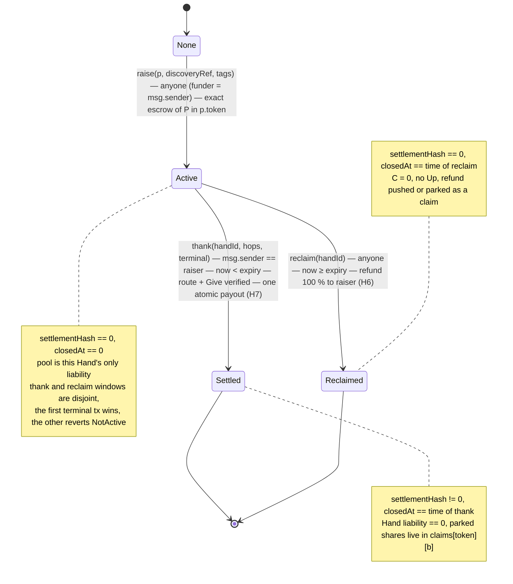

### 4.1 Transition table

| Transition | Caller | Preconditions (error, in check order) | Effects | Events (in order) |
|---|---|---|---|---|
| **raise** `None → Active` | anyone; `msg.sender` becomes `raiser` (funder + Thank authority + refund destination: H31, H6, D23) | (1) `rootCapability != 0` (`ZeroAddress`); (2) `(amount == 0) == (token == 0)` (`ZeroPotTerms`, Q11); (3) `charityBps ≤ 3000` and `1 ≤ minGiverClaimBps ≤ 10000` (`BoundsViolated`, D34, H11); (4) `charityBps == 0 ⇒ charityRecipient == 0` (`UnexpectedCharityRecipient`); `charityBps > 0 ⇒ charityAllowed[charityRecipient]` (`CharityNotAllowed`, D18; zero and Core can never be allowlisted, S35) **and** `C = cut(amount, bps) ≥ 1` (`ZeroCharityAllocation`: a declared donation that pays nothing is a false fact; this also rejects a zero pot with a donation, D4/D8); (5) `expiry > block.timestamp` (`ExpiryInPast`, Q8); (6) visibility coherence exactly as baseline: `metadataCommitment != 0`; Dark ⇒ empty ref, zero discoveryCommitment, no tags; else `1 ≤ |ref| ≤ 128` and `discoveryCommitment != 0` (`InvalidVisibilityData`, H24); (7) tags ≤ 8, strictly ascending (`TagsInvalid`, ADR-0005); (8) if `amount > 0`: `_pullExact(token, msg.sender, amount)` — **both** the payer's debit and Core's receipt must equal `amount` (`InexactDeposit`, H20, S3 four observations; §5.1) | `policyRevision` read into a local **before** rule 8 (so `Raised.policyRevision` names the revision under which rule 4 passed even if a token hook reaches `setCharityAllowed` mid-call); `handId = ++handsCount`; write Hand (status Active, pool = amount, closedAt = 0, settlementHash = 0) | `Raised(...)` with the full snapshot + `policyRevision`; `HandTagged` iff tags non-empty |
| **thank** `Active → Settled` | `msg.sender == h.raiser` (any account kind, incl. a controller contract: D23) | Phase A (view only): `status == Active` (`NotActive`); `now < expiry` (`HandExpired`, strict: H6); `msg.sender == raiser` (`NotRaiser`); route walk §6.2 (hop-indexed errors); Give check §6.2 (ordered list) | Phase B: pure floor math §5.2. Phase C (effects before any transfer, H9): `status = Settled; closedAt = now` (slot 0: the two field writes merge into one 2.9k store — measured, 2 storage writes per thank), `settlementHash = commitment(...)` (one cold SSTORE); all events. Phase D: pushes charity → paid hops in order → giver, each in an isolated frame behind the starvation guard; a failing frame credits `claims[token][to] += share` | `Settled`, `RouteHopSettled × n`, `PayoutAllocated` (Charity if C > 0; ShakerMargin per hop with A_i > 0; GiverResidual if G > 0), then exactly one `PayoutPushed` or `PayoutDeferred` per `PayoutAllocated`, same order (H10) |
| **reclaim** `Active → Reclaimed` | anyone (H6, U17) | `status == Active` (`NotActive`); `now ≥ expiry` (`HandNotExpired`) | `status = Reclaimed; closedAt = now` (slot 0: one store); pool untouched; one guarded push of P to `h.raiser` (if P > 0) | `Reclaimed`, then `PayoutAllocated(RaiserRefund)` + `PayoutPushed`/`PayoutDeferred` iff P > 0 |
| **withdraw** (ledger, no Hand transition) | anyone; destination fixed to `beneficiary` (H10, Q29) | `claims[token][beneficiary] != 0` (`ZeroClaim`; covers beneficiary == 0 and unknown tokens) | zero the claim, then `_transferExact(token, beneficiary, amount)` — reverts (claim restored by the revert) on any failure | `PayoutWithdrawn(token, beneficiary, amount)` |

Per-transition security argument: *raise* — the only external calls before effects are the four balance reads and the measured deposit; no state read after it except the balances (`policyRevision` is snapshotted before); lock held; a hook during `transferFrom` sees no new Hand (counter not yet incremented) and cannot enter any mutator. *thank* — Phase A is view-only (ECDSA is pure; ERC-1271 is a gas-capped `staticcall`); all Hand state and all events are final before the first push; each push is a self-only reverting frame with exact delta behind the starvation guard; the lock blocks every re-entry; so no observer sees a half-settled Hand, no push can move more than its allocation, and no push can be starved. *reclaim* — destination is the stored raiser, never a parameter; status flips before the single push. *withdraw* — fixed destination, zeroed before transfer, whole-tx revert on inexact delivery, lock held.

Raise validation order is fixed and documented so the precedence tests (TEST/AHand.raise.t.sol) are re-cut once (CODE-MAP §1.10 "validation order arbitrary").

### 4.2 Terminality and liability

- A Hand is terminal exactly once (`NotActive` on the second attempt); `pool` is never zeroed; `settlementHash != 0 ⇔ Settled`; `closedAt != 0 ⇔ terminal` (H5, I-1).
- The liability of a Hand is `pool` while Active and 0 when terminal; parked shares are liabilities of the claims ledger, not of the Hand (H4, §5.4).
- Expiry race: both terminal transitions require `status == Active` and the windows are disjoint by timestamp, so at most one succeeds in any block; the loser reverts `NotActive` / `HandExpired` / `HandNotExpired`. The SDK warns near expiry; Raisers thank with margin.
- No fifth transition exists: no pause, no cancel before expiry, no top-up, no amendment, no partial award (N4, N18, N19).

---

## 5. Money: custody, formulas, delivery

### 5.1 Custody model (Q2 decided; §16 #2)

**Shared custody per token, per-Hand nominal units, exact deltas on every move inside reverting frames, no global solvency gate, no haircut, no rescue.**

- *Promised unit*: raw token units as measured by `balanceOf` deltas (P = I = A on entry: paid = inserted = accounted — **both** measured; D = R = A on exit: debited = released = accounted — custody debit measured, beneficiary receipt is the token's business; S3). Core never reads `decimals`, `name`, `symbol` or a price (N29, S4) and never treats a token specially (no allowlist, no wrapper requirement: N24, Q17).
- *Entry*: `_pullExact(token, from, amount)` measures **both** sides (code in §5.3): `fromBefore = balanceOf(from)`, `coreBefore = balanceOf(this)`, `safeTransferFrom`, then `balanceOf(this) == coreBefore + amount` **and** `balanceOf(from) + amount == fromBefore`, else `InexactDeposit` (H20). Measuring only Core's receipt (the baseline, C:436-440) would admit a token with a sender-side fee or burn (debits 110 for 100): it enters, and then every exit — push, `withdraw`, the reclaim refund — fails the exit rule forever (refuter finding). Cost: two extra `STATICCALL`s (≈ 5k) on `raise` only. Receiver-fee, rebasing and share-based surprises are rejected, not absorbed; a token that wants in wraps itself in a conforming share token at the periphery (never mandatory: N24). Share-based rebasers (stETH-style, transfers off by 1 wei by design) can pass the entry check by luck and then fail every exit by 1 wei: the app catalogue lists that class as "never escrow directly, wrap" — the entry check is a door, not a classifier. Zero `amount` makes no token call at all (S23).
- *Exit*: `_transferExact(token, to, amount)` — OZ `safeTransfer` return rule, exactly (OZ 5.6.1 `_safeTransfer`): the call succeeded **and** (the first 32 bytes of returndata equal 1 — any returndata length ≥ 32 passes — **or** returndata is empty and the token has code); a call that *reverted* bubbles the token's own revert data; a call that *succeeded* with any other shape (word 0/2/3, short returndata, empty returndata from a codeless address) reverts `SafeERC20FailedOperation` — **and** `balanceOf + amount == before` (`TransferInexact`). Inside a push it runs in the `pushExact` frame (§5.3): a false return, a short word, a revert, an inexact delta or an out-of-gas all leave *no* token effect and park exactly `amount` as a claim. S1 transfer-then-false can no longer double-count; S2's surplus-masked double payment cannot occur because correctness comes from the per-move frame, not from a balance inequality.
- *Deficit policy* ("nominal-and-stop", by construction): no global `balance ≥ liability` gate exists (it would freeze a whole token class after one external drift and, per the ROUND14 counterexample, prevents nothing). A non-conforming token (negative rebase, confiscation, dishonest `balanceOf`, S3) can create a same-token shortfall; Core then simply fails the exits that no longer fit — pushes defer, withdraws revert — in call order, never reducing anyone's nominal number, never moving a neighbour's units (nothing in Core transfers more than one allocation at a time, every allocation is bounded by its own Hand's pool, and every exit is exact or nothing). The shortfall is borne by whoever exits last. **Two cases are not a shortfall but a total stop**, and are named as such: (a) a token that turns on a sender-side fee or burn *after* Hands are open (upgradeable fee tokens: a 110-for-100 debit fails `_transferExact`'s `custodyDebit == amount` on every exit — the entry check only guards the door), and (b) a token that blacklists or pauses Core itself. In both, 100 % of that token's escrow — every push, every parked claim, every `withdraw`, **and the Raiser's reclaim refund** — stays in Core forever; nobody "exits last" because nobody exits. This is the accepted price of exact-or-nothing exits (the alternative, tolerant exits, is the silent 100→98 that S3 forbids); it is confined to that token, disclosed in the app catalogue and in copy (H28), and part of the owner acceptance in §16 #2. Documented, not promised away (N24). **This is the shared same-asset deficit-stop, including the total-stop cases, the owner must explicitly accept (REQ Q2; §16 #2).**
- *Surplus*: unsolicited transfers and positive rebases are inert; no function reads the balance to compute an allocation, so surplus can never be paid out and never increases a liability (H4). No admin rescue (N4).
- *Why not a per-Hand vault (Q2 option B)*: a CREATE2 clone per raise plus a hop through it on every push is a permanent per-Hand tax (≈ 45k + ≈ 7k per push) that buys physical isolation only against tokens the entry rule already rejects; it cannot help against a dishonest `balanceOf`; and it puts a second contract into the money path (D36 "no bottlenecks"). The choice is **ABI-invisible**: `claims`, events and `IAHandFacts` are identical under A and B, so the pre-freeze measurement may still flip it (REQ Q2 "B as measurement candidate").

### 5.2 Settlement arithmetic (H3, D4, D8, S4, S17)

Inputs frozen at raise: `P = pool`, `b = charityBps ∈ [0, 3000]`, `f = minGiverClaimBps ∈ [1, 10000]`. Route claims `q_0 = 10000 ≥ q_1 ≥ … ≥ q_n ≥ f`, margins `δ_i = q_{i−1} − q_i`.

```text
C   = cut(P, b)   = floor(P · b / 10000)          Math.mulDiv — exact for any uint256 P (S4); 0 when b = 0 or P = 0
D   = P − C                                      distributable; D ≥ ceil(0.7·P) because b ≤ 3000 (D34)
A_i = cut(D, δ_i) = floor(D · δ_i / 10000)       each hop floored INDEPENDENTLY from D (S17), 0 when δ_i = 0
G   = D − Σ A_i                                  giver residual absorbs ALL dust
P   = C + Σ A_i + G                              exact, by construction (H3)
```

Bounds that follow: `G ≥ ceil(D · q_n / 10000) ≥ 1` whenever `D ≥ 1` (because `Σ floor ≤ floor Σ` and `q_n ≥ 1`): the giver is never below the signed floor and never zero on a funded Hand. Telescoping (S17): splitting a margin across hops can only lower what those hops receive; dust flows to the giver, never to charity, never to Core. Rounding order is fixed: charity from `P`, hops from `D`, giver last.

| Case | Rule | Source |
|---|---|---|
| `P == 0` (zero-reward Hand) | `token == 0`, `charityBps == 0` (forced by rule 4); no token call at raise, thank, reclaim; all allocations 0; `_pay` no-ops; `MarginRoundsToZero` not checked (D = 0) but a positive margin still needs a non-zero shaker (`AnonymousShakerWithMargin(i)`): attribution is a fact even when money is not; `Settled` is emitted with zero amounts; reclaim flips status only | D8, Q11, S23 |
| `P > 0`, `b == 0` | C = 0, no Charity allocation/push/event; `charityRecipient == 0` | D4 |
| `P > 0`, `b > 0` | `C ≥ 1` enforced at raise (so `P ≥ 4` and `D ≥ 3`); charity pushed at Thank, never at Reclaim (success-only donation, H3) | D4, D34 |
| any `D > 0`, hop with `δ_i > 0` | `A_i ≥ 1` else `MarginRoundsToZero(i)` — a paid hop that pays nothing is rejected rather than silently absorbed | H11 |

The formula lives once, in `AHandMath.cut`, used by `raise` (feasibility) and `thank` (split); readers consume `C`, `G`, `A_i` from the commitment (Q33).

### 5.3 Delivery: push with claimable fallback, isolated frames, starvation guard (H10, Q12, S1, S2, S25)

```solidity
function _pay(uint256 handId, address token, address to, AllocationKind kind, uint256 position, uint256 amount) private {
    if (amount == 0) return;                                       // zero-reward / 0 % paths (D8, D4)
    // EIP-150 forwards min(PUSH_GAS, 63/64 of what is left): guarantee the frame its full budget, so a
    // Raiser (or a stranger calling reclaim) cannot under-fund gas to park everyone's share as a claim (I-9).
    if (gasleft() < PUSH_GAS * 64 / 63 + PUSH_RESERVE) revert InsufficientGas();
    if (_pushFrame(token, to, amount)) {
        emit PayoutPushed(handId, token, to, kind, position, amount);
    } else {
        claims[token][to] += amount;                               // exactly this share, nothing else
        emit PayoutDeferred(handId, token, to, kind, position, amount);
    }
}

/// Outer call written in assembly with out = 0: the parent never copies returndata (no returndata bomb).
function _pushFrame(address token, address to, uint256 amount) private returns (bool ok) {
    bytes memory cd = abi.encodeCall(this.pushExact, (token, to, amount));
    assembly ("memory-safe") { ok := call(PUSH_GAS, address(), 0, add(cd, 0x20), mload(cd), 0, 0) }
}

/// The ONLY external function besides the four entry points and the three policy functions; callable solely
/// by this contract (OnlySelf); writes no Core storage. It exists because the EVM has no sub-transaction
/// other than a call frame: a transfer that does not move exactly `amount` units leaves no trace (S1/S2).
/// It carries NO `nonReentrant` modifier — deliberately: OZ ReentrancyGuardTransient is transaction-scoped,
/// so the self-call sees the outer lock; a reflexive modifier would revert every frame
/// (ReentrancyGuardReentrantCall) and silently park every payout as a claim while thank/reclaim still
/// succeed — only the PayoutAllocated → PayoutPushed pairing test would notice. Pinned by I-17 and ADR-0015.
function pushExact(address token, address to, uint256 amount) external {
    if (msg.sender != address(this)) revert OnlySelf();
    _transferExact(token, to, amount);
}

function _transferExact(address token, address to, uint256 amount) private {
    uint256 before = IERC20(token).balanceOf(address(this));
    IERC20(token).safeTransfer(to, amount);                        // OZ rule §5.1: first word == 1, or empty return && code
    if (IERC20(token).balanceOf(address(this)) + amount != before) revert TransferInexact();   // custodyDebit == amount
}

/// Entry (raise only): both the payer's debit and Core's receipt must equal `amount` (S3 four observations).
function _pullExact(address token, address from, uint256 amount) private {
    uint256 fromBefore = IERC20(token).balanceOf(from);
    uint256 coreBefore = IERC20(token).balanceOf(address(this));
    IERC20(token).safeTransferFrom(from, address(this), amount);
    if (IERC20(token).balanceOf(address(this)) != coreBefore + amount) revert InexactDeposit();  // custodyReceipt == amount
    if (IERC20(token).balanceOf(from) + amount != fromBefore)        revert InexactDeposit();  // payerDebit == amount (sender-fee/burn rejected at the door)
}
```

Properties: a push either moved exactly `amount` units (then `PayoutPushed`) or moved nothing and parked exactly `amount` as a claim (`PayoutDeferred`); never both (S1 fixed), never a partial, never a bubbled revert (U16, H10). A hostile recipient or token wastes at most `PUSH_GAS` per allocation and harms only its own share. Deferral is only ever a token/recipient fact, never a gas-supply fact (I-9) — absent call-depth exhaustion: a `CALL` at depth 1024 fails before the frame runs and would park the share with the token untouched; under EIP-150 with Base's 16.78M cap that depth is unreachable ((63/64)^1022 of any budget rounds to zero gas), so the exception is documented in I-9, not coded. `balanceOf` is uncapped inside the frame only in the sense that it shares the frame's `PUSH_GAS`; outside a frame (`raise`, `withdraw`) a returndata-bombing `balanceOf` is self-harm of the caller who chose that token. `withdraw` reuses `_transferExact` directly, unbounded, and reverts instead of deferring (S5 alignment); it is permissionless, fixed-destination, zeroed-before-transfer, never policy-gated (H10). A blacklisted beneficiary stays unwithdrawable forever; no redirect (Q29, S5 accepted).

Constants (to be measured on the frozen commit, D3/Q22): `PUSH_GAS = 200 000` — FiatToken proxy `transfer` ≈ 65k, hook-style tokens ≈ 120k, two proxied `balanceOf` ≈ 2 × 7k, frame overhead ≈ 8k ⇒ ≈ 1.4× headroom over the heaviest honest case; anything heavier always lands as a claim and is drained by `withdraw` with unbounded gas (S25). `PUSH_RESERVE = 30 000` — a cold `claims` SSTORE (22.1k) + the event (≈ 2.6k) + call overhead, so a passing guard also means the parent can record the outcome; under-sizing would only turn a deferral into an atomic revert, never into a starved push.

**`pushExact` versus H8 and H2 — decided: the frame is kept and both hard invariants are restated (§18 #2).** H8 ("exactly four mutating entry points … nobody moves escrow outside them") and H2 ("Core calls out only to the reward token … and to signers via ERC-1271 staticcall") are REQ §1 hard invariants, not ADR clauses that H30 lets a new ADR supersede. The frame touches both: a fifth selector that transfers tokens (reachable by no external account — `OnlySelf`; mutates no Core state; reachable only from `_pay` under the outer lock) and a third `CALL` target, `address(this)`. REQ Q12 named this frame only as an assistant proposal ("compare gas/code/security on implementation"); under the owner's delegation of 2026-11-01 (§18) it is decided here: the frame stays, and H8/H2 are restated rather than widened silently — **H8'** = "exactly four externally reachable mutating entry points (raise, thank, reclaim, withdraw); the self-only frame pushExact is reachable from no external account (OnlySelf), writes no Core storage and moves tokens only on their instruction"; **H2'** = "Core calls out only to the Hand's token, to signers via gas-capped staticcall, and to itself for the rollback frame" — in ADR-0015 (Appendix C, two rows: H8 and H2/ADR-0008) and in §12 I-17/I-18, for the owner to confirm at acceptance. The measured alternative, the *delta-trusting inline push* — a gas-capped low-level `call` to `token.transfer` with `out = 0`, the return word ignored, and the custody delta alone deciding: `Δ == amount ⇒ PayoutPushed`, `Δ == 0 ⇒ PayoutDeferred`, `0 < Δ ≠ amount ⇒ TransferInexact` (whole-tx revert) — needs no fifth selector and no self-call and is **rejected**. The argument that made the two look equivalent (a partial-delta token is the same total stop either way, §5.1: a token whose exits are inexact can be drained by `withdraw` under neither design) covers only *non-conforming* tokens. For a *conforming* token with recipient hooks (ERC-777-style `tokensReceived`, or any token that calls the recipient on transfer) a hostile recipient can send part of the amount back to Core during the push, and for a token with a selective fee (fee only to/from listed addresses) one listed recipient yields a partial custody delta while the token stays exact for everyone else. Under the inline push that partial delta must revert the whole thank — nothing can undo a partial move without a frame — so one consented hostile hop kills the Hand's settlement for everyone (the giver loses; only reclaim after expiry remains): precisely the bottleneck the owner forbids. Under the frame the anomaly rolls back inside `pushExact` and only that recipient's share parks as a claim, so H10's "parks exactly its own share" holds for every conforming token. Pure pull (N5) and the status-quo boolean (S1) stay rejected. The selector-inventory test pins the decided state (`pushExact` from any EOA/contract → `OnlySelf`) and the I-18 bytecode scan pins exactly two `CALL` targets: the Hand's token and `address(this)`.

### 5.4 Per-token identity (H4 restated for arbitrary assets)

```text
∀ token t, after every Core transition:
  balanceOf_t(Core) = Σ_{h Active, h.token == t} h.pool + Σ_b claims[t][b] + surplus_t,   surplus_t ≥ 0
```

Induction over the entry points, for a conforming token (exact deltas hold): raise adds `amount` to both sides; a delivered push subtracts the same allocation from the Hand term and the balance; a deferred push moves the allocation from the Hand term to the claims term with the balance unchanged; reclaim likewise with one allocation; withdraw subtracts the same amount from both sides. `surplus_t` grows only by out-of-protocol transfers and is never decreased by Core (inert forever). Settling one Hand never touches another's term, across tokens or within one (escrow isolation); so the solvency inequality `balance_t ≥ L_t` holds and no Hand can debit custody beyond its own allocations. A non-conforming token can violate the identity only by shrinking the left side, which Core cannot observe nor repair (§5.1 deficit policy).

### 5.5 Money-flow diagram

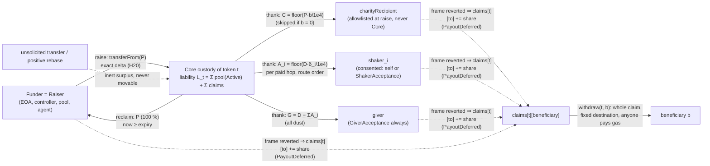

Every arrow out of custody is one `_pay` with one `(kind, position)` inside one frame behind the starvation guard; there is no other outflow in the contract (H8, N4). No arrow carries a fee (H16, N3).


---

## 6. Routing and consent

### 6.1 Capabilities (H11, H26, ADR-0003)

A capability is an address that can sign; Core cannot and does not distinguish a bearer key from a personal wallet from a contract (H26, H14). Verification starts at the stored `rootCapability` with claim 10 000 bps; hop `i` must be signed by hop `i−1`'s `childCapability`; a zero-shake route is the root signing the Give at 10 000. Every `childCapability` is non-zero (`ZeroCapability(i)`: a dead-end hop is rejected at the hop instead of failing later with the wrong error). Branching by leaked keys is a property, not a bug (U26); exclusive transfer/revocation is not claimed (N28).

### 6.2 Consent matrix (H12 / ADR-0011, unchanged; D28, D29 are periphery defaults expressible here)

| Hop shape | `shaker` | margin | acceptance bytes | consent proven by | typical use |
|---|---|---|---|---|---|
| anonymous | `0` | must be 0 (`AnonymousShakerWithMargin(i)`) | must be empty (`UnexpectedAcceptance(i)`) | nobody is attributed or paid | 0 % pass without a wallet (D29 default) |
| self | `== signing capability` | any | must be empty (`UnexpectedAcceptance(i)`) | the Shake signature itself (authority + attribution + payout terms) | personal capability hop; "name me" at 0 % (D29 opt-in) |
| explicit | distinct, non-zero (a child capability named as shaker counts) | any | validated by `shaker` as `ShakerAcceptance(shakeHash)` (`ShakerAcceptanceInvalid(i)`) | a second signature — or, for a contract shaker, whatever its `isValidSignature` accepts (S11, §6.4) | app/agent hop (D30/D45), DAO or Safe as shaker, paid bearer-link hop with a controlled payout account (U28) |
| **Give** | `giver` non-zero (`ZeroGiver`) | — | `Give` by the terminal capability (`CapabilityProof(n)`) **and** `GiverAcceptance(giveHash)` by `giver` always (`GiverAcceptanceInvalid`) | both authority and the payee's consent, even when giver == terminal capability | every settlement |
| **Thank** | — | — | — | `msg.sender == raiser` (H31) | the funder's (or controller's) decision |
| **Reclaim / Withdraw** | — | — | — | nobody: destinations fixed in storage (U17) | watchers, apps, strangers |

Positive margin ⇒ self or explicit. Core never requires identity for a 0 % pass (N22). `raiser == giver` settles (D12 is a Signals rule). The route walk, as code (Phase A, `view`; one pass computes facts, allocations and the margin total):

```text
expectedCap = h.rootCapability; expectedClaim = 10000; marginTotal = 0; ds = DOMAIN_SEPARATOR()
for i in 0..n−1:                                               // n unbounded (D3)
  s = hops[i].shake
  s.handId == handId                                           else WrongHand(i)
  s.childCapability != 0                                       else ZeroCapability(i)
  shakeHash = hashShake(s)
  _isValidSig(expectedCap, digest(ds, shakeHash), hops[i].capabilitySig)       else CapabilityProof(i)
  s.parentClaimBps == expectedClaim                            else ClaimMismatch(i)
  s.childClaimBps <= s.parentClaimBps                          else ClaimMustNotGrow(i)
  s.childClaimBps >= h.minGiverClaimBps                        else ClaimBelowFloor(i)
  now <= s.deadline                                            else ArtifactExpired(i)
  s.deadline <= h.expiry                                       else DeadlineExceedsExpiry(i)
  δ = parent − child; A = 0
  if δ != 0: s.shaker != 0                                     else AnonymousShakerWithMargin(i)
             A = cut(D, δ); if D != 0 && A == 0                → MarginRoundsToZero(i)
  if s.shaker != 0 && s.shaker != expectedCap:                 // explicit
       _isValidSig(s.shaker, digest(ds, hashShakerAcceptance(shakeHash)), hops[i].shakerAcceptanceSig)
                                                               else ShakerAcceptanceInvalid(i)
  else hops[i].shakerAcceptanceSig.length == 0                 else UnexpectedAcceptance(i)
  record shakeHashes[i], occShakers[i] = s.shaker, occClaimDeltas[i] = δ, hopAllocations[i] = A; marginTotal += A
  expectedCap = s.childCapability; expectedClaim = s.childClaimBps
routeHash = hashRoute(handRef(this, handId), shakeHashes)

Give check (after the walk; n = hops.length names the Give in every indexed error; baseline order C:880-895 kept, names per S26):
  t.give.handId == handId                                      else WrongHand(n)
  t.give.routeHash == routeHash                                else RouteHashMismatch
  t.give.finalClaimBps == expectedClaim                        else ClaimMismatch(n)
  t.give.giver != 0                                            else ZeroGiver
  now <= t.give.deadline                                       else ArtifactExpired(n)
  t.give.deadline <= h.expiry                                  else DeadlineExceedsExpiry(n)
  giveHash = hashGive(t.give)
  _isValidSig(expectedCap, digest(ds, giveHash), t.capabilitySig)                                 else CapabilityProof(n)
  _isValidSig(t.give.giver, digest(ds, hashGiverAcceptance(giveHash)), t.giverAcceptanceSig)       else GiverAcceptanceInvalid
```

Consent/signature matrix as a diagram (families × signer kinds × bytes × lifetime):

```mermaid
flowchart LR
    subgraph FAM["Four signature families (digest = EIP-712 domain v3 · Core · chainId)"]
        direction TB
        f1["Shake(i) — signer: expected capability (root, then child of hop i−1)<br/>bytes: required · error: CapabilityProof(i)"]
        f2["ShakerAcceptance(shakeHash) — signer: explicit shaker only<br/>anonymous/self: bytes MUST be empty (UnexpectedAcceptance(i))<br/>explicit: EOA needs 65 B · contract decides (may accept empty) · error: ShakerAcceptanceInvalid(i)"]
        f3["Give — signer: terminal capability<br/>bytes: required · error: CapabilityProof(n)"]
        f4["GiverAcceptance(giveHash) — signer: giver, ALWAYS (even giver == terminal)<br/>EOA needs 65 B · contract decides · error: GiverAcceptanceInvalid"]
    end
    subgraph KIND["Signer kind → verifier path → lifetime"]
        direction TB
        k1["EOA / EIP-7702 raw key<br/>ECDSA 65 B, low-s, valid v (tryRecoverCalldata)<br/>valid until the artifact deadline · irrevocable"]
        k2["ERC-1271 live validator (smart wallet, policy capability, splitter)<br/>staticcall ≤ 350k · 32-byte out buffer · magic word only<br/>DYNAMIC: re-checked at Thank · revocable"]
        k3["Safe approved hash<br/>signMessage → signedMessages[SafeMessage(digest)] != 0 · empty bytes<br/>IRREVOCABLE for that digest (signedMessages is permanent)"]
    end
    FAM --> V["one verifier _isValidSig: ECDSA first, then (code ⇒ ERC-1271)"]
    V --> KIND
```

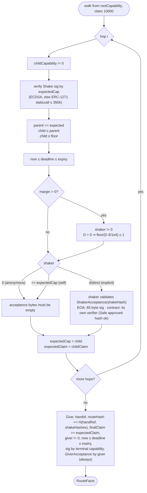

### 6.3 EIP-712: domain, type strings, digests (H13, Q18, M9)

```text
EIP712Domain(name "aHand", version "3", chainId, verifyingContract = Core)   ← version bump: every v2 artifact dies on v3 by construction
Shake(uint256 handId,address childCapability,address shaker,uint16 parentClaimBps,uint16 childClaimBps,bytes32 hopDataHash,uint40 deadline)
ShakerAcceptance(bytes32 shakeHash)
Give(uint256 handId,bytes32 routeHash,address giver,bytes32 solutionHash,uint16 finalClaimBps,uint40 deadline)
GiverAcceptance(bytes32 giveHash)
handRef   = keccak256(abi.encode(chainId, core, handId))
routeHash = keccak256(abi.encode(handRef, shakeHashes[]))          — signature bytes excluded (malleability cannot rename a route)
digest    = keccak256("\x19\x01" ‖ DOMAIN_SEPARATOR() ‖ structHash)
```

Type strings are unchanged from the baseline (H29); only the domain version moves. The domain comes from OZ `EIP712("aHand", "3")`: cached at deploy, recomputed when `block.chainid` or `address(this)` differs (fork safety, U25), with `eip712Domain()` (ERC-5267) exposed for wallets and the SDK and `DOMAIN_SEPARATOR()` kept as a view for v1 tooling parity. `AHandSig.domainSeparator(core)` stays in the library as the mirror used by vectors and tests; a test pins its equality with `DOMAIN_SEPARATOR()`. Vectors are regenerated once (`GenVectors.t.sol`, U27).

### 6.4 Signature verification and ERC-1271 policy (H14, Q3, S8, S9, S11)

One verifier for all four families; ECDSA first, then a gas-capped, mutation-proof, returndata-bounded ERC-1271 `staticcall`:

```solidity
uint256 private constant ERC1271_MAGIC_WORD = 0x1626ba7e;   // bytes4(isValidSignature(bytes32,bytes)) right-aligned as a word, so eq(shr(224, mload(0)), MAGIC) compares without a second shift

function _isValidSig(address signer, bytes32 digest, bytes calldata sig) private view returns (bool ok) {
    (address rec, ECDSA.RecoverError err,) = ECDSA.tryRecoverCalldata(digest, sig);   // 65-byte only; high-s and bad v rejected; empty → error
    if (err == ECDSA.RecoverError.NoError && rec == signer) return true;
    if (signer.code.length == 0) return false;
    bytes memory cd = abi.encodeCall(IERC1271.isValidSignature, (digest, sig));
    assembly ("memory-safe") {
        let success := staticcall(ERC1271_GAS, signer, add(cd, 0x20), mload(cd), 0x00, 0x20)   // fixed 32-byte out buffer: no returndata bomb
        ok := and(success, and(gt(returndatasize(), 0x1f), eq(shr(224, mload(0x00)), ERC1271_MAGIC_WORD)))
    }
}
```

Decisions (§16 #3):

- **Consent lifetime is dynamic** — a contract signer's consent is re-checked at Thank and may have been revoked (key rotation, module removal, upgrade). The hostage case (S8) is a liveness property of the *branch*, not of the Hand: the Raiser settles another route (any prior capability holder signs a fresh child, a fresh Give and a fresh GiverAcceptance) or reclaims at expiry; Core cannot and must not override a live refusal. Alternatives (ECDSA-only intermediates, a grant registry) exclude smart wallets from hop roles (U15, D45) or add a second consent system.
- **ECDSA-first ordering stays** (S9): an EIP-7702 account's raw key is that account's own root authority; accepting it escalates nothing. Documented as the EOA/7702 profile.
- **Empty acceptance bytes on an explicit hop are decided by the shaker's own verifier** (S11, as built and pinned by `test_EmptyAcceptance_TrivialAccepting1271Shaker_Passes`): an EOA never validates empty bytes (`tryRecoverCalldata` → `InvalidSignatureLength`), a contract validates whatever its `isValidSignature` says. This is not cosmetic — it is the **Safe approved-hash profile**: Safe's `CompatibilityFallbackHandler.isValidSignature(bytes32, bytes)` with an *empty* signature validates iff the Safe pre-approved the (Safe-wrapped) hash via `signMessage` (`signedMessages[hash] != 0`). Rejecting empty bytes would silently exclude every Safe that consents on-chain (U15, D45). Core passes the raw aHand digest; the wallet does its own wrapping (Safe `SafeMessage`, ERC-7739 nested typed data) — nothing in Core depends on it. A Safe-like mock with `signedMessages` joins the suite (I-12). One asymmetry the SDK/UI copy must state (H28 in the other direction): Safe `signedMessages` are permanent, so consent given by approved hash is **irrevocable** for that digest, while a live-validator contract signer's consent is revocable — the "contract-signer hops are revocable" label applies to live validators only (§13 row S8).
- `staticcall` keeps validators mutation-proof; `ERC1271_GAS = 350 000` keeps them from gas-bombing settlement (≥ a pure-Solidity P-256 verification, so a passkey wallet without RIP-7212 still validates; honest wallets use only what they need); the fixed 32-byte out buffer keeps them from returndata-bombing it. A hostile validator costs the Raiser who submitted that route at most `ERC1271_GAS` per signature and fails as that family's hop-indexed error. Under EIP-150 a Raiser who under-funds gas only starves their own signature checks (whole Thank reverts); no third party is harmed, so no guard is needed here (contrast §5.3).

### 6.5 Replay and route binding (H13)

| Threat | Binding that defeats it |
|---|---|
| replay on another chain / another Core | domain (chainId, Core) + `handRef` in `routeHash`; fork recompute |
| replay on another Hand of the same Core | `handId` in every Shake and Give (`WrongHand(i)`) |
| tail or prefix substitution, reordering, dropped hop | `Give.routeHash == H(handRef, ordered shakeHashes)` (`RouteHashMismatch`); chain starts at the stored root; acceptances sign struct hashes |
| margin inflation | `parent == previous child` (`ClaimMismatch(i)`), `child ≤ parent` (`ClaimMustNotGrow(i)`), `child ≥ floor` (`ClaimBelowFloor(i)`), `Give.finalClaimBps == q_n` (`ClaimMismatch(n)`) |
| stale artifacts | `now ≤ deadline ≤ expiry` per artifact (`ArtifactExpired(i)`, `DeadlineExceedsExpiry(i)`); Thank strictly before expiry |
| double settlement | terminal status is the single-use guard; no nonces (bearer design: a signed Shake is reusable on any branch where its signer is the current capability, H26; a signed Give until its deadline — harmless because Thank is settle-once and raiser-only) |
| framing an unwilling payee | ShakerAcceptance / GiverAcceptance (§6.2) |
| malleable signature renaming a route | OZ rejects high-s; signature bytes are outside every hash |

Hop-indexed errors (S26): every route error carries `uint256 position` (`n` = `hops.length` denotes the Give); `CapabilityProof(position)` is shared by Shake and Give with the index disambiguating. Clients get the exact failing hop by simulating `thank` with `eth_call` — no separate precheck view.

### 6.6 Signing sequences: Shake and Give (off-chain; nothing touches Core until Thank)

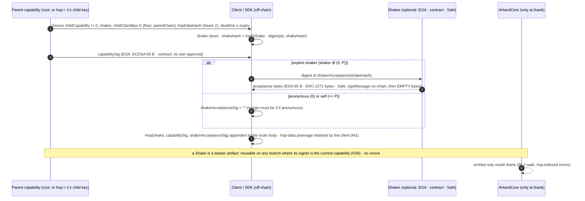

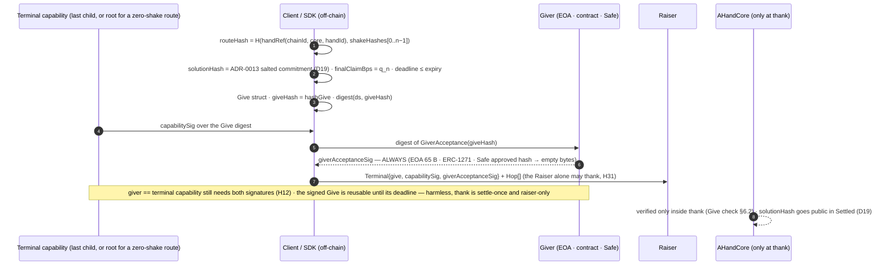

---

## 7. Thank: one atomic settlement

### 7.1 Signature and phases (H7, H9, D3)

```solidity
function thank(uint256 handId, Hop[] calldata hops, Terminal calldata t) external nonReentrant {
    Hand storage h = _hands[handId];
    // Phase A — checks and verification: SLOADs, pure hashing, ECDSA, gas-capped staticcalls; zero mutation
    if (h.status != Status.Active) revert NotActive();
    if (block.timestamp >= h.expiry) revert HandExpired();            // strict: expiry belongs to reclaim (H6)
    if (msg.sender != h.raiser) revert NotRaiser();                    // H31
    uint256 pool = h.pool;
    uint256 charity = AHandMath.cut(pool, h.charityBps);
    uint256 distributable = pool - charity;
    (uint40 expiry, address rootCapability) = (h.expiry, h.rootCapability);   // the Hand scalars the verifiers need, read once
    RouteFacts memory r = _verifyRoute(handId, hops, distributable, rootCapability, h.minGiverClaimBps, expiry);
                                                                       // one pass; hop-indexed reverts; marginTotal accumulated; r.ds = the domain separator
    _verifyGive(handId, t, r, expiry);                                 // sets r.giveHash under the same r.ds
    // Phase B — pure: one subtraction
    uint256 residual = distributable - r.marginTotal;
    // Phase C — effects: every Hand write and every fact event before the first token move (H9)
    uint40 nowTs = SafeCast.toUint40(block.timestamp);
    h.status = Status.Settled;
    h.closedAt = nowTs;                                                // same slot as status: one store (the optimizer merges the two field writes; measured)
    bytes32 sh = AHandSettlement.commitment(address(this), SettlementPreimage({
        handId: handId, raiser: h.raiser, giver: t.give.giver, token: h.token, charityRecipient: h.charityRecipient,
        pool: pool, charityAllocation: charity, giverAllocation: residual,
        routeHash: r.routeHash, giveHash: r.giveHash, solutionHash: t.give.solutionHash, closedAt: nowTs,
        occShakers: r.occShakers, occClaimDeltas: r.occClaimDeltas, occAllocations: r.hopAllocations }));
    h.settlementHash = sh;                                             // the one cold SSTORE of a thank
    address token = h.token;
    emit Settled(handId, t.give.giver, token, pool, h.charityRecipient, charity, distributable, residual,
                 r.routeHash, r.giveHash, t.give.solutionHash, sh, hops.length, nowTs);
    address parentCap = rootCapability;
    for (uint256 i; i < hops.length; ++i) {                            // pass 2: hop facts, frozen order
        Shake calldata s = hops[i].shake;
        emit RouteHopSettled(handId, r.routeHash, i, parentCap, s.childCapability, s.parentClaimBps, s.childClaimBps,
                             s.shaker, r.shakeHashes[i], s.hopDataHash, r.hopAllocations[i]);
        parentCap = s.childCapability;
    }
    if (charity != 0)  emit PayoutAllocated(handId, token, h.charityRecipient, AllocationKind.Charity, 0, charity);
    for (uint256 i; i < hops.length; ++i) {                            // pass 3: the grant ledger
        uint256 a = r.hopAllocations[i];
        if (a != 0) emit PayoutAllocated(handId, token, hops[i].shake.shaker, AllocationKind.ShakerMargin, i, a);
    }
    if (residual != 0) emit PayoutAllocated(handId, token, t.give.giver, AllocationKind.GiverResidual, 0, residual);
    // Phase D — interactions: pushes, each guarded and isolated in its own frame (§5.3)
    _pay(handId, token, h.charityRecipient, AllocationKind.Charity, 0, charity);
    for (uint256 i; i < hops.length; ++i) {                            // pass 4
        uint256 a = r.hopAllocations[i];
        if (a != 0) _pay(handId, token, hops[i].shake.shaker, AllocationKind.ShakerMargin, i, a);
    }
    _pay(handId, token, t.give.giver, AllocationKind.GiverResidual, 0, residual);
}
```

`RouteFacts` (memory only): `ds` (the domain separator the walk verified under, reused by the Give check), `routeHash, giveHash, terminalCapability, finalClaimBps, marginTotal, shakeHashes[], hopAllocations[], occShakers[], occClaimDeltas[]`. The verifiers take the Hand scalars they need (`rootCapability`, `minGiverClaimBps`, `expiry`) as arguments: no storage pointer inside a verifier, each Hand word read once. Four passes over `hops` (verify, hop events, allocation events, pushes) instead of the baseline's five: `marginTotal` accumulates in the walk; the two event passes stay separate only because the frozen event order (`Settled → RouteHopSettled×n → PayoutAllocated×k → pairs`) is part of the ABI promise (§11) and merging them would change it for ≈ 150 gas per hop.

| Phase | Nature | Work |
|---|---|---|
| A — verify | `view`; the only external calls are ERC-1271 `staticcall`s | window checks; `C`, `D` from `AHandMath`; route walk filling `RouteFacts`; Give check |
| B — math | `pure` | `G = D − Σ A_i` |
| C — effects | storage + events, **before the first token transfer** | `status`, `closedAt` (slot 0: one 2.9k store), `settlementHash` (one cold SSTORE); `Settled`; `RouteHopSettled × n`; `PayoutAllocated` per non-zero allocation |
| D — interactions | guarded, isolated frames | `_pay` charity, each paid hop in route order, giver. The honest CEI statement (S24): *Hand state is final before any transfer; the claims ledger is the one piece of state written after an external call, it is written only on a failed frame, it is monotone within the transaction, consumed only by `withdraw` under the lock, and every push runs in a frame that can neither re-enter the four entry points nor observe a half-settled Hand* |

All-or-nothing: the first invalid hop reverts the whole call with its index; no partial acceptance of a prefix (N5), no staged pre-verification (D3 rejected IDEA-R215), no hop constant (D3). `reclaim` is O(1) regardless of how long the failed branches were (U10).

### 7.2 Sequence diagram

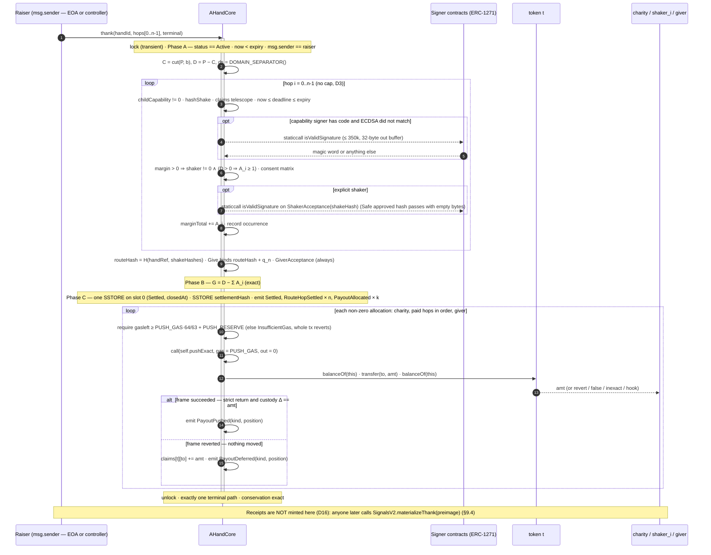

### 7.3 Gas model per hop, the estimator, and the chain cap (H7, D3, Q22, S7)

Thank gas is linear in the route; nothing per hop grows with `n` (memory growth of the four `n`-word arrays is ≈ 6k in total at `n = 300`):

```text
G(thank) ≈ G_fixed + Σ_i G_hop(i) + Σ_j G_push(j)

G_fixed   ≈ 21k tx + calldata(terminal ≈ 1.5k) + 5 cold SLOADs (≈ 10.5k) + slot-0 write (2.9k + 0.1k) + 1 cold SSTORE (22.1k)
          + Settled (2 topics, 12 words ≈ 5k) + Give verification (2 × ecrecover ≈ 7.4k) + hashing ≈ 2k             ≈ 70–75k
G_hop(i)  ≈ calldata (7 words + 65-byte sig + offsets ≈ 3.8k) + hashShake (≈ 0.3k) + ecrecover (≈ 3.7k) + checks
          + RouteHopSettled (2 topics, 9 words ≈ 4k)                                                                ≈ 12k (anonymous/self, unpaid, EOA)
          + [explicit: acceptance calldata ≈ 1.1k + second ecrecover ≈ 3.7k] + [paid: mulDiv + PayoutAllocated ≈ 3k]  ≈ 20k (explicit, paid, EOA) + G_push
          + [contract signer: each ecrecover replaced by the validator's own cost, ≤ 350k; Safe ≈ 25–45k; passkey ≈ 10–60k on Base]
G_push(j) delivered ≈ frame call (≈ 2.6k) + 2 × balanceOf (≈ 2.4–14k) + transfer (≈ 8–30k existing / 25–65k fresh or proxy) + event (≈ 2.6k)   ≈ 20–85k
G_push(j) deferred  ≈ frame consumption ≤ PUSH_GAS (typically 5–30k before the token reverts) + claims SSTORE (22.1k new / 2.9k existing) + event   ≈ 30–55k; hostile worst case ≈ 230k
```

**Estimator pitfall and the SDK rule.** `eth_estimateGas` binary-searches for the smallest gas at which the transaction does not revert. Without the starvation guard, a push that runs out of gas inside its frame is *not* a revert of `thank` (it defers), so the estimator could return an amount at which every push parks as a claim and recipients pay `withdraw` gas. With the guard (§5.3), too little gas at any push reverts the whole transaction, so the smallest non-reverting estimate necessarily satisfies `gasleft ≥ PUSH_GAS·64/63 + PUSH_RESERVE` at every push: the estimate is sound. The SDK still budgets explicitly, `G_fixed + Σ G_hop + k × PUSH_GAS × 64/63 + margin` with `k` the number of non-zero allocations, because bundlers (ERC-4337 call-gas limits) and ERC-20 paymasters (D17, Q20) do not run the same search, and quotes both execution gas and the L1 data fee, which dominates the *price* of a long route on Base. The soundness claim assumes recipients and ERC-1271 validators behave identically in simulation and on-chain: a hostile one keyed on `tx.origin`, block parity or `gasleft()` can pass the estimate and burn its full `PUSH_GAS`/`ERC1271_GAS` on-chain so that `thank` reverts `InsufficientGas` after consuming the budget — one wasted transaction per attempt, bounded by the SDK's explicit budget, never a loss of funds or a parked share.

Two limits bind a route, and for EOA routes **calldata, not gas, binds first**. Per-hop calldata (ABI): array element offset 32 + `Shake` 7 × 32 + two `bytes` offsets 64 + signature length word 32 + 65 B padded to 96 + empty acceptance length word 32 = **480 B** for an anonymous/self hop; an explicit hop adds a second padded signature = **576 B**. The txpool limit is op-geth's `txMaxSize = 4 × txSlotSize (32 KiB) = 128 KiB`; Base's sequencer may set its own value — verify at implementation (Q22). Under Base's per-transaction cap of 16 777 216 gas (S7) and that calldata limit the practical envelope is (expectations, to be **measured** per commit on the series 0/1/6/7/32/255/256/257 hops × {EOA, ERC-1271} × {pushed, deferred} × {fresh, existing, duplicate recipients}, D3/Q22 owed artifact):

| Route shape | ≈ gas per hop | calldata per hop | fits by gas (16.78M) | fits by calldata (128 KiB) | binding limit |
|---|---|---|---|---|---|
| anonymous / self EOA hops, unpaid | 12k | 480 B | > 1 000 | ≈ 273 | **calldata** |
| explicit EOA hops, each paid, hookless 6-dec token, fresh recipients | 20k + ≈ 60k | 576 B | ≈ 200 | ≈ 227 | gas, calldata close behind |
| explicit EOA hops, each paid, recipients already holding the token | 20k + ≈ 30k | 576 B | ≈ 330 | ≈ 227 | **calldata** |
| contract-signer hops at the 350k cap, paid | ≈ 720k worst case | 576 B + validator bytes | ≈ 22 (typical Safe ≈ 100k → ≈ 150) | ≈ 227 | gas |
| every recipient hostile (each frame burns PUSH_GAS) | ≈ 230k | 576 B | ≈ 70 | ≈ 227 | gas |

Consequence for the D3/Q22 series: 255/256/257 hops are a **forge-only width test** (direct block inclusion); a 257-hop all-explicit route (≈ 148 KB) never enters a public mempool, and the row "≈ 200 paid hops fit" in §17.2 is a gas figure that calldata trims to ≈ 227 explicit hops at most. The SDK preflight checks both bounds.

Behaviour at the cap: a route whose `thank` cannot fit is simply not settleable on that chain; the Hand stays Active, the Raiser may settle a shorter branch or wait for reclaim; Core holds no state about failed attempts; the SDK preflights before every hop extension and the UI says so (U10). No "infinite routes" claim is made (N24). Positions are `uint256` in events and loops (S6; the `uint8(i)` truncation at hop 256 is gone).

---

## 8. Reclaim, expiry, withdraw

### 8.1 Expiry (H6)

`expiry` is a single, final timestamp fixed at raise: Thank iff `now < expiry`; Reclaim iff `now ≥ expiry`; every artifact deadline satisfies `now ≤ deadline ≤ expiry`. No dispute hold, no extension, no Thank after expiry, no retroactive authority (N18). A controller that wants delivery/challenge/decision windows nests them *inside* expiry (`deliveryDeadline < challengeDeadline < decisionDeadline < expiry`, D23) and raises with an expiry long enough — which is why the product window (1 d … 180 d) leaves Core (Q8, §16 #5): a one-year community budget and a two-hour local errand are both legitimate Hands, and a too-short Hand harms only its own Raiser.

### 8.2 Reclaim

```solidity
function reclaim(uint256 handId) external nonReentrant {
    Hand storage h = _hands[handId];
    if (h.status != Status.Active) revert NotActive();
    if (block.timestamp < h.expiry) revert HandNotExpired();
    h.status = Status.Reclaimed;
    h.closedAt = SafeCast.toUint40(block.timestamp);                   // slot 0: one store with status
    address token = h.token;                                            // each field read on its own line
    address raiser = h.raiser;
    uint256 pool = h.pool;
    emit Reclaimed(handId, raiser, token, pool);
    if (pool != 0) emit PayoutAllocated(handId, token, raiser, AllocationKind.RaiserRefund, 0, pool);
    _pay(handId, token, raiser, AllocationKind.RaiserRefund, 0, pool);  // no-op at pool == 0; guarded frame otherwise
}
```

Permissionless (a watcher, the app, anyone), refund destination fixed to `h.raiser` (a controller Raiser receives it and distributes under its own pre-agreed rules — that distribution is not Core settlement and must never be displayed as one, D23). Full pool, zero charity (success-only donation, H3), no `settlementHash`, no receipts beyond RAISED (H21, D6). Zero-pot Hands flip status and `closedAt` only (D8). A deferred refund (raiser blacklisted by the token) becomes `claims[token][raiser]`. The starvation guard applies here too: a stranger cannot park the Raiser's refund by calling `reclaim` with too little gas.

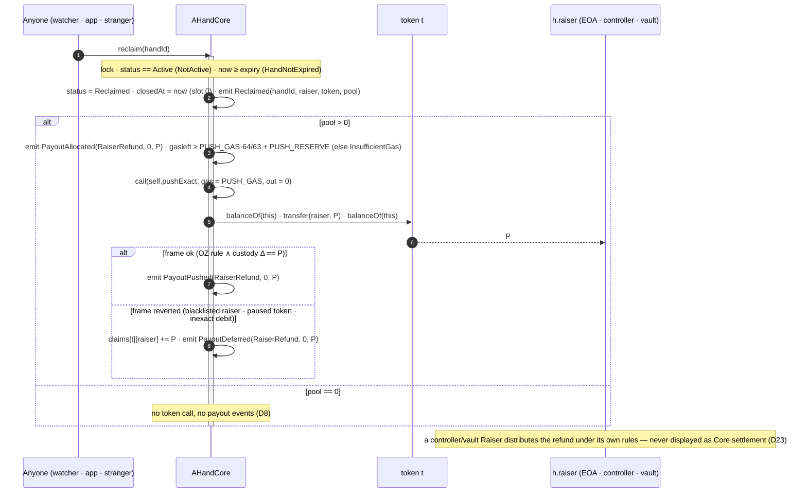

### 8.3 Withdraw

```solidity
function withdraw(address token, address beneficiary) external nonReentrant {
    uint256 amount = claims[token][beneficiary];
    if (amount == 0) revert ZeroClaim();                               // covers beneficiary == 0 and unknown tokens
    claims[token][beneficiary] = 0;
    _transferExact(token, beneficiary, amount);                        // bubbles: a failed drain restores the claim by revert
    emit PayoutWithdrawn(token, beneficiary, amount);
}
```

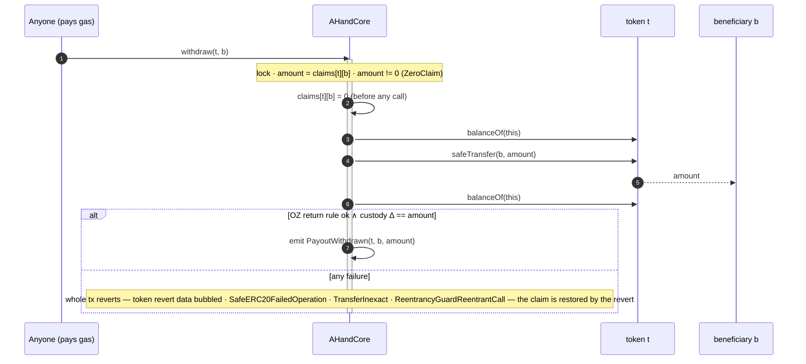

Drains the aggregate `claims[token][beneficiary]`; zeroed before `_transferExact`; reverts (restoring the claim) on any failure — OZ-detected return-shape failures as `SafeERC20FailedOperation`, a reverting token with its own revert data, an inexact custody delta as `TransferInexact` (the `withdraw` mocks in Appendix D assert exactly these selectors); no partial mode; no redirect (Q29); never gated by policy (H10). Aggregation across Hands is deliberate (one claim per (token, beneficiary)); per-Hand attribution lives in the `PayoutDeferred(handId, kind, position)` events (Q39). A re-entering token hook hits the lock and reverts the whole withdraw (claim intact). Known limitation unchanged: a token that blocks the beneficiary leaves the claim stranded forever (S5); copy must never present a deferred claim as spendable money.

---

## 9. Extension mechanism (Q1 — the central question)

### 9.1 The chosen mechanism: three seams, zero hooks

D21 asks for "seamless extension by any possible scenario" over a frozen Core; H1/H2/H15/N10 forbid every mechanism that would let Core *call* an extension (hooks, registries, delegatecall, pluggable resolvers that settlement waits on — M5/M16 rejected; M4 Payable, M18 chunking, M3 native role split, M12 generic spend API, M14 ThankPermit not adopted). The resolution is to make extension a property of **where a scenario attaches**, not of a plugin interface:

| Seam | When | What Core offers | What an extension does | Candidate ids |
|---|---|---|---|---|
| **1 — Participation** | before / at settlement | every role is an address: Raiser (`msg.sender`), capability, shaker, giver (ECDSA or ERC-1271); Core treats a contract exactly like a person (D45, H14, H16) | holds a role and enforces its own policy *inside itself*: a controller decides when to call `thank`; a policy capability decides which Shakes it signs; a splitter decides how to spend a residual it received; a Safe consents by approved hash | M2 (accepted D23), M15 |
| **2 — Opaque typed data** | inside a Hand / hop / Give | `metadataCommitment` (per Hand, mandatory), `discoveryCommitment` + `discoveryRef` + tags (per Hand, event-only), `hopDataHash` (per hop, signed by the capability), `solutionHash` (per Give) — Core never interprets any of them (H19, M1, M10) | commits a versioned envelope `H(schemaTag ‖ payload)`; the preimage is published by the client and verified by readers; ADR-0013's salt rode here without a Core change (D19) | M1, M10 |
| **3 — Authenticated facts** | after settlement | `IAHandFacts.facts()` (stable interface), `settlementHash` (versioned generic commitment with allocations), `closedAt`, wide ordered events; permissionless, idempotent materialization pattern (H21) | reads facts and interprets them: receipts, Up, valuation, voting weight, risk flags, prints, tip distribution | M6, M7, M8, M11, M20 |
| **Beside** | independent budgets | `handRef`, `routeHash`, `giveHash`, `occShakers` as stable keys | tips, guarantors, bounties, crowdfunding refunds from **new** money; the pot is never partially spent nor topped up (N19) | M19, Q25 |
| **Versioning rule** | across Cores | a new Core = new address + EIP-712 version + `SETTLEMENT_TAG`; readers bind `sourceCore` immutably; old Hands settle only on their Core | several Cores and several interpreters coexist; nothing migrates (D32, M9, M17) | M9, M17 |

What stays a protocol change (new Core): the winning-route predicate, refund rights, the consent matrix, custody semantics, the split formulas (ST/IMMUTABLE-CORE-DESIGN:17, REQ §3 "non-retrofittable"). That is the honest boundary of "any scenario": every scenario that **does not redefine who may be paid without their consent** attaches through a seam.

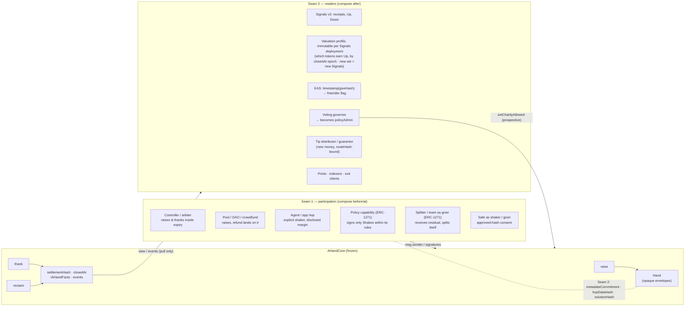

### 9.2 Seam 2 in detail: the envelope convention (SDK-level, Core-opaque)

```text
metadataCommitment = keccak256(abi.encode(schemaTag, keccak256(canonicalPayload)))
hopDataHash        = keccak256(abi.encode(schemaTag, keccak256(canonicalPayload)))   (or 0 = none)
solutionHash       = ADR-0013 salted commitment (D19), unchanged
```

`schemaTag` is a `bytes32` like `keccak256("ahand.meta.v1")`, `keccak256("ahand.hop.app.v1")`, `keccak256("ahand.meta.controller.v1")`. Readers that know a tag verify the payload; readers that do not ignore it. Core enforces only non-zero `metadataCommitment` (H24). This is the whole "versioned opaque data" story: no `bytes32` is added to any struct mechanically (M7 cons; Q38), the envelope versions itself.

### 9.3 Scenario catalogue — how each future case attaches with the Core untouched

| # | Scenario (ids) | Attaches via | Concretely | What it can never do |
|---|---|---|---|---|
| 1 | **Opt-in controller / arbiter** (D23, U12, Q9) | Seam 1 (Raiser) + Seam 2 (policy envelope) | `PolicyRaiser` contract: humans fund it under a fixed policy (decision maker, evidence, `deliveryDeadline < challengeDeadline < decisionDeadline < expiry`); it calls `raise` (it *is* `h.raiser`), later `thank` with the unmodified signed route + Give; after expiry anyone reclaims and the refund lands on the controller, which distributes under its policy. `metadataCommitment` carries `ahand.meta.controller.v1 { policyHash, principal }`. Probe 4/4 on the unchanged baseline (ST/probes/controller) | adopt an EOA Hand; thank after expiry; skip GiverAcceptance; extend expiry; pay anyone not on the consented route |
| 2 | **Pools / DAO / crowdfunding raiser** (U7, Q25, D47) | Seam 1 (Raiser) | `FundingVault`: contributors deposit until a funding deadline, the vault raises one Hand with one token and one pot (H20) inside the window `[fundingDeadline, executionDeadline)` (U7's funding-then-execution deadline: refunds open when no raise happened by the execution deadline or when Core reclaimed), contributor refund rights live in the vault; each cycle is a new Hand (N19 no top-up). Reclaim refunds the vault, which refunds contributors pro-rata | top up a live Hand; partial awards; a second Give |
| 3 | **Agents and apps as hops** (D45, D30, U5, U6) | Seam 1 (explicit shaker, ERC-1271 or EOA) + Seam 2 (`hopDataHash`) | an agent wallet or the board inserts a Shake with a disclosed margin and `hopDataHash = H("ahand.hop.app.v1", …)`; identical economics to a human (H16); an agent's reach is bounded by the floor and by the Raiser's Thank; the SDK's "insert a service hop" helper is one `Hop` struct | obtain a fee path, a fixed position, or a role flag (N3) |
| 4 | **Signals v2 / v3** (D5–D16, U19, Q14, Q28) | Seam 3 (`IAHandFacts`, `settlementHash`) | `materializeThank(SettlementPreimage)` recomputes `AHandSettlement.commitment` and compares with `facts(p.handId).settlementHash`; mints THANKED/GIVEN, one SHAKEN per non-zero occurrence (D13, O(n)), earned Up only if `raiser != giver` (D12) ∧ `charityAllocation > pool / 100` (D5 reading, to be confirmed) ∧ token qualified by `(token, closedAt)` against the deployment's constructor-fixed profile (Q4, row 6) ∧ recipient ∉ participants (S35); Down burns own earned Up incl. 0 (D14). A v3 binds the same Core with new tags; Core never knows (M11) | block or alter settlement; read anything Core did not commit |
| 5 | **EAS timestamps of a Give** (D20, U21, Q19) | Seam 3 (`giveHash`, `Settled`/`Reclaimed` events) + Seam 2 | the Giver (or app) calls `EAS.timestamp(keccak256(abi.encode("ahand.give.v1", chainId, core, handId, giveHash)))`; a later reader joins timestamped giveHashes with `Reclaimed` Hands and `closedAt` to raise a freerider *flag* (evidence, not adjudication, S19) | influence Thank or Reclaim |
| 6 | **Qualifiers / curation** (Q4, Q17, D27, M13) | Seam 3 (valuation profile compiled into Signals vN) + Seam 1 (app-level gates) | Core stores `closedAt` and commits `token`, `C`, `P`, and values nothing. Which tokens earn Up, and at what unit, is a **constructor-fixed profile set of each Signals deployment** (`token → profile`, immutable, applied by `closedAt` epoch); a new profile set is a new Signals (M11 epochs, D32 "only extending", admin-free exactly like the baseline S:52 "no owner can repoint"). No curator key, no registry contract (D26 July words «no separate registries for charities/tokens», N9, H15 "never touch Signals"); a mutable curator is decided NO (§16 #30, §18 #4). Personhood is an app gate on *its* Hands (D27); charity curation stays Core's prospective allowlist (D18) | gate Raise or settlement on any token or identity (N9); re-value a settled Hand |
| 7 | **New payout shapes** (U11, Q25, M19) | Seam 1 (giver = splitter contract; guarantor) + Beside (tip distributor) | *residual split*: a `Splitter` contract is the giver (ERC-1271 GiverAcceptance) and splits `G` among a team by its own rules; *tips to a losing path*: `TipDistributor` escrows **new** money bound to a `routeHash`/`shakeHash` and pays on `Settled`/`Reclaimed` facts (no Up, N25); *guarantor*: pays a bond from its own reserve on a qualified refusal; *several winners*: several Hands | touch the fixed pot; create a second Give; add a fee |
| 8 | **New consent shapes** (M23, Q3, U28, U15) | Seam 1 (policy capability; Safe) | a `PolicyCapability` contract is the `childCapability`: its `isValidSignature` accepts a Shake only if `parent − child ≤ maxMarginBps`, `childCapability ∈ allowed`, `deadline ≤ window` — a delegated agent's over-reach is bounded without a Core field (M23 for free); since Core hands a verifier only the digest, the probe's signature bytes are `abi.encode(uint8 kind, bytes artifact, bytes ownerSig)` (kind 0 Shake / 1 Give): the capability recomputes the digest under the Core's domain, applies its policy to the decoded artifact, then checks the owner's ECDSA — the general shape of any policy-bounded ERC-1271 capability, needing nothing from Core; a `bearer-link` payout account for a walletless paid pass (U28) is likewise a contract shaker with its own acceptance rule; a Safe consents by `signMessage` + empty bytes (§6.4) | weaken a consent Core requires (every signature Core demands is still demanded) |
| 9 | **Voting / governance** (D22, Q16, M15) | Seam 3 (Up facts) + the policyAdmin seam (§10) | a governor contract reads Signals balances/checkpoints, is nominated via `transferPolicyAdmin` and accepts; it can then call exactly `setCharityAllowed` | pause, upgrade, rescue, select winners, touch any Hand (H15) |
| 10 | **Relayed Thank / liveness watchers** (U22, Q10) | Seam 1 (controller or AA account as Raiser) | an ERC-4337 account or a controller is the Raiser and exposes its own relayed/permit path; watchers call permissionless `reclaim`/`withdraw` | thank for an EOA Raiser (H31) |

Six of these (1, 2, 3, 5, 8, 10) compose against today's baseline already; v2 adds what makes 4, 5, 6, 9 *verifiable on-chain* rather than indexer-trusting (`settlementHash` generic with allocations + `closedAt` + `IAHandFacts`), and removes the two things that would have forced a redeploy for 3 and 7 (`MAX_SHAKES`, single token).

### 9.4 Signals v2 — reference implementation shipped in this change (§18 #10; periphery; the facts it needs are all in §3.5)

**Reference implementation shipped in this change (§18 #10).** `AHandSignalsV2.sol` is built in this change as the reference reader of Seam 3 — not a sketch — with a **constructor-fixed, USDC-only qualification profile**: deploy args Base USDC `0x833589fCD6eDb6E08f4c7C32D4f71b54bdA02913` (mainnet) and Base Sepolia USDC `0x036CbD53842c5426634e7929541eC2318f3dCF7e` (testnet), one per deployment; a different profile set is a new Signals (§9.3 #6, §18 #4). The D5 gate is `C > P / 100` in integer arithmetic — i.e. `C > floor(P / 100)`, equivalently `100·C > P`, overflow-free for any `uint256` pool (§18 #6). Core references none of it (H21).

```solidity
interface IAHandSignalsV2 {               // one immutable, ADMIN-FREE ledger per epoch (Q28, M11); binds sourceCore (H21); no owner, no curator
    // ids frozen as built: RAISED 1 · SHAKEN 2 · GIVEN 3 · THANKED 4 · UP 5 (9 decimals, ONE_UP = 1e9) · DOWN 6 (D14: id kept, minted only by down())
    function sourceCore() external view returns (address);
    function materializeRaised(uint256 handId) external;                               // RAISED for any status != None (D6)
    function materializeThank(AHandSettlement.SettlementPreimage calldata p) external;  // p.handId is the ONLY id (no duplicate parameter to disagree with)
        // f = facts(p.handId): f.status == Settled (NotSettled); commitment(sourceCore, p) == f.settlementHash (SourceCommitmentMismatch)
        // processed flag BEFORE mints (AlreadyMaterialized); THANKED → raiser, GIVEN → giver — both also when raiser == giver (Q32),
        // SHAKEN per non-zero occShakers[i] (D13, O(n), S21; no dedup)
        // earned Up iff raiser != giver (D12) ∧ p.charityAllocation > p.pool / 100 (D5 gate: C > floor(P/100) ⇔ 100·C > P, overflow-free; decided §18 #6)
        //            ∧ qualified(p.token, p.closedAt) — constructor-fixed profile of THIS deployment: USDC-only in this change, Base / Base Sepolia addresses above (Q4, §9.3 #6, §16 #30/#31, §18 #10)
        //            ∧ p.charityRecipient ∉ {raiser, giver} ∪ occShakers (S35 qualifier: a donation that never left the circle earns nothing;
        //              a Raiser-controlled shaker that is also the allowlisted charity is otherwise the S20 rebating-charity case);
        //            credit = valuation(token, charityAllocation) / 2 each (D9 allocated, D10 donation only); floor-sqrt curve, ONE_UP = 1e9 (D11)
    event ThankSignalsMaterialized(bytes32 indexed sourceKey, uint256 indexed handId, address raiser, address giver,
                                   uint256 charityAllocation, uint256 occurrences, uint256 earnedUpMinted);
        // D13: baseline `uniqueShakers` (S:107,115) removed, `occurrences` = occShakers.length; D7: no USD field, uint256 amounts
    function up(address target, uint256 wholeUp, UpContext calldata ctx) external;    // as built (H22)
    function down(address target, uint256 amount, UpContext calldata ctx) external;   // voluntary burn of own earned UP incl. 0 (D14): burns earned UP, mints DOWN (id 6) to target; details Q6 (§16 #33)
    function uri(uint256 id) external view returns (string memory);                   // D39 ⇄ D15 reconciliation: renders ROLE and LEVEL ring per id, never the raw Up number
    // ERC-1155 read ABI + supportsInterface(0xd9b67a26) == true + always-reverting transfer/approval stubs; no mint callbacks (D15, N11)
    // wallet-display caveat (H28): balanceOf(a, 5) exposes the raw UP count to any ERC-1155 wallet by the standard itself; D39 («роли и уровни,
    //   без числа») governs aHandprint/uri() and every app surface, and the docs say so instead of promising a number nobody can hide
}
```

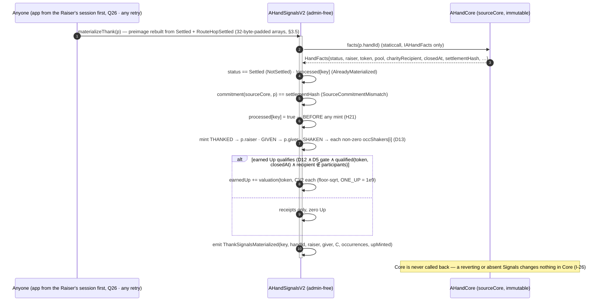

Nothing in Core references this interface (H21). The only Core facts Signals v2 reads are `facts(handId)` and the hash; occurrence arrays (shakers, margins, allocations) are re-supplied from `RouteHopSettled` events and verified by the hash; no floor math is re-implemented (Q33).

As built (periphery-local, each reversible by redeploying Signals; none changes a Core fact or the ABI shape above):

- `constructor(address sourceCore, address qualifiedToken)`: the deploy args of §18 #10; the constructor reads the token's `decimals()` once and fixes `unitScale = 10^(18 − decimals)` (more than 18 decimals reverts `UnsupportedDecimals`) instead of hard-coding USDC's 1e12 — one staticcall at deployment, no further external calls. A profile token without `decimals()` cannot be bound (nominal valuation needs the unit).
- `qualified(token, closedAt)`: the USDC-only profile has no epoch bound (materialization is permissionless and retryable, so a Hand settled before this Signals was deployed must still earn); the body is `token == qualifiedToken`, the `closedAt` parameter stays as the Seam-3 shape a later profile set may bind.
- `materializeThank` check order: `!processed` (one SLOAD) → `facts()` → `status == Settled` (`NotSettled`) → commitment (`SourceCommitmentMismatch`) → flag → mints. End states are those of the diagram; a replay, the common failure, costs no external call. The flag is set before the first mint.
- ERC-1155 stubs: `safeTransferFrom`, `safeBatchTransferFrom`, `setApprovalForAll` revert `Soulbound`; the approval *query* `isApprovedForAll` answers the truthful `false` so a wallet's read path never breaks.
- `down(target, amount, ctx)`: `amount` in Up base units (zero allowed); the §16 #33 interim eligibility is binding for this deployment as `isThankParticipant(msg.sender)` (holds THANKED, GIVEN or SHAKEN; else `NotParticipant`) — a nominal gate (a receipt costs the gas of a zero-pot Hand its raiser thanks to itself) that marks participation, not trust; one DOWN unit (id 6) is minted per Down and the burned amount travels in `Downed` for app weighting; the same `UpContext` and zero/self/empty-context rules as `up`.
- `uri(id)` names the role for ids 1–4 and the level-ring legend for UP/DOWN (it has no account argument); the per-account ring is `levelOf(account)` (0..4 at the named constants `LEVEL_1_UP..LEVEL_4_UP` = 1, 5, 25, 100 whole Up held, earned and received — D39's rings as option text, interim). Received Up counts and the floor-sqrt curve is sub-additive per account only, so a level is a provenance display, never a sybil-resistant score (S18). `uri` never renders the raw Up number; `balanceOf(a, 5)` exposes it by the standard (the documented caveat).
- Source-key tags are `aHand.signals.source.raised.v2` / `aHand.signals.source.thank.v2`: a new ledger epoch keys its facts under its own tag, so v1 and v2 keys never collide in an indexer.
- `UpContext` and the Signals-only errors (`NotSettled`, `AlreadyMaterialized`, `SourceCommitmentMismatch`, `SelfTarget`, `ZeroContext`, `NotParticipant`, `Soulbound`, `UnsupportedDecimals`, …) are declared in `AHandSignalsV2.sol`; `ZeroAddress` is imported from Types.

### 9.5 Proof: an extension can never move money it was not granted

Let `E` be any contract in any role. Define the grant of Hand `h` to address `a`:

```text
Granted(h, a) =  [a == h.charityRecipient] · C(h)                        (chosen and funded by the Raiser at raise; allowlisted; never Core)
              +  Σ_{i : shaker_i == a ∧ consent_i} A_i(h)                 (consent_i: self-signature, or ShakerAcceptance validated by a)
              +  [a == giver(h) ∧ GiverAcceptance validated by a] · G(h)
              +  [a == h.raiser ∧ reclaimed(h)] · P(h)
```

Claim: for every address `a` and token `t`, the total of tokens Core ever transfers to `a` on account of `h` is ≤ `Granted(h, a)`, and Core transfers nothing to anyone on no account.

1. **Enumeration.** Token outflows exist only inside `_transferExact`, reachable from `pushExact` (self-only, called only by `_pay` from `thank` and `reclaim`) and from `withdraw` (H8' as restated in §18 #2 — the frame moves tokens only on the entry points' instruction; selector-inventory test). Every `_pay` is tagged with a `(handId, kind, position)` and its amount is one of `C, A_i, G, P` of that Hand (§5.2, §4.1). `withdraw` pays `claims[t][a]`, which only ever grows by amounts that `_pay` failed to push to the same `a` — so `withdraw` never exceeds the sum of `a`'s deferred grants (I-8).
2. **Recipient binding.** `C` goes to `charityRecipient`, set by the funder at raise (an extension cannot be the recipient unless the funder chose it and the policyAdmin allowlisted it — and it cannot be Core, I-20). `A_i` goes to `shaker_i`, which is either the signer of that Shake (self) or an address whose verifier accepted `ShakerAcceptance(shakeHash)`; `shakeHash` is in turn chained from `rootCapability`, which the funder set. `G` goes to `give.giver`, whose verifier accepted `GiverAcceptance(giveHash)`, and `giveHash` binds the exact `routeHash`. `P` on reclaim goes to `h.raiser`. There is no other recipient variable in the contract: no admin recipient, no fee address, no redirect, no caller-supplied destination (H10, H15, H16).
3. **Amount binding.** `C, A_i, G, P` are pure functions of `h.pool` and the signed bps (§5.2) with `Σ = P`. An extension that is a capability can only *lower* the claims downstream of itself (`child ≤ parent`), i.e. it can grant itself at most what its parent left and never what the Giver's floor protects (`child ≥ f`). A controller that is the Raiser decides *whether* to thank, never *how much* goes where (the route is signed by others; GiverAcceptance is still required: probe check 3).
4. **No invocation.** Core never calls an extension except via `staticcall isValidSignature` (cannot write; bounded gas and returndata) and never reads an extension's state to compute an amount (H2). Hence an extension cannot cause a transfer by returning something; it can only *refuse* (return non-magic), which blocks only the branch that depends on it. A token with hooks executes only inside a frame bounded by `PUSH_GAS` and cannot enter any entry point (lock).
5. **Isolation across Hands and tokens.** Each `_pay` amount is bounded by its own Hand's pool, each push is exact or nothing, and the per-token identity (§5.4) holds for conforming tokens; so money of Hand `h'` is never moved on account of `h` (escrow isolation), and no amount of calls from `E` can make Core transfer a token `E` never funded.
6. **Immutability of the premises.** No function changes `rootCapability`, `charityRecipient`, `pool`, `raiser`, `expiry` or the formulas after raise (no setter exists; H1, H15), so the grant set of a Hand is fixed at raise and the consents are collected per settlement.

Therefore `outflow(h, a) ≤ Granted(h, a)` and `Σ_a outflow(h, a) ≤ P(h)`. The test that pins it: a stateful invariant over a fuzzed population of controller Raisers, policy capabilities, contract shakers (incl. a Safe-like approved-hash signer) and contract givers, asserting after every call that for each address the ghost sum of grants ≥ tokens received + claims, and that the Core balance never drops below `L_t` for conforming tokens (extends TEST/AHand.invariant.t.sol T-INV-01..03 with contract actors; I-19), plus a bytecode scan that the only `CALL` targets are the Hand's token and `address(this)` — the rollback frame, kept under §18 #2; H2' names exactly these — and the only `STATICCALL` targets are the token (`balanceOf`) and signers.

### 9.6 Conformance check instead of "any scenario" (M21, Q30)

Before freeze, the candidate Core is exercised unchanged by: consumers A (Signals v2 over zero-reward, repeated, anonymous Hands), B (allocation credit via `IAHandFacts` + preimage only, no indexer, no floor math), C (an experimental voting reader over Up facts), D (late-delivery flag over EAS + `Reclaimed` + `closedAt`), and the probes: pooling controller (existing 4/4), policy capability, Safe approved-hash shaker, relayed execution via an AA Raiser, tip route. Each run records what had to be trusted, which preimages were lost, and where a new contract was needed — that record is the honest answer to D21, not a promise. Nothing in this list may require a Core change; if one does, the design is wrong, not the probe.


---

## 10. policyAdmin: exact powers and bounds (H15, D18, ADR-0012)

```solidity
constructor(address[] memory charities, address policyAdmin_);
    // policyAdmin_ != 0 (ZeroAddress) — exactly as the baseline (C:281). An ownerless Core is the alternative ADR-0012:55
    //   explicitly REJECTED ("cannot stop new Raises to a compromised charity"), and no owner decision asks for it
    //   (D18 «Мой ключ, как сейчас»); a frozen-list deployment on another chain is decided NO (§16 #29, §18 #3), not a mode.
    //   Emits PolicyAdminTransferred(0, policyAdmin_).
    // each charity: != 0, != address(this) (S35), not a duplicate (NoChange) → charityAllowed = true, CharityPolicyUpdated(c, true, 1)
    // policyRevision = 1 after construction
function setCharityAllowed(address charity, bool allowed) external onlyPolicyAdmin;
    // charity != 0 && charity != address(this) (ZeroAddress / CharityNotAllowed); charityAllowed[charity] != allowed (NoChange);
    // ++policyRevision; CharityPolicyUpdated(charity, allowed, revision)
    // not under the transient lock (moves no money); raise snapshots policyRevision BEFORE its deposit call (§4.1), so a token
    //   hook that reaches this setter mid-raise cannot make Raised.policyRevision name a revision whose list excludes the recipient
function transferPolicyAdmin(address newAdmin) external onlyPolicyAdmin;
    // newAdmin != pendingPolicyAdmin (NoChange: a repeated nomination and a repeated cancel both revert); pendingPolicyAdmin = newAdmin;
    // emits PolicyAdminTransferStarted(policyAdmin, newAdmin) — with newAdmin == 0 this IS the cancel event; no revision bump
function acceptPolicyAdmin() external;                                     // msg.sender == pendingPolicyAdmin (NotPendingAdmin); zero can never be accepted
```

That is the complete mutable surface besides the four money entry points. `setTokenEnabled` is removed (Q17): under D7 there is no token to switch. A prospective `raiseOpen` admission switch (security-invariants' reading of ADR-0012's availability clause) is **not** included: H15 permits it but no owner decision asks for it, it adds a key that can halt all new Raises, and under D4 the admin can already not stop 0 %-donation Raises — it is decided NO in §16 #13 / §18 #5 (no pause in any form).

| May | May not (each line has a negative test, T-POL) |
|---|---|
| add/remove a charity for **future** Hands with `charityBps > 0`; each real change bumps `policyRevision`, snapshotted into `Raised` | affect any Active or terminal Hand (recipient is snapshotted), any claim, any deadline, any formula or bound |
| hand the role over in two steps (no timelock, as decided: D18 «Мой ключ, как сейчас»; multisig rejected N14) | pause `thank`, `reclaim`, `withdraw`, or any raise with `charityBps == 0`; stop Raises as a whole |
| be a contract (a future governor, D22, M15) | upgrade, rescue, redirect, select winners, forge consent, add fees, add/remove assets, touch Signals, allowlist `address(0)` or Core |

Compromise impact (S20): future donation Hands may be steered to a colluding charity; a rebating charity defeats the external-cost assumption behind Up for Hands raised under it — a Signals/valuation concern, never a Core one. Copy names the curator (H28).

---

## 11. Events and indexing contract

All amounts `uint256`, all positions `uint256` (S6). Enum params appear as `uint8` in the ABI. Frozen order per transaction is part of the ABI promise (U18).

| Event | Fields | When | Rebuilds |
|---|---|---|---|
| `Raised` | `handId idx, raiser idx, token idx, pool, expiry u40, rootCapability, visibility, metadataCommitment, discoveryCommitment, discoveryRef bytes, minGiverClaimBps u16, charityRecipient, charityBps u16, policyRevision u64` | once per raise | the full immutable snapshot without any read; policy in force (H15); identity fields let a client recognise its own Raise after a reorg (S13) |
| `HandTagged` | `handId idx, raiser idx, bytes32[] tagIds` | iff tags non-empty (never for Dark) | discovery (ADR-0005) |
| `Settled` | `handId idx, giver idx, token, pool, charityRecipient, charityAllocation, distributable, giverAllocation, routeHash, giveHash, solutionHash, settlementHash, hopCount, closedAt u40` | once per thank, first | the pool split and every identity a reader needs; `settlementHash` here equals storage; `solutionHash` goes public here (D19) |
| `RouteHopSettled` | `handId idx, routeHash idx, position, parentCapability, childCapability, parentClaimBps u16, childClaimBps u16, shaker, shakeHash, hopDataHash, marginAllocation` | one per hop incl. anonymous/zero-margin, route order, positions `0..hopCount−1` | self-contained per hop (no chaining needed if a log is missed): `occShakers[i] = shaker`, `occClaimDeltas[i] = parentClaimBps − childClaimBps`, `occAllocations[i] = marginAllocation`, `shakeHashes[i]` → the `SettlementPreimage` and the `routeHash` preimage |
| `Reclaimed` | `handId idx, raiser idx, token, refund` | once per reclaim | — (`closedAt` = the block's timestamp) |
| `PayoutAllocated` | `handId idx, token idx, beneficiary idx, kind u8, position, amount` | per non-zero allocation, after the hop events; order Charity, ShakerMargin (route order), GiverResidual; RaiserRefund alone | the grant ledger (§9.5); `position` is the hop index for ShakerMargin and 0 otherwise |
| `PayoutPushed` / `PayoutDeferred` | `handId idx, token idx, beneficiary idx, kind u8, position, amount` | exactly one per `PayoutAllocated`, same order; all `PayoutAllocated` precede the first of these (H10) | delivered vs parked per allocation — `kind`/`position` added so partial pushes reconcile order-independently (Q39, S27) |
| `PayoutWithdrawn` | `token idx, beneficiary idx, amount` | per successful withdraw | claim drained (aggregate, no Hand link by construction) |
| `CharityPolicyUpdated` | `charity idx, allowed, policyRevision u64` | constructor seeds, each real setter change | the allowlist history; revision strictly +1 per real change |
| `PolicyAdminTransferStarted` / `PolicyAdminTransferred` | `previousAdmin idx, newAdmin idx` | nomination or cancel (`Started(admin, 0)` is the cancel); acceptance; constructor emits `Transferred(0, admin)` | admin history |

Removed: `TokenPolicyUpdated`, `usdScale`/`charityUsd` fields (D7, N29). Not emitted on purpose: anything Signals computes (D24), anything about failed Thank attempts (Q38 failed-route attestation dropped).

Indexing guarantees: (1) `Settled` + `RouteHopSettled × hopCount` in one tx reconstruct the preimage byte-for-byte (arrays hashed with 32-byte-padded elements, §3.5) — `Settled` carries no `raiser`, so the reader joins `Raised` (or calls `facts()`) for it, exactly as the test base's `preimageFromLogsOn` does — and a subgraph can then call `materializeThank` with no extra Core read; (2) `PayoutAllocated → Pushed|Deferred` pairing is 1:1 in order and `Σ PayoutAllocated.amount` per Hand equals `pool` on Thank and on Reclaim; (3) `handId` is reorg-reassignable like any counter — clients bind intent to `(chainId, core, handId, metadataCommitment)` from `Raised`, never to the id alone (S13); (4) on-chain readers never need events for the *authenticated* facts (`facts()` + hash) — events are for preimages and display; (5) no event is emitted after the first external transfer except `PayoutPushed`/`PayoutDeferred`/`PayoutWithdrawn` (H9). The subgraph must index `PayoutPushed`/`PayoutDeferred` and the policy events (S27, Q35) — periphery.

---

## 12. Invariants (numbered; enforcement site; test)

| # | Invariant | Enforced where | Test (suite · shape) |
|---|---|---|---|
| I-1 | Lifecycle `None→Active→{Settled,Reclaimed}`, terminal once; `settlementHash != 0 ⇔ Settled`; `closedAt != 0 ⇔ terminal`; `pool` never zeroed; ids monotonic from 1 (H5) | id counter in `raise`; status checks in `thank`/`reclaim`; single write sites in Phase C | invariant: transition ghost; T-WIN second attempt → `NotActive` |
| I-2 | Windows disjoint and final: thank iff `now < expiry`, reclaim iff `now ≥ expiry`; `now ≤ deadline ≤ expiry` per artifact (H6) | Phase A checks; route walk; Give check | T-WIN-01..05 at `expiry−1`, `expiry`, `expiry+1`; same-block thank vs reclaim race |
| I-3 | Per-Hand conservation `P = C + ΣA_i + G`, dust to giver, no fee term; reclaim refunds `P` with `C = 0` (H3) | `AHandMath.cut` + residual construction | T-CONS fuzz over P ∈ [0, 2^256), b ∈ [0, 3000], f, routes 0..257 hops; golden 20.00 USDC fixture; `Σ PayoutAllocated == pool` |
| I-4 | Giver floor: `G ≥ ceil(D·q_n/1e4) ≥ 1` when `D ≥ 1`; `q_n ≥ f ≥ 1` | `ClaimBelowFloor(i)`; residual math | fuzz over floors and splits incl. 6-decimal dust |
| I-5 | Exact entry: `pool` equals the measured custody delta **and** the measured payer debit; zero amount → no token call (H20, S3 four observations) | `_pullExact` (`InexactDeposit`, both checks); zero branch | receiver-fee/`SenderFeeToken` (debits 110 for 100 → raise reverts)/false/no-return/hook/zero-reverting tokens; `amount == 0` makes no call |
| I-6 | Per-token identity `balance_t = Σ pool(Active) + Σ claims + surplus_t` and H4 verbatim — "settling one Hand never consumes another's escrow (also across tokens)" — **for conforming tokens; for a non-conforming same-token deficit the last exit bears it, and a token that turns hostile after entry stops every exit of that token (§5.1)**; surplus inert | exact-delta entry/exit; one allocation per push; no balance-derived liability | stateful invariant over 3 tokens (6/18 dec, no `decimals()`), blacklist token, junk force-sends, ghost `L_t` |
| I-7 | Exit exactness: each push moves exactly `amount` or nothing and parks exactly `amount`; never both, never partial, never bubbles; `withdraw` is exact or reverts whole (S1, S2, H10). A token whose exits are inexact (sender fee switched on after entry) parks every push **and** makes every `withdraw` revert: a documented total stop, not a shortfall (§5.1) | `pushExact` frame + `_transferExact`; `withdraw` | T-DEF: transfer-then-false mock that MOVES funds; return words 0/1/2/3 (`withdraw` → `SafeERC20FailedOperation`); short returndata; no-return; `LateSenderFeeToken` (fee on after raise: all pushes defer, withdraw and reclaim refund stuck — asserted, not hidden); negative rebase; gas-hog; returndata bomb |
| I-8 | Pairing: exactly one `Pushed|Deferred` per `Allocated`, same `(kind, position)` and order; a failing push parks exactly its own share; `claims` grows only by deferred grants (H10) | `_pay` | invariant handler on every fuzzed thank/reclaim; duplicate shaker aggregation; every recipient blocked still settles |
| I-9 | Pushes cannot be starved by the caller's gas choice: deferral is only ever a token/recipient fact, absent call-depth exhaustion (depth 1024 is unreachable under EIP-150 at Base's cap; documented, not coded) (Raiser-side griefing closed) | `InsufficientGas` guard before every frame | thank/reclaim with gas just below the guard reverts whole, no deferral; just above → frame gets `PUSH_GAS` (EIP-150 arithmetic test) |
| I-10 | Authority and fixed destinations: `thank` only by `h.raiser`; reclaim refund only to `h.raiser`; withdraw only to `beneficiary`; charity only to the snapshotted recipient (H31, H6, H10) | `msg.sender` check; storage-fixed destinations; no destination parameter | T-ATK stranger thank → `NotRaiser`; withdraw/reclaim stranger tests; controller probe checks 1–4 |
| I-11 | Route authority and telescoping: starts at stored root with 10 000; signer_i = child_{i−1}; `parent_i == child_{i−1}`; `child ≤ parent`; `child ≥ floor`; every `childCapability != 0`; zero-shake route valid (H11) | route walk incl. `ZeroCapability(i)` | T-ATK truncation trio, mid-chain start, growth, floor; T-RH zero-shake; dead-end hop → `ZeroCapability(i)` |
| I-12 | Consent matrix exact: positive margin ⇒ non-zero shaker; anonymous/self ⇒ empty bytes; explicit ⇒ acceptance validated by the shaker's own verifier (EOA: 65-byte sig; contract: its `isValidSignature`, incl. Safe approved hash with empty bytes); `GiverAcceptance` always, even when giver == terminal (H12, S11) | consent branch; `_verifyGive` | T-ACC 3×3 matrix incl. cross-Hand/cross-hop acceptance replay; trivially-accepting 1271 shaker with empty bytes passes (pinned); Safe-like `signedMessages` mock: approved → settles, not approved → `ShakerAcceptanceInvalid(i)`; EOA with empty bytes → `ShakerAcceptanceInvalid(i)` |
| I-13 | Give binding: `handId`, exact `routeHash`, `finalClaimBps == q_n`, giver ≠ 0; no prefix/tail substitution (H12) | `_verifyGive` | T-RH tail swap → `RouteHashMismatch`; `ClaimMismatch(n)`; `ZeroGiver` |
| I-14 | Replay domain: chainId + Core + handId + ordered route; fork recompute; no cross-Core replay; terminal status the only single-use guard (H13) | OZ `EIP712` v3; `handRef`; `routeHash`; `WrongHand(i)` | T-FORK; new: artifact for Core A on Core B → `CapabilityProof(0)`; `AHandSig.domainSeparator(core) == DOMAIN_SEPARATOR()` |
| I-15 | One verifier: ECDSA first (65-byte, low-s, valid v), then ERC-1271 only for code, `staticcall`, `≤ ERC1271_GAS`, fixed 32-byte out buffer, magic word only (H14) | `_isValidSig` | T-1271 per family: gas bomb, SSTORE attempt, reentrant withdraw attempt, 1 MB returndata, strict magic (0x1626ba7e only), 7702 own-key |
| I-16 | Phase order (H9, S24): all Hand writes and all fact events precede the first non-static external call; `claims` is the only storage written during interactions and only on a failed frame | `thank`/`reclaim` structure | hooked token reading `getHand`/`facts`/`claims` mid-push sees a settled Hand and a monotone ledger |
| I-17 | **H8'**: exactly four externally reachable mutating entry points (`raise`, `thank`, `reclaim`, `withdraw`) under one transient lock; the self-only frame `pushExact` is reachable from no external account (`OnlySelf`), writes no Core storage and moves tokens only on their instruction; it carries **no** `nonReentrant` (a reflexive modifier would defer every payout); no `receive`/`fallback`; Core never `approve`s or `delegatecall`s (H8 restated as H8' under the owner's delegation, §18 #2, Appendix C; confirmed by the owner at ADR-0015 acceptance) | OZ `ReentrancyGuardTransient`; `OnlySelf`; absence of code | T-POL selector inventory (incl. `pushExact` from EOA/contract → `OnlySelf`); **a push under `thank` succeeds and emits `PayoutPushed` (no lock conflict)**; reentrant-token mocks for raise/thank/reclaim/withdraw → `ReentrancyGuardReentrantCall` (inside a frame: deferral; in withdraw: revert) |
| I-18 | **H2'**: Core calls out only to the Hand's token (`balanceOf/transfer/transferFrom`), to signers via gas-capped `staticcall isValidSignature`, and to itself for the rollback frame (`pushExact`); Core stores no callee address (H2 restated as H2' under the owner's delegation, §18 #2, Appendix C; N10) | code shape; storage layout | Slither call-graph gate (D1, `SLITHER-TRIAGE`: 0 real findings); `test_I18_RuntimeOpcodes_NoForbiddenCalls_CallSitesPinned` pins the metadata-stripped Core runtime at CALL 6 / STATICCALL 8 and zero DELEGATECALL/CALLCODE/CREATE/CREATE2/SELFDESTRUCT (a changed count means a new or moved call site: redo the inventory first); `test_I26_RuntimeOpcodes_StaticcallOnly` pins Signals at STATICCALL 2 and nothing else; layout snapshot; removal test with every periphery contract deleted |
| I-19 | Grant bound `outflow(h,a) ≤ Granted(h,a)`; Core calls no extension (§9.5) | enumeration of outflows | stateful invariant with contract Raisers / policy capabilities / contract shakers (incl. Safe-like) / contract givers; ghost grants ≥ received + claims |
| I-20 | policyAdmin bounds: only `setCharityAllowed` + handover; prospective only; `policyRevision` = count of real changes; allowlist never contains `0` or `address(this)` (constructor and setter); `policyAdmin` never zero (constructor `ZeroAddress`, as baseline C:281); zero pending can never be accepted; `transferPolicyAdmin` to the current pending (incl. 0 → 0) is `NoChange` (H15, S35) | modifier; `NoChange`; boundary checks; absent selectors | T-POL negative test per ADR-0012 "may not" bullet; selector absence (`setTokenEnabled`, `setRaiseOpen`, `pause`, `rescue`, `upgradeTo`); constructor with zero admin → `ZeroAddress`; hooked token calling `setCharityAllowed` mid-raise cannot change `Raised.policyRevision` |
| I-21 | Zero-pot and 0 % shapes: `P == 0 ⇔ token == 0`; no token call; zero allocations; `charityBps == 0 ⇔ recipient == 0`; declared donation pays ≥ 1 unit; `MarginRoundsToZero` only when `D > 0`; `AnonymousShakerWithMargin` always (D8, D4, Q11) | raise rules (2)(4); `_pay` no-op; walk | raise(0)/thank/reclaim/materialize; b = 0; P = 4, b = 3000 → C = 1; P = 3, b = 3000 → `ZeroCharityAllocation`; P = 0, b > 0 → `ZeroCharityAllocation`; `(0, token)` and `(amount, 0)` → `ZeroPotTerms` |
| I-22 | No product bounds beyond `MAX_CHARITY_BPS`, `MAX_PUBLIC_TAGS`, `MAX_DISCOVERY_REF`; `expiry > now` only; any token by behaviour (D1, D7, D34, Q8) | raise rules | expiry = now+1, now+10y; tokens without `decimals()`, 0/18/30 decimals, > 2^96 pots |
| I-23 | Settlement commitment: `settlementHash == commitment(preimage rebuilt from Settled + RouteHopSettled)`; any single-field change (giver, C, G, any A_i, order, dropped zero, closedAt, recipient) mismatches (M7, S16) | Phase C | T-SIG-like mutation matrix over every preimage field; round-trip from events |
| I-24 | Positions and lengths unbounded and exact: hop 256 has position 256; routes 0/1/6/7/32/255/256/257 settle or fail only on gas in forge (direct inclusion; the 128 KiB calldata bound of §7.3 is a mempool fact, not a Core one) (D3, S6) | `uint256` everywhere | gas series test; event position assertions |
| I-25 | Facts interface stability: `facts(handId)` equals the stored fields and carries every Raise-time fact (`status, raiser, token, pool, charityBps, charityRecipient, minGiverClaimBps, rootCapability, expiry, closedAt, visibility, metadataCommitment, discoveryCommitment, settlementHash` — the struct in §3.4 is frozen); `IAHandFacts` has no external calls; identical ABI across custody options (Q33, S22) | view | Signals v2 consumer and a Seam-2 envelope verifier compiled against `IAHandFacts` only, never `getHand` |
| I-26 | Receipts outside Thank: no Core selector calls any address other than token/self/signers; a reverting or absent Signals never blocks thank/reclaim/withdraw (H21, D16) | by construction | removal test: thank with no Signals deployed; Signals reverting materialization leaves Core state unchanged |
| I-27 | Telescoping: splitting one margin across hops never increases `Σ A_i` (S17) | floor-from-D rule | coalition fuzz (T-ATK-07) |
| I-28 | Error locality: every route failure names its hop; Give failures name `n = hops.length` (S26) | hop-indexed errors | `expectRevert` with position per rule |
| I-29 | Hostile signer or recipient costs the submitter at most `ERC1271_GAS` per verification and `PUSH_GAS` per push, harms only its own share, and can never inflate cost through returndata outside a frame | gas caps; `out = 0` frame; fixed 1271 out buffer | gas-bomb and returndata-bomb mocks; cost deltas asserted |
| I-30 | Dead surface absent: no `ThankPermit`, `tokenEnabled`, `usdScale`, `MAX_SHAKES`, `MIN/MAX_EXPIRY`, reserved fields, unused interface members (S28, P6) | ABI | ABI snapshot test |

---

## 13. Threat model (threat → mitigation → test)

| Threat (ids) | Mitigation in Core v2 | Test |
|---|---|---|
| Transfer-then-false / odd return words double-count (S1, S2) | exact delta + OZ strict return inside a reverting frame; `withdraw` same policy; no global solvency gate | I-7 mocks (funds actually move + false); ROUND14 counterexample replayed must fail closed |
| Fee-on-transfer (sender- or receiver-side) / rebase / confiscation deficits (S3) | exact-delta entry measures payer debit **and** custody receipt, so sender-fee and burn-on-transfer tokens are rejected at the door; exit exact-or-nothing; nominal-and-stop; no neighbour drain (one allocation per push, bounded by own pool) | `SenderFeeToken` raise → `InexactDeposit`; 3-token invariant with a negative-rebase token; order-dependence documented |
| Token turns hostile **after** entry: sender fee/burn switched on, Core blacklisted or paused (S3, N24) | not mitigable: 100 % of that token's escrow incl. parked claims and the reclaim refund is stopped forever (§5.1 total stop); confined to that token; disclosed in catalogue and copy; owner acceptance §16 #2 | `LateSenderFeeToken` / `PausableToken` after raise: pushes defer, withdraw reverts, refund parks — asserted as the documented outcome |
| Share-based rebaser (stETH-style, 1-wei transfer error) | entry check may pass by luck; every exit then fails by 1 wei → same total stop; named in the app catalogue as "never escrow directly, wrap" | `SharesRebaserToken` lifecycle test documents the outcome |
| Hooked token flips the charity allowlist mid-raise (policyAdmin == Raiser or forwards to it) | `policyRevision` snapshotted before the deposit; allowlist checked before it; policy functions move no money | `HookToken` calling `setCharityAllowed` inside `transferFrom`: `Raised.policyRevision` names the pre-deposit revision |
| Recipient/validator behaves differently in simulation and on-chain (`tx.origin`, block parity, `gasleft()`) | estimator soundness assumption stated (§7.3); worst case one wasted tx reverting `InsufficientGas` after the burned budget; never a parked share or lost funds | `TxOriginHostileRecipient` mock: estimate passes, on-chain reverts whole, no state change |
| Fee/burn on receive at push | custody debit exact; beneficiary receives the token's net; disclosed by the app catalogue | fee-out mock: pushed, custody −amt |
| Hostile recipient (revert / gas-hog / blacklist / pausable token) (U16, S5) | frame gas cap `PUSH_GAS`; only its share parks; fixed destination | T-DEF per kind; every recipient blocked still settles; withdraw after unblock |
| Raiser (or stranger on reclaim) under-funds gas to park every payout | `InsufficientGas` guard (I-9) | low-gas thank/reclaim reverts whole |
| Returndata bomb from a hostile token or validator | outer frame copies no returndata (`out = 0`); 1271 call uses a fixed 32-byte buffer | 1 MB return mocks; gas delta bounded |
| Reentrancy through a hooked token or validator (S24) | transient lock on all four entry points; frames cannot re-enter; validators `staticcall`; Phase C before pushes | reentrant token/validator mocks per entry point; view mid-push sees settled Hand |
| Capability theft / branching (S31, U26) | by design: exact enforceable boundary; personal anchor stops truncation beyond it; short deadlines, fresh child keys (periphery) | T-ATK trio |
| Prefix/tail substitution, reordering, claim inflation (H11, H12) | root-anchored chain, `routeHash` in Give, telescoping checks, acceptances over struct hashes | T-RH, T-ATK |
| Framing an unwilling payee (ADR-0011) | ShakerAcceptance / GiverAcceptance; consent defined by the payee's own verifier | T-ACC; Safe approved-hash matrix |
| ERC-1271 hostage / revocation (S8) | documented dynamic lifetime; branch-level liveness only; Raiser can settle another route or reclaim; SDK labels live-validator consent as revocable and Safe approved-hash consent as irrevocable (`signedMessages` is permanent) — never the one word for both (H28) | ConsentBoundary harness promoted to the suite (4 families); Safe-like mock cannot "un-approve" |
| 7702 raw-key bypass of wallet policy (S9) | documented EOA/7702 profile; ECDSA-first kept | T-1271 7702 case |
| Replay across chain / Core / Hand / fork (H13, U25) | domain v3 (OZ fork recompute), `handRef`, `handId` in artifacts | T-FORK + cross-Core test |
| Malleable signature renaming a route | OZ high-s rejection; signature bytes outside every hash | malleability test |
| Charity recipient == Core / zero (S35) | can never be allowlisted (constructor + setter) | policy tests; raise with Core as recipient → `CharityNotAllowed` |
| Charity recipient == raiser / giver / shaker (S35) | fact recorded (`charityRecipient` in the commitment); Up qualification is Signals policy; Core neutral (H19) | settles; Signals v2 test mints no Up |
| policyAdmin compromise (S20) | bounded to future donation Hands; cannot stop raises; single key accepted (D18); negative tests | T-POL |
| Long route DoS of a Hand / route beyond the chain cap (U10, S7) | no Core state about attempts; atomic revert; reclaim O(1); other Hands unaffected; SDK preflight | gas series; reclaim after a 257-hop failed thank |
| Expiry race | disjoint windows; status single-use | same-block thank vs reclaim |
| Sybil routing vs payouts (S17) | telescoping theorem: splitting never amplifies; dust to giver | coalition fuzz (T-ATK-07) |
| Sybil / splitting vs Up (S18) | out of Core: Signals shows provenance, never a net score (D24, D39, D43) | Signals v2 tests |
| Freeriding Raiser (S19) | by design: EAS evidence (D20); permissionless fixed reclaim; no adjudication | documented |
| Zero-pot edge cases (S23) | explicit zero branch (I-21) | zero lifecycle |
| Position overflow past 255 (S6) | `uint256` positions, no casts | 256/257-hop test |
| Reorg reassigns `handId` (S13) | clients bind `(chainId, core, handId, metadataCommitment)` from `Raised`; no dedup of repeated Raises promised | SDK journal test |
| Stale sponsor ceilings / AA constants (S32) | no AA constants in Core; everyone pays gas (D17, H32) | bytecode scan for EntryPoint/paymaster refs |
| Privacy leakage (H24, N27, S31) | Dark emits nothing semantic; commitments salted off-chain; no encryption claim | Dark `Raised` shape test |
| Dishonest `balanceOf` (N24) | not mitigable; documented; never promised | — |

---

## 14. Deliberately NOT in Core, and why

| Not in Core | Why (ids) | Where it lives instead |
|---|---|---|
| hooks, callbacks, plugin registry, delegatecall, proxy, pause, rescue, redirect, migration | would let periphery block or redirect money; immutability (H1, H2, N4, N10, M16) | nowhere |
| MAX_HOPS / MAX_SHAKES, staged verification, pull-only settlement, partial route acceptance | D3, N5 | SDK preflight (Q22) |
| per-Hand or deployment money cap | D1, H18, N1 | pre-mainnet quality programme |
| mandatory charity, donation floor, governance-movable bounds | D4, D34, N6 | app defaults (Q5) |
| protocol / app / agent fee, appId, registry, role categories | H16, N3, D25, D45 | the 2.5 % app hop is an ordinary shaker (D30) |
| token allowlist, `tokenEnabled`, `raiseOpen`, `decimals`/price reads, oracle, USD scale | D7, Q17, N24, N29 | Signals valuation profile, constructor-fixed per deployment (Q4, §16 #30); app catalogue |
| gas sponsorship, trusted forwarder, relayer path, `ThankPermit` | D17, H32, N7, Q10, M14 | ERC-20 paymaster / AA Raiser / controller |
| settlement authority ≠ raiser, funder/principal fields, dispute hold, Thank after expiry, Payable | D23, H31, N18, Q9, M3, M4 | controller as Raiser (§9.3 #1); principal via signed envelope |
| trust score, ENS, personhood, AppRegistry | H19, D24–D27, N8, N9 | apps / Signals display |
| minting receipts inside Thank, Signals calls, receiver callbacks | D16, H21, N11 | separate retryable `materializeThank` |
| tips from the pot, multiple Givers, top-up, amendment, scheduler | N19, H20, Q25 | TipDistributor with new money; FundingVault; new Hand per cycle |
| product calendar bounds (1 d … 180 d), UI defaults (70/2/30) | Q8, Q5 (§16 #5) | app defaults |
| solution-text normalisation, unsalted hash, salt in the signed Give | D19, N16 | SDK `solution.ts` (trim + NFC + EOL, Q23) |
| Witness | D20, D48, N15 | EAS timestamps (Q19) |
| encryption / privacy promises; encrypted modes | H24, N27, Q36 | copy (H28); a new ADR if ever |
| stored giver, stored per-hop allocations, Merkle roots, a global solvency gate | derivable from / covered by the commitment and the frame; cost without consumer (Q13, S2) | preimage re-supply from events; optional index contract |
| generic Up spend API, fixed DOWN_COST, on-chain SHAKEN dedup | M12 not chosen; D14; D13 | Signals v2 native `down()`; per-occurrence facts |
| failed-route attestations, CREATE2 sunset commitments, hopDataHash on every struct, reserved "spare" fields | Q38 assistant checklist items, no decision; S28 | — |

---

## 15. Decision log: owner decision → design element

| D | Design element in this document |
|---|---|
| D1 | `uint256 pool`, `mulDiv` math, no ceiling anywhere (§3.4, §5.2); quality gates in §12/§13 and §17 |
| D2 | all three shipped together: no hop cap (§7), optional donation (§5.2), any ERC-20 (§5.1); `MIN_CHARITY_BPS`, `MAX_SHAKES`, `decimals` check, `TokenMismatch`, `TokenNotEnabled`, `RouteTooLong`, `ZeroDistributable` deleted |
| D3 | one atomic `thank`, linear walk, `uint256` positions, gas model, estimator rule and cap behaviour (§7.3); staged pre-verification absent |
| D4 | `charityBps ∈ [0, 3000]`; allowlist only when `> 0`; Charity allocation/push/event skipped at 0; declared donation pays ≥ 1 (§4.1, §5.2) |
| D5 | Core keeps floor math and commits `C` and `P`; the `> 1 %` gate (`C > P/100` raw) is a Signals v2 rule, flagged as the assistant's formalisation (§9.4) |
| D6 | receipts minted regardless of C or P: Signals v2 reads `facts()` (§9.4) |
| D7 | per-Hand `token`, raw units, no scale, exact deltas (§5.1); `claims[token][b]` generic |
| D8 | `P == 0 ⇔ token == 0`; no token calls; zero allocations; attribution rule kept (§5.2 table) |
| D9 | `charityAllocation` (allocated, not delivered) is in the commitment; delivery only in `PayoutPushed/Deferred` (§3.5, §11) |
| D10 | commitment carries `C`, `G`, `A_i` as separate money facts; Signals v2 credits from `C` only (§9.4) |
| D11 | floor-sqrt curve stays in Signals (§9.4); Core unaffected |
| D12 | `raiser == giver` settles in Core (never rejected); zero credit in Signals v2 (§9.4) |
| D13 | ordered `occShakers`/`occClaimDeltas`/`occAllocations` in the commitment; one `RouteHopSettled` per occurrence; no dedup anywhere; Signals v2 `ThankSignalsMaterialized` drops `uniqueShakers` for `occurrences` (§3.5, §9.4, §11) |
| D14 | `down(target, amount ≥ 0, ctx)` in the Signals v2 sketch; no `DOWN_COST`; `SIGNAL_DOWN` id 6 kept and minted only by `down()` (§9.4) |
| D15 | ERC-1155 interface id + reverting stubs + hook-free mints in the Signals v2 sketch; `balanceOf(a, 5)` necessarily exposes the raw Up count to wallets — reconciled with D39 by `uri()` rendering roles/levels and a stated wallet-display caveat (§9.4) |
| D16 | Core never calls Signals; `materializeThank` separate and permissionless (§7.2 note, §9.4, I-26) |
| D17 | no sponsor path, no forwarder, no `ThankPermit`; every entry point pays its own gas (§14) |
| D18 | `policyAdmin` single key, charity allowlist only, two-step handover (§10) |
| D19 | `solutionHash` opaque and unchanged; salted off-chain (§3.2, §9.2) |
| D20 | Witness excluded; EAS timestamp of `giveHash` as scenario #5 (§9.3) |
| D21 | the three-seam mechanism + versioning rule + conformance check (§9) |
| D22 | governor attaches as policyAdmin successor; Up facts readable (scenario #9) |
| D23 | controller = Raiser via `msg.sender`; windows nested inside final expiry (§8.1, scenario #1) |
| D24 | Core records facts only: `IAHandFacts`, `settlementHash`, events; no score (§3.4, §11) |
| D25 | no appId; `hopDataHash` envelope for app provenance (§9.2) |
| D26 | no ENS reads; no separate charity/token registry contracts — Signals token qualification is a constructor-fixed profile, not a curated map (§9.3 #6, §16 #30) |
| D27 | personhood as an app gate (scenario #6) |
| D28 / D29 | zero-margin anonymous and self hops valid; margin and naming are periphery choices (§6.2) |
| D30 | app hop = explicit shaker with disclosed margin; no fee path (scenario #3) |
| D31 / H28 | every table above describes as-built rules only; gas numbers labelled as expectations |
| D32 / D33 | new deployment, domain "3", `aHand.settlement.v2` tag; baseline shapes kept where no decision asked otherwise (§6.3, §3.2) |
| D34 | `MAX_CHARITY_BPS = 3000` kept, no setter (§5.2, §16 #4) |
| D35 | process only: this design precedes any merge |
| D36 | each element cites its id; diagrams per flow: boundaries §2.2 · state machine §4 · raise Appendix B · shake and give §6.6 · consent/signature matrix §6.2 (Mermaid) · route walk §6.2 · thank §7.2 · money-flow §5.5 · reclaim §8.2 · withdraw §8.3 · materialize §9.4 · extension flow §9.1 |
| D37 | small 6-decimal pots settle exactly (`C ≥ 1` only when declared; dust to giver) (§5.2) |
| D38 / D39 / D40 / D41 / D43 | periphery/Signals design criteria; no transferable asset minted anywhere (§14); D39 «roles and levels, no raw number» honoured by `uri()` + copy, with the ERC-1155 `balanceOf` caveat stated (§9.4) |
| D42 | Signals v2 stubs revert; `up`/`down` debit earned only (§9.4) |
| D44 | no work verification, milestones or partial payment (§4.2) |
| D45 | contracts in every role via ERC-1271 incl. Safe approved hash; identical economics (§6.2, §6.4, scenarios #3, #8) |
| D46 | no domain fields; tags opaque (§3.3) |
| D47 | tips/crowdfunding as periphery with new money (scenarios #2, #7) |
| D48 | Witness out of scope (§2.1) |
| D49 / Q3 | dynamic ERC-1271 lifetime, documented EOA/7702/Safe profiles (§6.4) |
| D50 / Q5 | no product defaults in Core (§14) |
| D51 / Q6 | Down eligibility is Signals design (§9.4) |
| D52 | moot |

---

## 16. Open choices made here, with justification (owner decisions win; simplicity wins ties)

| # | Q | Choice | Why |
|---|---|---|---|
| 1 | **Q1** extension mechanism | three seams + beside, zero hooks (§9) + generic versioned `settlementHash` with allocations + `closedAt` + `IAHandFacts` + conformance check | the only family of mechanisms compatible with H1/H2/H15/N10; the controller seam is already owner-accepted (D23); M7/M8/M20 are the minimal additions that turn "events for indexers" into "facts for contracts" (S15, S16, S22); M21 replaces an unverifiable promise with a finite record |
| 2 | **Q2** custody | shared custody per token, nominal units, exact-delta frames, nominal-and-stop by construction (no global gate), surplus inert, no haircut, no rescue (§5.1) | per-Hand vaults add a contract to the money path and a permanent tax for protection the entry rule already provides; choice is ABI-invisible so a pre-freeze measurement can still flip it. **Chosen against the research default**: REQ Q2's base default was B (per-Hand vault) as the measurement candidate with A only under explicit owner acceptance — this design picks A for the reasons given. **DECIDED (§18 #1): option A accepted under the owner's delegation, including the shared same-asset deficit-stop and the two total-stop cases named in §5.1** (REQ Q2 condition met by the delegated decision; owner reviews at ADR-0015 acceptance) |
| 3 | **Q3 + S11** ERC-1271 lifetime and empty bytes | dynamic (re-checked at Thank) for all four families; ECDSA-first kept; empty acceptance bytes on an explicit hop are decided by the shaker's own verifier (Safe approved-hash profile documented and tested) (§6.4) | zero extra state; the hostage case is branch-level liveness with a Raiser-side exit; a grant registry would be a second consent system; rejecting empty bytes buys no security (a trivially-accepting contract accepts one byte just as well) and silently excludes Safes that consent on-chain (U15, D45) |
| 4 | **Q7** donation maximum | keep `MAX_CHARITY_BPS = 3000`, no setter | the owner's only words on the maximum are D34 («30% максимум, иначе ерунда»), never superseded; D4 superseded only the floor; dropping it is an assistant default, which loses to owner words |
| 5 | **Q8** product bounds | drop `MIN/MAX_EXPIRY` (`expiry > now` only); keep `MAX_PUBLIC_TAGS = 8` and `MAX_DISCOVERY_REF = 128` | expiry windows block legitimate controller/pool Hands and protect nobody but the Raiser; the discovery bounds are in accepted ADRs (0005/0007) and changing them needs an ADR (H30) — cheap indexer hygiene kept |
| 6 | **Q9** controller attribution | controller is the Raiser; no `principal`/`authority`/`refundTo` fields; principal attribution via a consented envelope + Signals v2 policy | D23 accepted exactly this boundary; native role separation adds a consent model per role (M3 cons) for a case the envelope already expresses |
| 7 | **Q11** zero-pot rules | `P == 0 ⇔ token == 0` (`ZeroPotTerms`); `charityBps > 0 ⇒ C ≥ 1` (so a zero pot forces `charityBps == 0` and `recipient == 0`); no token calls; `MarginRoundsToZero` skipped at `D = 0`; `AnonymousShakerWithMargin` kept | one canonical shape for "no money", no fake "0 USDC" facts, no `transferFrom(0)` on exotic tokens (S23); one rule fewer than a dedicated "zero pot ⇒ no donation" check |
| 8 | **Q12** delivery | rollback-hybrid: `pushExact` self-frame with exact delta + OZ strict return, outer call with no returndata copy, `InsufficientGas` guard before each frame; `withdraw` reverting with the same transfer rule (§5.3) | fixes S1/S2 without pull-only (N5) and keeps H10's "parks exactly its own share" for every token whose exits are exact; the guard closes the one Raiser-side griefing path and makes `eth_estimateGas` sound. **DECIDED — frame kept (§18 #2)**: H8/H2 are restated as H8'/H2', not widened silently; the ABI-identical inline delta-trusting push is rejected because under a conforming hook or selective-fee token one consented hostile hop would revert the whole thank (§5.3) |
| 9 | `PUSH_GAS` / `PUSH_RESERVE` | 200 000 / 30 000 | proxy transfer + hook tokens + two proxied `balanceOf` + frame overhead with ≈ 1.4× headroom; reserve = cold claims SSTORE + event + call overhead; liveness never depends on either (claims); **to be frozen only after the D3/Q22 gas table** |
| 10 | `ERC1271_GAS` | 350 000 kept | no decision asks otherwise; ≥ a pure-Solidity P-256 verification; the "14 verifications" comment is deleted; the cap is a per-signature policy documented as such (S25) |
| 11 | **Q10** ThankPermit | drop, with `_settle(raiserAuthority)` | no consumer, main use gone with D17; relays compose at Seam 1 |
| 12 | **Q13** commitment | flat, versioned, with `closedAt`, `solutionHash`, `giveHash`, `routeHash`, roles, recipient, `P/C/G`, ordered occurrences **with allocations**; no Merkle | consumers need the whole preimage; committing allocations ends formula triplication by consumption (Q33); an index contract can add proofs later |
| 13 | **Q17** token / admission power | none; `tokenEnabled` removed; no `raiseOpen` switch | any-ERC-20 by behaviour; an admission switch is a hidden allowlist (N24) or an unasked availability lever; governance-verified tokens (2026-07-21 musing) are a Signals valuation concern. **DECIDED (§18 #5): no "stop new Raises" switch — no pause in any form; Core has no availability lever** |
| 14 | **Q18** EIP-712 | name "aHand", version "3" via OZ `EIP712` (ERC-5267); type strings unchanged; new tag `aHand.settlement.v2`; vectors regenerated | minimal fork of every old signature; keeps SDK diff small; wallets get domain discovery for free |
| 15 | **Q33** read coupling | `IAHandFacts.facts()` + `getHand` kept for apps; `AHandMath.cut` single source for Core; readers consume committed `C`/`G`/`A_i` | layout independence for readers; one formula site; no reader re-implements it |
| 16 | **Q39** payout identity | `kind` + `position` on `Pushed/Deferred` | two words per event buys order-independent reconciliation (S27); recorded in ADR-0015 as an ADR-0010 event widening |
| 17 | **S35** recipient distinctness | `address(0)` and `address(this)` rejected at the allowlist boundary (constructor + setter) — so never at raise; participants allowed, Up-unqualified at Signals when `charityRecipient ∈ {raiser, giver} ∪ occShakers` (the shaker case is otherwise S20's rebating charity with a Raiser-controlled hop) | one check at the only door into the allowlist; participant policy is interpretation (H19) |
| 18 | **S26** errors | hop-indexed errors; `HandExpired` / `HandNotExpired` / `ArtifactExpired(i)` naming; `ZeroCapability(i)`; `LengthMismatch` eliminated by `Hop[]` | DX with no gas cost beyond one calldata word in reverts |
| 19 | **Q14** SHAKEN | per occurrence, O(n), separate tx (Signals v2) | D13 + S21 |
| 20 | **Q28** ledgers | one recognized Signals ledger per epoch, by convention and copy; no Core registry | N9; alternative ledgers are non-additive views |
| 21 | lock / domain implementation | OZ `ReentrancyGuardTransient`, OZ `EIP712`, `ECDSA.tryRecoverCalldata`, `SafeERC20`, `Math.mulDiv`, `SafeCast` | audited primitives over hand-rolled Yul (S28 duplicated magic literals); fewer lines to freeze |
| 22 | **Q22** widths | `uint256` positions and pools; loop index `uint256`; `uint40` times; `uint16` bps | S6, S4 |
| 23 | `closedAt` on both terminal transitions | stored in the status word | free at the SSTORE level; `closedAt != 0 ⇔ terminal` is a one-line invariant; late-delivery and valuation readers get the time without a preimage |
| 24 | `NoChange` on setters; duplicate seeds rejected | `policyRevision` means "number of real policy changes"; genesis log canonical | S20 provenance |
| 25 | ownerless deployment mode (was proposed by the minimal-immutable lens) | **removed**: `policyAdmin_ != 0` kept (`ZeroAddress`, baseline C:281) | ADR-0012:55 explicitly rejected an ownerless Core; D18 chose the owner's key; H29/P6 allow no v2 difference without a decision — see #29 for the other-chain case |
| 26 | **Q29** | fixed destination forever | any redirect is the theft vector the design excludes |
| 27 | **Q31** ADR numbering | 0015; 0014 left unassigned and the gap recorded in `ADR/README.md` | workflow default |
| 28 | **`pushExact` self-frame versus H8 and H2 (hard invariants) — DECIDED: frame kept (§18 #2)** | the frame stays (§5.3), decided under the owner's delegation of 2026-11-01 and reviewed by the owner at ADR-0015 acceptance; the alternative — the delta-trusting inline push (no fifth selector, no self-`CALL`; gas-capped `call` to `token.transfer`, `out = 0`, return word ignored; `Δ == amount ⇒ Pushed`, `Δ == 0 ⇒ Deferred`, else `TransferInexact` whole-tx revert) — is **rejected** | H8/H2 are REQ §1 "never violated", not ADR clauses H30 lets an ADR supersede, so they are restated (H8'/H2', §18 #2) rather than widened silently; Q12 named the frame only as an assistant proposal "compare on implementation"; the two variants are ABI-identical except the extra selector; the frame's advantage (a partial-delta push parks instead of reverting) is **not** moot: it is moot only for non-conforming tokens (a total stop either way, §5.1), while a conforming hook token or selective-fee token lets one consented hostile hop produce a partial delta — under the inline push that reverts the whole thank for everyone, under the frame only that share parks (§5.3). Appendix C carries both rows (H8'; H2'/ADR-0008) as restated under the delegation, confirmed by the owner at acceptance |
| 29 | frozen-allowlist deployments on other chains (what the deleted ownerless mode was for) | **none**: every deployment takes a non-zero `policyAdmin_` (the owner's key, H25 independent deployments) | ADR-0012:55 rejected an ownerless Core; no owner decision asks for one; a frozen list would need a new ADR — **DECIDED (§18 #3): none; every deployment takes a non-zero `policyAdmin_`, Base mainnet only for now** |
| 30 | Signals-side token qualification — who holds it (Q4 mechanism) | Core: store `closedAt`, commit `token`, `C`, `P`, value nothing. Signals: constructor-fixed `token → profile` set, immutable per deployment, applied by `closedAt` epoch; a new set = a new Signals | D26 July words (no token/charity registries), N9, H15 ("never touch Signals"), the admin-free baseline (S:52); Q4 has no owner selection and ST/MAINNET.md:116's "map held by owner key" is an assistant default. **DECIDED (§18 #4): no mutable curator key inside Signals; a new profile set = a new Signals** |
| 31 | **Q4** valuation policy content | deferred to owner; interim default: stables-only profile (USDC on Base at nominal units); unknown asset ⇒ receipts, no priced Up; one credit forever; Core never calls a feed | REQ Q4 assistant default; owner asked about Chainlink/Hyperliquid without selecting |
| 32 | **Q5** Hand defaults | Core: none (§14). Deferred to owner; UI interim default 70 / 2 / 30 (giver floor % / donation % / days) | REQ Q5 assistant default, not chosen; Core unaffected either way |
| 33 | **Q6** Down details | Signals v2 native `down(target, amount ≥ 0, ctx)` spending own earned Up (D14); forbid zero/self target; context shaped like `UpContext`; eligibility (any participant vs pair-only) and app weighting **deferred to owner**, interim = any Thank participant | D14 fixes the burn; the rest is REQ Q6 assistant default; no Core impact |
| 34 | **Q16** voting | not designed here; a governor attaches as policyAdmin successor (scenario #9); weight earned-only, received Up never counts as earned, prospective-eligibility boundary only | owner deferred; Core offers nothing beyond ADR-0012's handover |
| 35 | **Q19** EAS schema | giver-side `EAS.timestamp(keccak256(abi.encode("ahand.give.v1", chainId, core, handId, giveHash)))` (scenario #5); no Witness | REQ Q19 assistant default (fixed commitment format before the app build); owner confirms the schema name only |
| 36 | **Q20** paymaster | none in Core (D17, H32); SDK budget formula §7.3; ERC-20 paymaster (Pimlico-style) verified at implementation | owner leaned against extra server load; deferred |
| 37 | **Q21** initial charity list, key custody, handover | none recorded; the constructor takes the seed list; two-step handover is the only mechanism | owner's single key (D18); deferred to owner |
| 38 | **Q23** solution normalisation | SDK: trim + NFC + EOL→LF; tag `aHand/solution/v2` only if v1 shipped trim-only (§14) | REQ Q23 assistant default; Core-opaque (D19) |
| 39 | **Q24** app 250-bps hop disclosure | required, placement free; in Core an ordinary explicit shaker (D30) | REQ Q24 assistant default |
| 40 | **Q26** who sends `materializeThank` | the app submits it from the Raiser's session right after Thank; anyone may retry; the Raiser pays (D16 «not sponsored — the Raiser pays») | D16 wording; REQ Q26 assistant reading |
| 41 | **Q27** delivery-provenance fact | **none in Core**: delivery lives only in `PayoutPushed/Deferred/Withdrawn` events (§11); an external proof layer may add it later | D9 (Up on allocation) makes it unnecessary; storage/gas without a consumer (P6) |
| 42 | **Q32** raiser == giver receipts | both THANKED and GIVEN minted to the one address; zero earned Up (§9.4) | D12 + docs reading; confirmed in ADR-0015 |
| 43 | **Q34** tag namespace | Core: opaque `bytes32`, ≤ 8 ascending (ADR-0005); naming/registry is an app convention | REQ Q34 default; no registry contract (N9) |
| 44 | **Q40** jurisdictions / card on-ramp | product; nothing in Core | not a protocol question |
| 45 | **H29/P6 trace for assistant-originated v2 differences** | `ZeroCapability(i)` (baseline C:821/891 already dead-ends a zero child; v2 names it at the hop), `NoChange` on setters (baseline allows no-op revision bumps, C:335-340), `UnexpectedCharityRecipient` (D4 coherence), the fixed raise-validation order (CODE-MAP §1.10), the payer-side entry check (S3) — each originates in a lens/judge/refuter ask (Appendix E), not in a §2 decision or §3 proposal | listed so H29's "every v2 difference traces …" holds by the owner's acknowledgement rather than by silence; each is reversible at zero ABI cost (an error name, a check) if the owner says no |

Every item above is decided in §18 for this implementation, under the owner's delegation of 2026-11-01: #2 (deficit-stop incl. the total-stop cases) → §18 #1; #28 (frame kept) → §18 #2; #29 → §18 #3; #30 → §18 #4; #13 → §18 #5; the D5 reading → §18 #6; #9/#10 (provisional until measured) → §18 #7; #45 → §18 #8; Q37 → §18 #9; #31–#44 interim defaults → §18 #10; probes location → §18 #11; process → §18 #12. The owner reviews §18 at ADR-0015 acceptance and may reverse any row.

---

## 17. Estimated size and gas expectations

### 17.1 Lines of code (Solidity, excluding NatSpec; with NatSpec ≈ ×1.7)

| Contract / file | Role | Immutable | LoC (code) | Notes |
|---|---|---|---|---|
| `AHandCore.sol` | escrow + settlement + facts | yes | ≈ 500 (built: 531 code / 919 with NatSpec) | baseline 924 incl. NatSpec ≈ 480 code; v2 adds the frame + guard (+30), facts getter (+12), hop-indexed errors (±0), `ZeroCapability`/`NoChange` (+6); removes constants/policy/permit/Yul guard (−70), `Hop[]` ABI (−15) |
| `AHandTypes.sol` | enums, structs, errors, `IAHandFacts` | frozen | ≈ 200 (built: 127 / 289) | baseline 434 incl. NatSpec |
| `AHandSig.sol` | EIP-712 library | frozen | ≈ 80 (built: 53 / 116) | split out of Types; domain string mirror for vectors |
| `AHandFacts.sol` | `AHandMath` + `AHandSettlement` | frozen | ≈ 70 (built: 55 / 93) | single source of the formula and the commitment |
| `AHandSignalsV2.sol` | receipts/Up/Down (periphery, reference implementation) | replaceable | ≈ 420 (built: 285 / 574) | baseline 447 incl. NatSpec; + stubs, `down()`, facts-based verify, − dedup, − `DOWN_COST` |
| probes (`PolicyRaiser`, `PolicyCapability`, `FundingVault`, `TipDistributor`, `SafeLikeSigner`) | scenario proofs, not protocol | — | ≈ 120 / 60 / 150 / 120 / 40 | `contracts/test/probes/`; never deployed as protocol |
| `contracts/test/probes/` (location) | test-only tree for the probes above | — | (counted in the row above) | compiled as test contracts, never as protocol; excluded from the deployment manifest; the extensions suite that exercises them is the §9.6 conformance record (§18 #11) |
| tests | §12 + §13 matrices + gas series | — | ≈ 8 000 (built: 10 suites, 14 963 lines incl. the test base; 20 mocks, 8 probes) | baseline 5 984 lines, 215 entry points |

Bytecode: well under 24 576 bytes (the baseline fits with via-IR; v2 removes code and adds ≈ 1 KiB for the frame, guard and facts getter). Built: `AHandCore` 13 176 B runtime / 14 749 B initcode; `AHandSignalsV2` 10 963 B / 11 463 B.

### 17.2 Gas expectations (Base, cancun, 200 runs, via-IR; written before measurement, D3/Q22; the measured figures are in the last section of this document; nothing here is a promise, H28)

| Path | Expectation | Driver |
|---|---|---|
| `raise` (funded, Public, 2 tags, 60-byte ref, charity > 0) | ≈ 200–230k | 7 zero→non-zero Hand SSTOREs (≈ 155k; slot 7 is `thank`'s) + counter (non-zero→non-zero, cold, ≈ 5k) + `transferFrom` via proxy (≈ 60k) + 4 `balanceOf` (payer + custody, before/after) + `Raised` (≈ 6k) |
| `raise` (funded, Dark, 0 %) | ≈ 160–180k | 6 slot writes, no ref/tags |
| `raise` (zero pot, Dark) | ≈ 120–140k | no token calls |
| `thank` 0 hops, EOA giver, charity 10 %, both pushed | ≈ 150–230k | fixed ≈ 72k + 2 pushes ≈ 2 × (20–80k) |
| `thank` 6 explicit EOA hops, all paid (v1 golden shape) | ≈ 450–700k | 72k + 6 × (20k + 40–80k) + giver/charity pushes |
| `thank` 32 hops (16 anonymous, 16 paid) | ≈ 1.2–1.9M | linear |
| `thank` 257 paid EOA hops, fresh recipients | ≈ 21–23M → **exceeds the 16.78M cap**; ≈ 200 paid hops fit by gas, and calldata caps explicit hops at ≈ 227 (§7.3) — 257 is a forge-only width test | the documented practical limit (H7) |
| `thank` 6 Safe-signed hops + acceptances | + ≈ 12 × 40k ≈ +0.5M over EOA | ERC-1271 cost per signature |
| `thank` with every recipient hostile (k allocations) | ≈ 72k + k × 230k | each frame burns `PUSH_GAS`; nothing else grows |
| `reclaim` | ≈ 55–90k | slot-0 write (one store) + guarded push |
| `withdraw` | ≈ 40–65k | zero + transfer + 2 `balanceOf` |
| `setCharityAllowed` | ≈ 30–50k | one mapping write + revision + event |
| `materializeThank` (Signals v2, 6 hops) | ≈ 250–300k | 8 mints + sqrt + commitment recompute, in a separate tx |

The measurement series owed by D3 (0/1/6/7/32/255/256/257 hops × EOA/ERC-1271 × pushed/deferred × fresh/existing/duplicate recipients) is written by `test/AHandV2.settlement.t.sol` (`test_gas_*`) to `contracts/out/gas/gas-series.txt` (a build artifact: gitignored, wiped by `forge clean`; `OUT` overrides the directory but must point inside a path `foundry.toml` grants); `PUSH_GAS`, `PUSH_RESERVE` and `ERC1271_GAS` were measured against it (last section) and freeze at ADR-0015 acceptance; copy quotes only measured numbers (H28).

---

## 18. Owner-delegated decisions (2026-11-01)

On 2026-11-01 the owner wrote, verbatim:

> «первым шагом нужно привести контракты к виду, который мы в итоге задумали, со всеми обсуждёнными нюансами + расширяемость, модульность, универсальность и поддержка самых разных юзкейсов, но с неизменяемым, непробиваемым ядром. хочу, чтобы каждая строчка контрактов была на своём месте, никакого слопа, узких мест и уязвимостей. кристалльно прозрачную идиоматичную логику, проиллюстрированную подробными диаграммами и графиками... если необходимо, можно спайки зарядить для этого. решай сам, как будет лучше.»

Gloss: bring the contracts to the form we finally intended — extensible, modular, universal, every line in its place, no slop, no bottlenecks, no vulnerabilities, crystal-clear idiomatic logic with detailed diagrams, spikes if needed — and "decide yourself what is best".

Under that delegation the assistant decided every item §16 had left to the owner. They are decisions **for this implementation**, recorded here so that nothing is decided by silence: the owner reviews this table at ADR-0015 acceptance and may reverse any row, and each row says what reversing costs. Nothing in H1–H33 or D1–D52 is reopened; no §16 choice beyond the rows below changes.

| # | Item (§16 row / Q id) | Decision | Why | Cost of reversing |
|---|---|---|---|---|
| 1 | §16 #2 · Q2 custody | **Option A accepted**: shared custody per token, nominal units, exact deltas, nominal-and-stop — **including** the two total-stop cases of §5.1 (a sender fee or burn switched on after entry; Core blacklisted or the token paused) | a per-Hand vault helps against none of the cases that matter (a dishonest `balanceOf`, a late fee or a blacklist hit the vault exactly as they hit Core) and adds a contract to the money path (D36 "no bottlenecks") plus a permanent per-Hand tax (§5.1) | reversible before freeze: yes — ABI-invisible (`claims`, events and `IAHandFacts` are identical under A and B); after freeze: a new Core |
| 2 | §16 #28 · Q12 `pushExact` self-only rollback frame | **KEPT**; the inline delta-trusting push is **REJECTED**. H8 and H2 are RESTATED, not silently widened, in ADR-0015 (Appendix C) and in §12 I-17/I-18: **H8'** = "exactly four externally reachable mutating entry points (raise, thank, reclaim, withdraw); the self-only frame pushExact is reachable from no external account (OnlySelf), writes no Core storage and moves tokens only on their instruction"; **H2'** = "Core calls out only to the Hand's token, to signers via gas-capped staticcall, and to itself for the rollback frame" | the "moot" argument (a partial-delta token is a total stop either way, §5.1) covers only **non-conforming** tokens. For a **conforming** token with recipient hooks (ERC-777-style `tokensReceived`, or any token that calls the recipient on transfer) a hostile recipient can send part of the amount back to Core during the push; for a token with a selective fee (fee only to/from listed addresses) one listed recipient yields a partial custody delta while the token stays exact for everyone else. Under the inline push a partial delta must revert the WHOLE thank (nothing can undo a partial move without a frame), so one consented hostile hop kills the Hand's settlement for everyone — the giver loses, only reclaim after expiry remains. That is exactly the bottleneck the owner forbids («никаких … узких мест»). Under the frame the anomaly rolls back inside `pushExact` and only that recipient's share parks as a claim (H10 holds for every conforming token) | reversible before freeze: yes — drop one selector (`pushExact`, `_pushFrame`, `OnlySelf`: ≈ 10 lines) and switch `_pay` to the inline push, at the price above (one consented hostile hop under a conforming hook/selective-fee token reverts the whole thank); the selector-inventory test and the I-18 bytecode scan are re-cut |
| 3 | §16 #29 frozen-allowlist / ownerless deployments | **none**: every deployment takes a non-zero `policyAdmin_` (the owner's key); Base mainnet only for now | ADR-0012:55 rejected an ownerless Core; D18 chose the owner's key; H25 independent deployments need no second mode | a frozen-list mode is a new ADR plus a constructor branch (≈ 5 lines); no ABI change; per deployment, so a later chain can still get it |
| 4 | §16 #30 mutable token-qualification curator inside Signals v2 | **NO**: constructor-fixed profile set per Signals deployment; a new set = a new Signals | D26 («no separate registries for charities/tokens»), N9, H15 ("never touch Signals"), the admin-free baseline S:52; a curator key is a hidden valuation registry | a curated map is a new Signals deployment (D32 framing); Core untouched either way |
| 5 | §16 #13 prospective "stop new Raises" switch | **NO**: no pause in any form; Core has no availability lever | H15 permits it but no owner decision asks for it; it is a key that can halt every new Raise; under D4 it could not stop 0 %-donation Raises anyway, so it protects nothing it claims to | ≈ 6 lines (`raiseOpen`, setter, event, raise check) before freeze; after freeze, a new Core |
| 6 | D5 reading (§16 closing list) | earned Up iff the charity allocation `C` is strictly greater than 1 % of the pool `P` after rounding: `C > floor(P / 100)`, arithmetically equivalent to `100·C > P`; implemented in Signals v2 as `C > P / 100` (overflow-free) — together with `raiser != giver`, token qualified by `(token, closedAt)`, recipient ∉ {raiser, giver} ∪ occShakers | «строго > 1 % после округления» read on the allocated amount, which is the only amount Core commits (D9); integer division keeps the gate overflow-free for any `uint256` pool and needs no `mulDiv` | Signals-only: Core commits `C` and `P` and values nothing; a different reading is one comparison in `materializeThank` and a new Signals deployment, never a Core change |
| 7 | §16 #9 / #10 gas constants | `PUSH_GAS = 200 000`, `PUSH_RESERVE = 30 000`, `ERC1271_GAS = 350 000` are **PROVISIONAL**. The Finish stage measures them (proxy + blacklist token like FiatToken, hook token, returndata-bomb token, gas-hog recipient) and must show ≥ 1.4× headroom for the heaviest honest push and that the reserve covers a cold `claims` SSTORE + event + overhead; if not, the constants are adjusted and the design and `GAS.md` say so. They freeze at ADR acceptance | the numbers are derived (§5.3), not measured; liveness never depends on them (a heavy push lands as a claim and `withdraw` has unbounded gas), so the only harm of a wrong value is cost, which the series catches | constants only, no ABI change; re-measure and re-freeze |
| 8 | §16 #45 assistant-originated differences | **ALL ACCEPTED**: `ZeroCapability(i)`, `NoChange`, `UnexpectedCharityRecipient`, the fixed raise-validation order, the payer-side entry check | each originates in a lens/judge/refuter finding (Appendix E) and closes a real gap: a dead-end hop named at its index; no no-op revision bumps; D4 coherence; precedence tests cut once; sender-fee and burn tokens rejected at the door (§5.1) | each reversible at zero ABI cost (an error name, a check, a test re-cut) |
| 9 | Q37 goal statement | the owner's 2026-11-01 goal statement is filed in `knowledge/INBOX-RU.md` by the assistant (outside this workflow) | this section leans on it; Q37 asks that it be recorded before it is relied on | none (a knowledge entry) |
| 10 | §16 #31–#44 periphery interim defaults | stand as interim (Core depends on none). **Signals v2 ships IN THIS CHANGE** as the reference implementation of Seam 3 with a USDC-only constructor profile (deploy args: Base USDC `0x833589fCD6eDb6E08f4c7C32D4f71b54bdA02913`; Base Sepolia USDC `0x036CbD53842c5426634e7929541eC2318f3dCF7e`); UI defaults 70 / 2 / 30; native `down()`; EAS tag `ahand.give.v1`; trim + NFC + LF; `materializeThank` sent by the app from the Raiser's session; no delivery fact in Core; raiser == giver gets both receipts and zero Up | every interim default is the REQ assistant default already stated in §16; Seam 3 needs one shipped reader for §9.6 to be a record rather than a promise, and USDC is the one asset with an owner-stated valuation | each is periphery: a new Signals deployment, an SDK/UI constant or a schema name; Core untouched |
| 11 | probes location | `PolicyRaiser`, `PolicyCapability`, `FundingVault`, `TipDistributor`, `SafeLikeSigner` live under `contracts/test/probes/` (compiled as test contracts, never deployed as protocol); the extensions suite is the §9.6 conformance record | keeps the protocol tree free of non-protocol bytecode and the deployment manifest honest; the conformance check needs a durable, re-runnable artifact | a directory move and a profile line in `foundry.toml`; nothing else |
| 12 | process | ADR-0015 stays **"proposed"** until the owner's explicit yes; branch `core-v2` is never merged to `main` without that yes; nothing is pushed by this workflow | D35 (design precedes any merge); H30 (every supersession lands as an ADR the owner accepts) | none — this row is what keeps every other row reversible |

---

## Appendix A — Core v2 external surface (complete)

```solidity
contract AHandCore is IAHandFacts, EIP712, ReentrancyGuardTransient {
    // constitution
    uint16  public constant BPS_DENOMINATOR   = AHandMath.BPS;   // 10 000
    uint16  public constant MAX_CHARITY_BPS   = 3_000;      // D34
    uint256 public constant MAX_PUBLIC_TAGS   = 8;          // ADR-0005
    uint256 public constant MAX_DISCOVERY_REF = 128;        // ADR-0007
    uint256 public constant ERC1271_GAS       = 350_000;    // H14
    uint256 public constant PUSH_GAS          = 200_000;    // §5.3
    uint256 public constant PUSH_RESERVE      = 30_000;     // §5.3

    constructor(address[] memory charities, address policyAdmin_) EIP712("aHand", "3");

    // money (the only four entry points, H8)
    function raise(RaiseParams calldata p, bytes calldata discoveryRef, bytes32[] calldata tags) external nonReentrant returns (uint256 handId);
    function thank(uint256 handId, Hop[] calldata hops, Terminal calldata t) external nonReentrant;
    function reclaim(uint256 handId) external nonReentrant;
    function withdraw(address token, address beneficiary) external nonReentrant;
    function pushExact(address token, address to, uint256 amount) external;   // OnlySelf frame, NO nonReentrant, no storage writes (ADR-0015; frame kept, H8'/H2' restated, §18 #2)

    // policy (prospective only, H15)
    function setCharityAllowed(address charity, bool allowed) external;       // onlyPolicyAdmin; NoChange
    function transferPolicyAdmin(address newAdmin) external;                  // onlyPolicyAdmin
    function acceptPolicyAdmin() external;

    // facts (view, no external calls)
    function facts(uint256 handId) external view returns (HandFacts memory);   // IAHandFacts
    function getHand(uint256 handId) external view returns (Hand memory);
    function DOMAIN_SEPARATOR() external view returns (bytes32);              // = _domainSeparatorV4()
    function eip712Domain() external view returns (...);                       // ERC-5267 (OZ)
    function handsCount() external view returns (uint256);
    function claims(address token, address beneficiary) external view returns (uint256);
    function charityAllowed(address charity) external view returns (bool);
    function policyAdmin() / pendingPolicyAdmin() / policyRevision();
}
```

Errors (Core; `ZeroAddress` covers the root capability, the policy admin and a charity, and is reused by Signals v2 for its own required addresses): `ZeroAddress, ZeroPotTerms, BoundsViolated, UnexpectedCharityRecipient, CharityNotAllowed, ZeroCharityAllocation, ExpiryInPast, InvalidVisibilityData, TagsInvalid, InexactDeposit, NotActive, HandExpired, HandNotExpired, NotRaiser, WrongHand(uint256), ZeroCapability(uint256), CapabilityProof(uint256), ClaimMismatch(uint256), ClaimMustNotGrow(uint256), ClaimBelowFloor(uint256), ArtifactExpired(uint256), DeadlineExceedsExpiry(uint256), AnonymousShakerWithMargin(uint256), MarginRoundsToZero(uint256), ShakerAcceptanceInvalid(uint256), UnexpectedAcceptance(uint256), RouteHashMismatch, ZeroGiver, GiverAcceptanceInvalid, InsufficientGas, TransferInexact, OnlySelf, ZeroClaim, OnlyPolicyAdmin, NotPendingAdmin, NoChange` (+ OZ `ReentrancyGuardReentrantCall`, `SafeERC20FailedOperation`, `SafeCastOverflowedUintDowncast`).

Events: `Raised, HandTagged, Settled, RouteHopSettled, Reclaimed, PayoutAllocated, PayoutPushed, PayoutDeferred, PayoutWithdrawn, CharityPolicyUpdated, PolicyAdminTransferStarted, PolicyAdminTransferred` (+ OZ `EIP712DomainChanged`).

## Appendix B — Raise sequence

```mermaid
sequenceDiagram
    autonumber
    participant F as Funder (EOA / controller / vault)
    participant C as AHandCore
    participant T as token
    F->>C: raise(p, discoveryRef, tags)
    activate C
    Note over C: lock (transient)
    C->>C: (1) root != 0 · (2) amount == 0 ⇔ token == 0 · (3) bps ≤ 3000, 1 ≤ floor ≤ 10000
    C->>C: (4) bps == 0 ⇒ recipient == 0 · bps > 0 ⇒ allowlisted ∧ C ≥ 1 · (5) expiry > now · (6) visibility · (7) tags
    C->>C: rev = policyRevision (snapshot BEFORE any token call)
    alt p.amount > 0
        C->>T: balanceOf(F) · balanceOf(Core)
        C->>T: transferFrom(F, Core, amount)
        C->>T: balanceOf(Core) · balanceOf(F)
        C->>C: Core Δ == amount ∧ F Δ == amount else InexactDeposit (S3: payerDebit = custodyReceipt = A)
    end
    C->>C: handId = ++handsCount · write Hand (7 slots, each once; zero fields skipped, slot 1 always) · emit Raised(…, rev) (+ HandTagged)
    deactivate C
```

## Appendix C — ADR-0015 outline (H30; numbering per Q31: 0014 stays unassigned, gap recorded in `ADR/README.md`)

**Title.** Core v2: any ERC-20 per Hand, optional donation, unbounded routes, generic settlement facts, rollback push frame.

**Status.** Proposed (awaiting the owner's yes at freeze) — written as [`docs/70-decisions/0015-core-v2.md`](../70-decisions/0015-core-v2.md). **Supersedes** the clauses below; every affected document under `docs/` is updated in the same change.

| Superseded clause | By | Owner decision / finding |
|---|---|---|
| ADR-0002:17 mandatory charity 1–30 % | donation optional 0–30 %; allowlist only when `bps > 0`; declared donation pays ≥ 1 unit | D4, D34 |
| ADR-0002:34, ADR-0003:15 `MAX_SHAKES = 6` | no hop constant; practical limit = gas, measured per commit | D3 |
| ADR-0001:22, ADR-0002:15, ADR-0006:26, ADR-0011:21 one SHAKEN per distinct account | one fact per occurrence; no on-chain dedup | D13 |
| ADR-0010:11-13,39 single immutable stablecoin, $1 valuation | any ERC-20 per Hand, raw units, no valuation in Core; valuation is Signals policy | D7, Q4 |
| ADR-0010 event amounts `uint96`, positions `uint8`; `PayoutPushed`/`PayoutDeferred` without allocation identity | `uint256` amounts and positions; `kind` + `position` added to `PayoutPushed`/`PayoutDeferred`; `PayoutAllocated → Pushed|Deferred` vocabulary, pairing and order unchanged | S4, S6, Q39, S27 |
| ADR-0010 push success shape (boolean return) | self-only `pushExact` frame: strict return **and** exact custody delta, rolled back on any anomaly; `withdraw` on the same rule; `InsufficientGas` guard | S1, S2, S3, Q12 |
| ADR-0012:13,20 token switch and 100-bps floor | no token power; no floor; charity allowlist only; allowlist never holds `0`/Core; `NoChange`; `policyAdmin_ != 0` kept (ADR-0012:55 ownerless rejection stands) | D4, D7, Q17, S35 |
| ADR-0006 / Types `thank.v1` commitment (Signals-v1-shaped) | `aHand.settlement.v2` generic commitment with roles, `P/C/G`, ordered occurrences with allocations, `routeHash`, `giveHash`, `solutionHash`, `closedAt`; `IAHandFacts` narrow view | M7, M8, M20, S15, S16, S22 |
| ADR-0011 consent lifetime (unstated) | dynamic validity at Thank for all four families; empty acceptance bytes decided by the shaker's verifier (Safe approved-hash profile) | Q3, S8, S11 |
| **H8** "exactly four mutating entry points … nobody moves escrow outside them" — a HARD INVARIANT, not an ADR clause: **restated by this ADR under the owner's delegation of 2026-11-01 (§18 #2); confirmed by the owner at acceptance** | **H8'** = "exactly four externally reachable mutating entry points (raise, thank, reclaim, withdraw); the self-only frame pushExact is reachable from no external account (OnlySelf), writes no Core storage and moves tokens only on their instruction" — pinned by the selector-inventory test (I-17). The delta-trusting inline push (§5.3) is rejected: under a conforming hook or selective-fee token one consented hostile hop would revert the whole thank | Q12; §18 #2 (delegated decision; owner confirms at acceptance) |
| **H2 / ADR-0008:11-15** "Core calls out only to the reward token … and to signers via ERC-1271 staticcall" — same status: **restated by this ADR under the owner's delegation of 2026-11-01 (§18 #2); confirmed by the owner at acceptance** | **H2'** = "Core calls out only to the Hand's token, to signers via gas-capped staticcall, and to itself for the rollback frame" — the bytecode scan in I-18 pins exactly this target set (token and `address(this)` via `CALL`; token `balanceOf` and signers via `STATICCALL`) | Q12; §18 #2 (delegated decision; owner confirms at acceptance) |
| — (no clause superseded) | this ADR records the delegated decisions of §18 as part of its acceptance: custody option A incl. the total-stop cases (#1); frame kept with H8'/H2' (#2); no frozen-list or ownerless mode (#3); no Signals curator (#4); no admission switch (#5); D5 gate `C > P / 100` (#6); provisional gas constants frozen at acceptance (#7); the #45 differences (#8); Q37 filed (#9); periphery interim defaults with Signals v2 shipped as the Seam-3 reference, USDC-only profile (#10); probes under `contracts/test/probes/` (#11); status "proposed" until the owner's explicit yes, no merge, nothing pushed (#12) | owner delegation of 2026-11-01 («решай сам, как будет лучше»); each row reversible at the cost §18 states |
| EIP-712 domain version "2"; `ThankPermit` typehash; `_settle(raiserAuthority)` | version "3" via OZ `EIP712`; `ThankPermit` and the indirection removed | Q18, Q10, D17 |
| `MIN_EXPIRY` / `MAX_EXPIRY` | `expiry > now` only | Q8 |
| thank ABI (three positional arrays) | `Hop[]` + `Terminal`; hop-indexed errors | S26 |

**Not superseded (explicitly kept):** ADR-0005 tags ≤ 8 ascending, ADR-0007 ref ≤ 128 and the three visibility modes, ADR-0003 route authority, ADR-0011 consent matrix, ADR-0012 bounded prospective policy and two-step handover, ADR-0013 salted solution commitment, the 30 % ceiling (D34).

## Appendix D — Test plan skeleton and new mocks

Suites (re-cut per REQUIREMENTS §7): keep T-RAISE/T-POL/T-ACC/T-WIN/T-RH/T-ATK/T-CONS/T-WD/T-DEF/T-1271/T-FORK/T-INV/T-SIG/T-VEC with fixtures re-cut for per-Hand token, zero reward, 0 % donation, `Hop[]` ABI, domain "3"; invert/retire per §7.2; add the properties in §12 (I-1 … I-30) and §13. New mocks: `TransferThenFalseToken` (moves funds, returns false), `Returns2Token` and `ShortReturnToken` (`withdraw` asserts `SafeERC20FailedOperation`; a reverting mock asserts its own bubbled data), `SenderFeeToken` (debits 110 for 100 on `transferFrom` **and** `transfer`; raise reverts `InexactDeposit`), `LateSenderFeeToken` (fee switched on after raise: every push defers, `withdraw` and the reclaim refund stay stuck — the documented total stop), `ReceiverFeeToken`, `NegativeRebaseToken`, `SharesRebaserToken` (1-wei transfer error), `HookToken` (re-enters each entry point; calls `setCharityAllowed` mid-raise), `ReturndataBombToken`, `PausableToken` (paused after raise), `NoDecimalsToken`, `Token30Decimals`, `GasHogRecipient`, `TxOriginHostileRecipient` (passes `eth_call`, burns on-chain), `ReturndataBombValidator`, `SafeLikeSigner` (`signedMessages` + empty-bytes path; no un-approve), `Revocable1271Signer`, `PolicyCapability`. Lock test: a push under `thank` succeeds (`pushExact` has no `nonReentrant`); vectors include a non-empty route with a zero shaker (32-byte-padded array hashing). Gas series: 0/1/6/7/32/255/256/257 hops × {EOA, ERC-1271} × {pushed, deferred} × {fresh, existing, duplicate recipients}, reported per commit. Process gates (D1, S34): Slither/Aderyn clean on I-18; stateful invariants over ≥ 3 tokens with contract actors (I-19); raised fuzz budgets; conformance consumers A/B/C/D + probes on the unchanged candidate (§9.6); external review record; vectors regenerated; bytecode verification + deployment manifest.

## Appendix E — Synthesis provenance (what came from which lens)

| Element | Source lens | Judge ask |
|---|---|---|
| three seams, `IAHandFacts`, generic `settlementHash`, `Granted(h,a)` proof + I-19, scenario catalogue incl. `PolicyCapability`, envelope convention, `kind/position` on payout events, conditional `ZeroCharityAllocation`, `P == 0 ⇔ token == 0`, 30 % kept, ADR bounds kept, `Hop[]`/`Terminal`, hop-indexed errors, `pushExact` frame with `out = 0` | modular-extensible (winner) | keep |
| `InsufficientGas` guard + `PUSH_RESERVE`, `ZeroCapability(i)`, `NoChange`, allowlist boundary rejecting 0/Core at constructor and setter, expiry-race note, per-transition security argument, 30-row invariant table | security-invariants | all three judges |
| slot-0 packing with `closedAt` in the status word, OZ `EIP712`/ERC-5267, `ECDSA.tryRecoverCalldata`, fixed 32-byte 1271 out buffer with a `uint256` magic word, `eth_estimateGas` analysis and SDK formula, thank/reclaim/withdraw code bodies, per-token identity with explicit inert surplus | idiomatic-gas | all three judges |
| `occAllocations` in the commitment, "every stored field exists because" discipline, cited "deliberately NOT in Core" table, no reserved field (its ownerless deployment mode was dropped: ADR-0012:55) | minimal-immutable | all three judges |
| Safe approved-hash profile replacing the empty-bytes rejection; `PUSH_GAS` 200k; ADR-0015 clause for the self-only frame and every supersession; `MAX_CHARITY_BPS` and ADR-0010 event vocabulary kept against the drifting lenses | synthesis per verdicts | protocol-security-auditor, solidity-architect, owner-fidelity |
| payer-side debit in `_pullExact`; total-stop cases named; `pushExact` without `nonReentrant`; H8/H2 restated as H8'/H2' with the inline alternative rejected (#28, §18 #2); ownerless mode removed; Signals qualification immutable per deployment (curator: no — #30, §18 #4); `HandFacts` widened; slot numbers after OZ `EIP712` fallbacks; OZ `SafeERC20` rule stated exactly; SSTORE costs corrected; calldata bound and the 128 KiB source; `policyRevision` snapshot before the deposit; `_verifyGive` order; `materializeThank(p)` single id; 32-byte-padded array hashing; `transferPolicyAdmin` cancel semantics; stETH-class note; Safe irrevocability note; sequence diagrams for shake/give/reclaim/withdraw/materialize + Mermaid consent matrix; §16 rows #28–#45 | final editor (refutations: attack, fidelity, implementability) | this step |

---

## Measured gas (core-v2 @ 8811082)

Foundry, solc 0.8.35, evm cancun, via-IR, optimizer 200 runs; Core sources unchanged since 2aa568f. Source: `contracts/out/gas/gas-series.txt` written by `test/AHandV2.settlement.t.sol` (`test_gas_*`) and `forge test --gas-report` over the settlement and signals suites. Nothing here is a promise (H28); it is the record the SDK preflight and the three constants freeze on.

How to read the thank series: every hop is an **explicit, paid** hop (1 bps margin, A_i = 9 000 units on the 100e6 pool, an acceptance signature per hop — the most expensive honest hop shape: two signatures and one push per hop); `pushes = n + 2` (charity, n shakers, giver); the token is `BlacklistToken` (a plain 6-decimal ERC-20 with a USDC-style blocklist, no proxy, no hooks). `signer = ERC-1271` means every capability, shaker and giver is a `SmartWallet1271` (a contract that validates its owner's ECDSA signature, ≈ 4.1k gas per `isValidSignature`). `delivery = deferred` means every recipient is blocked, so every frame reverts inside the token and the share parks as a claim. `recipients`: `fresh` = cold zero balance (a 20 000-gas SSTORE per landed push, or a cold 22 100-gas `claims` SSTORE per deferral), `existing` = a non-zero balance (2 900-gas SSTORE), `duplicate` = the same shaker on every hop (warm after the first push). `exec` is the gas the EVM charges inside the call; `intrinsic` = 21 000 + calldata (4 per zero byte, 16 per non-zero byte); `total` = `exec + intrinsic`, the figure that must fit Base's per-transaction cap of 16 777 216.

### 1. Thank: operation × hops

#### Thank — total gas (execution + intrinsic incl. calldata), n explicit paid hops, n + 2 pushes

| signer | delivery | recipients | n = 0 | n = 1 | n = 6 | n = 7 | n = 32 | n = 255 | n = 256 | n = 257 |
|---|---|---|---|---|---|---|---|---|---|---|
| EOA | pushed | existing | 154 795 | 200 586 | 429 371 | 475 247 | 1 621 956 | 12 026 659 | 12 074 163 | 12 121 338 |
| EOA | pushed | fresh | 188 995 | 251 886 | 566 171 | 629 147 | 2 203 356 | 16 421 359 | 16 485 963 | 16 550 238 |
| EOA | pushed | duplicate | 188 995 | 251 862 | 446 671 | 485 723 | 1 462 384 | 10 351 575 | 10 391 679 | 10 432 294 |
| EOA | deferred | fresh | 184 721 | 249 125 | 570 975 | 635 464 | 2 247 498 | **16 802 900** | **16 869 017** | **16 934 805** |
| EOA | deferred | existing | 184 721 | 249 125 | 570 975 | 635 464 | 2 247 498 | **16 802 900** | **16 869 017** | **16 934 805** |
| EOA | deferred | duplicate | 184 721 | 249 101 | 461 475 | 504 040 | 1 568 526 | 11 241 116 | 11 284 733 | 11 328 861 |
| ERC-1271 | pushed | existing | 169 302 | 229 510 | 530 900 | 591 182 | 2 102 937 | 15 929 883 | 15 992 734 | 16 056 798 |
| ERC-1271 | pushed | fresh | 203 502 | 280 834 | 667 628 | 745 178 | 2 684 481 | **20 324 511** | **20 405 110** | **20 485 530** |
| ERC-1271 | pushed | duplicate | 203 478 | 280 858 | 535 628 | 586 730 | 1 866 153 | 13 619 871 | 13 673 470 | 13 727 130 |
| ERC-1271 | deferred | fresh | 199 228 | 278 049 | 672 504 | 751 399 | 2 728 479 | **20 706 124** | **20 787 588** | **20 870 265** |
| ERC-1271 | deferred | existing | 199 228 | 278 073 | 672 552 | 751 543 | 2 728 479 | **20 705 764** | **20 788 044** | **20 870 121** |
| ERC-1271 | deferred | duplicate | 199 204 | 278 049 | 550 432 | 604 999 | 1 972 055 | 14 509 292 | 14 566 308 | 14 623 985 |

Bold = exceeds Base's per-transaction gas cap of 16 777 216 (forge-only width test).

#### Thank — execution gas only (what `eth_estimateGas` returns minus the intrinsic part)

| signer | delivery | recipients | n = 0 | n = 1 | n = 6 | n = 7 | n = 32 | n = 255 | n = 256 | n = 257 |
|---|---|---|---|---|---|---|---|---|---|---|
| EOA | pushed | existing | 128 447 | 169 690 | 375 867 | 417 171 | 1 450 696 | 10 844 183 | 10 887 079 | 10 929 814 |
| EOA | pushed | fresh | 162 647 | 220 990 | 512 667 | 571 071 | 2 032 096 | 15 238 883 | 15 298 879 | 15 358 714 |
| EOA | pushed | duplicate | 162 647 | 220 978 | 393 167 | 427 659 | 1 291 160 | 9 168 691 | 9 204 487 | 9 240 542 |
| EOA | deferred | fresh | 158 373 | 218 229 | 517 471 | 577 388 | 2 076 238 | 15 620 424 | 15 681 933 | 15 743 281 |
| EOA | deferred | existing | 158 373 | 218 229 | 517 471 | 577 388 | 2 076 238 | 15 620 424 | 15 681 933 | 15 743 281 |
| EOA | deferred | duplicate | 158 373 | 218 217 | 407 971 | 445 976 | 1 397 302 | 10 058 232 | 10 097 541 | 10 137 109 |
| ERC-1271 | pushed | existing | 142 942 | 198 638 | 477 384 | 533 154 | 1 931 737 | 14 747 515 | 14 806 094 | 14 865 286 |
| ERC-1271 | pushed | fresh | 177 142 | 249 950 | 614 148 | 687 102 | 2 513 209 | 19 142 179 | 19 218 182 | 19 294 102 |
| ERC-1271 | pushed | duplicate | 177 130 | 249 962 | 482 148 | 528 678 | 1 694 845 | 12 437 059 | 12 486 362 | 12 535 702 |
| ERC-1271 | deferred | fresh | 172 868 | 247 177 | 618 988 | 693 371 | 2 557 279 | 19 523 756 | 19 600 948 | 19 678 753 |
| ERC-1271 | deferred | existing | 172 868 | 247 189 | 619 012 | 693 443 | 2 557 279 | 19 523 576 | 19 601 176 | 19 678 681 |
| ERC-1271 | deferred | duplicate | 172 856 | 247 177 | 496 952 | 546 971 | 1 800 867 | 13 326 540 | 13 379 308 | 13 432 413 |

#### Per-hop fit (least squares over the eight points of each row; exec gas) and the binding limit

| signer | delivery | recipients | fixed exec (n = 0) | exec / hop | intrinsic / hop | total / hop | max n by gas (16 777 216) | max n by calldata (128 KiB) | binds |
|---|---|---|---|---|---|---|---|---|---|
| EOA | pushed | existing | 128 447 | 42 049 | 4 534 | 46 582 | ≈ 356 | 226 | **calldata** (226) |
| EOA | pushed | fresh | 162 647 | 59 149 | 4 534 | 63 682 | ≈ 260 | 226 | **calldata** (226) |
| EOA | pushed | duplicate | 162 647 | 35 271 | 4 535 | 39 805 | ≈ 416 | 226 | **calldata** (226) |
| EOA | deferred | fresh | 158 373 | 60 662 | 4 534 | 65 195 | ≈ 254 | 226 | **calldata** (226) |
| EOA | deferred | existing | 158 373 | 60 662 | 4 534 | 65 195 | ≈ 254 | 226 | **calldata** (226) |
| EOA | deferred | duplicate | 158 373 | 38 782 | 4 535 | 43 317 | ≈ 383 | 226 | **calldata** (226) |
| ERC-1271 | pushed | existing | 142 942 | 57 323 | 4 534 | 61 857 | ≈ 268 | 226 | **calldata** (226) |
| ERC-1271 | pushed | fresh | 177 142 | 74 424 | 4 533 | 78 957 | ≈ 209 | 226 | **gas** (209) |
| ERC-1271 | pushed | duplicate | 177 130 | 48 048 | 4 533 | 52 581 | ≈ 315 | 226 | **calldata** (226) |
| ERC-1271 | deferred | fresh | 172 868 | 75 936 | 4 534 | 80 470 | ≈ 206 | 226 | **gas** (206) |
| ERC-1271 | deferred | existing | 172 868 | 75 936 | 4 533 | 80 470 | ≈ 206 | 226 | **gas** (206) |
| ERC-1271 | deferred | duplicate | 172 856 | 51 559 | 4 534 | 56 093 | ≈ 295 | 226 | **calldata** (226) |

#### How to use the fit (the SDK budget formula of §7.3, now with measured coefficients)

```text
total(n) ≈ fixed_total + n × total_per_hop                         (every row is linear in n; R² > 0.9999 over the eight points)

EOA, plain token, explicit paid hops:
   recipients already hold the token    total ≈ 154 795 + n × 46 582     (exec 128 447 + n × 42 049)
   recipients with a zero balance       total ≈ 188 995 + n × 63 682     (exec 162 647 + n × 59 149)
   every push deferred (cold claims)    total ≈ 184 721 + n × 65 195     (exec 158 373 + n × 60 662)
ERC-1271 wallet signers (SmartWallet1271-class): + ≈ 14 500 fixed (Give + GiverAcceptance) and + ≈ 15 300 per hop (Shake + ShakerAcceptance)
```

Decomposition of one explicit paid EOA hop (row differences, each matching an EVM price): a hop whose push lands on a warm recipient costs **35.3k**, of which verification (two ECDSA recoveries, hashing, the telescoping checks) + the two events (`RouteHopSettled`, `PayoutAllocated`) ≈ 23k and the landed push ≈ 12k (frame call, two `balanceOf`, `transfer` on dirty slots, `PayoutPushed`); a cold non-zero recipient balance adds **+6.8k** (2 900 + 2 100 + cold account access) and a zero balance **+17.1k** on top of that (20 000 − 2 900). A deferral costs **+3.5k** over a landed warm push when the beneficiary's `claims` slot is already dirty (frame call, one `balanceOf`, the token's revert, `claims += share`, `PayoutDeferred`) and **+25.4k** when the `claims` slot is cold (22 100 − 100 more; so a deferred fresh hop, 60.7k, is 1.5k dearer than a landed fresh one, 59.1k). The intrinsic part is **4 534 gas per hop** for 576 bytes of calldata (an anonymous or self hop carries no acceptance bytes: 480 B ≈ 3.8k, and skips the ≈ 4k acceptance recovery as well). Design §7.3 estimated 20k + push per explicit paid hop and 70–75k fixed; measured: ≈ 23k + push, and ≈ 104k fixed before the two pushes on a warm token (128.4k with two warm pushes; the extra over the estimate is the per-call warming of the token and the two `balanceOf` sites, which the estimate folded into the pushes) — the linear model holds with R² > 0.99999 on every row.

#### The practical route limit

Two bounds, exactly as §7.3 said, and for EOA routes **calldata binds first**: thank calldata is 644 B + 576 B per explicit hop, and op-geth's txpool rejects a transaction above `txMaxSize` = 128 KiB (131 072 B) → **226 explicit hops** at most through a public mempool (644 + 226 × 576 = 130 820 B; 227 hops = 131 396 B). Gas binds first only for the heavy ERC-1271 rows: **≈ 209** wallet-signed paid hops with fresh recipients, **≈ 206** if every push defers. Honest EOA routes fit the 16.78M cap up to ≈ 254–416 hops depending on recipient state, so 255/256/257 hops settle in forge (direct inclusion, the bold cells excepted) and are a width test only (I-24): position 256 is emitted as 256, no truncation. A route with every recipient hostile (each frame burns its full `PUSH_GAS` before the token reverts) costs ≈ 23k + 200k + 25k + 4.5k ≈ **253k per hop** → ≈ 65 hops by gas; this is the submitter's own cost, never a parked share (I-9/I-29).

### 2. Raise, reclaim, withdraw, policy, materializeThank

| Operation | Case | exec gas |
|---|---|---|
| `raise` | first Hand on a fresh Core (counter and custody slots cold), funded, Public, 2 tags, 60-byte ref, 10 % charity | 261 386 |
| `raise` | funded, Public, 2 tags, 60-byte ref, 10 % charity (`MockUSD`) | 227 186 |
| `raise` | funded through a proxied USDC-shaped token (`FiatTokenLikeV1`), same shape | 257 795 |
| `raise` | funded, Dark, 0 % (no ref, no tags, no charity slot, no discovery slot) | 174 816 |
| `raise` | zero pot, Dark (no token call, no pool slot) | 128 018 |
| `reclaim` | refund pushed (raiser holds the token) | 57 680 |
| `reclaim` | refund deferred (raiser blocked by the token: cold `claims` SSTORE) | 71 248 |
| `reclaim` | zero pot (status + closedAt only) | 33 900 |
| `withdraw` | to a beneficiary with a zero balance | 66 768 |
| `withdraw` | to a beneficiary holding the token | 49 668 |
| `setCharityAllowed` | add (cold mapping slot, revision bump, event) | 53 639 |
| `setCharityAllowed` | remove | 36 527 |
| `materializeThank` (Signals v2) | over the signals suite, 602 calls: min 29 867 (a guard revert) · median 251 405 · max 470 888 (the 4-hop route with a repeated shaker and earned Up on both sides) | see row |
| `materializeRaised` (Signals v2) | median 114 167 | |
| `up` / `down` (Signals v2) | 22 556 – 69 672 / 22 173 – 94 757 | |

Against §17.2's expectations: `raise` funded Public 227k (expected 200–230k; the proxied token adds ≈ 31k); Dark 0 % 175k (160–180k); zero pot 128k (120–140k); `reclaim` 34–71k (55–90k); `withdraw` 50–67k (40–65k, the fresh-recipient case is 1.7k over the band); `setCharityAllowed` 37–54k (30–50k, the cold add is 3.6k over); `materializeThank` median 251k (250–300k). Review-step measurement (DESIGN-ERRATA review §2): `raise` makes 7 Hand-slot stores + the counter, each exactly once; `thank` writes slot 0 once (status and closedAt merge into one store) and `settlementHash` once.

### 3. The push-cost series and the three constants (§18 #7)

One frame per case, run exactly as Core runs it (`pushExact` from Core's own address with `PUSH_GAS`), from a cold context (token address, custody slot and recipient slot all cold — the worst case for a single frame; inside a long thank they are warm after the first push):

| Case | landed | frame gas |
|---|---|---|
| `MockUSD`, fresh recipient | yes | 56 956 |
| `MockUSD`, existing recipient | yes | 39 856 |
| proxied USDC-like (`FiatTokenLikeV1`: proxy → implementation, blacklist checks), fresh recipient | yes | **69 390** ← heaviest honest push |
| proxied USDC-like, existing recipient | yes | 52 290 |
| proxied USDC-like, blacklisted recipient | no (reverted) | 40 749 |
| `BlacklistToken`, blocked recipient | no (reverted) | 31 131 |
| `HookToken` → no-op hook recipient, fresh | yes | 64 519 |
| `HookToken` → hook recipient burning 100k | yes | 166 898 |
| `HookToken` → hook recipient burning 250k | no (out of gas at the budget) | 200 000 |
| `ReturndataBombToken`, 1 KiB returndata | yes | 61 428 |
| `ReturndataBombToken`, 1 MiB returndata | no (out of gas at the budget; the parent copies nothing: `out = 0`) | 200 000 |
| `GasHogToken` burning 100k inside `transfer` | yes | 159 698 |
| `GasHogToken` burning 250k | no (out of gas at the budget) | 200 000 |

**`PUSH_GAS = 200 000` — kept.** Heaviest honest push 69 390 → headroom **2.88×** (`push_headroom … ratio_x100=288`), above the 1.4× bar of §18 #7; a recipient hook or token may burn up to ≈ 130k on top of a proxied transfer and still land. Anything heavier parks as a claim and is drained by `withdraw` with unbounded gas (S25). Lowering the budget to the 1.4× bar (≈ 100k) would save nothing on honest routes (the frame returns unused gas) and would turn an honest 100k-hook recipient into a deferral, so the measured headroom is kept as is.

**`PUSH_RESERVE = 30 000` — kept.** `test_gas_guard_boundary_deferred`: a giver whose token burns 250k exhausts the whole frame; with exactly the least settling gas (293 126 for that zero-shake thank; guard threshold `PUSH_GAS·64/63 + PUSH_RESERVE` = 233 174) the parent still records the deferral — cold `claims` SSTORE (22 100) + `PayoutDeferred` (≈ 2.3k) + call bookkeeping fit inside the reserve — and one gas unit less reverts the whole thank with `InsufficientGas`, never an out-of-gas after the frame. `test_gas_guard_boundary_pushed`: a hook recipient observes the same 157 753 gas inside the frame at the boundary as under ample gas (EIP-150: the frame receives exactly `PUSH_GAS`), so `eth_estimateGas` is sound (§7.3).

**`ERC1271_GAS = 350 000` — kept.** The honest contract signers in the suite use ≈ 4.1k (`SmartWallet1271`, ECDSA through a contract), ≈ 0.3k (trivial validator) and a few k (Safe-like approved hash); a pure-Solidity P-256 verification (a passkey wallet on a chain without RIP-7212) needs ≈ 330k, which is why the cap sits where it does (§6.4); Base has the RIP-7212 precompile, so a passkey wallet there costs ≈ 4–10k. `test_GasBombValidator_CostCappedAtERC1271Gas` pins the cost of a hostile validator at ≤ `ERC1271_GAS` per signature and `ReturndataBombValidator` at the fixed 32-byte out buffer. No measurement asks for a change.

**Result: no constant changes; no `fix: calibrate push gas constants` commit was needed.** The three values are now measured and freeze at ADR-0015 acceptance.

### 4. Sizes

`forge build --sizes` @ 8811082: `AHandCore` runtime 13 176 B (initcode 14 749 B; margin to EIP-170's 24 576: 11 400 B); `AHandSignalsV2` runtime 10 963 B (initcode 11 463 B). Libraries (`AHandSig`, `AHandMath`, `AHandSettlement`) are internal and inlined.
