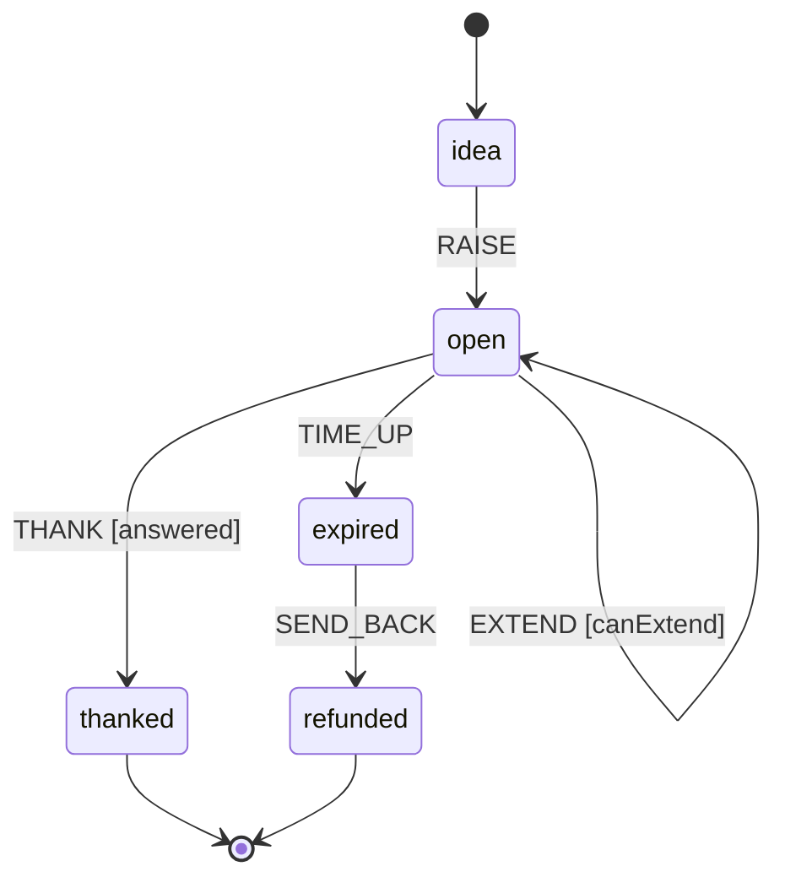

# aHand use cases: the catalogue

Generated by `bun tests/demo/catalogue.ts` from `tests/demo/scenarios/`. Do not edit by hand.

Play one: `DEMO=1 DEMO_ONLY=<id> STAND_SLOT=<n> bunx playwright test -c playwright.demo.config.ts`.

## Coverage

| Use case | | Covered by | Planned |
|---|---|---|---|
| U1 Human seeks human through a chain (flagship) | ✅ | [first-loop](#first-loop), [life](#life), [first-thanks](#first-thanks), [first-thanks-injected-helper](#first-thanks-injected-helper), [long-chain-3-dark](#long-chain-3-dark), [long-chain-2-public](#long-chain-2-public) |  |
| U2 Hiring / recruiting | ✅ | [hiring](#hiring) |  |
| U3 Lost-and-found: a QR tag as a bearer link, dark, zero reward | ✅ | [lost-and-found-tag](#lost-and-found-tag) |  |
| U4 Household services: $8–150, short expiry | ✅ | [life](#life), [first-thanks](#first-thanks), [first-thanks-injected-helper](#first-thanks-injected-helper) |  |
| U5 Agents as hops, raisers, givers (ERC-1271) | ⚙️ Core/SDK |  |  |
| U6 Apps as hops with a disclosed margin | ✅ | [app-hop-margin](#app-hop-margin) |  |
| U7 Contract raisers, pools, DAOs | ⚙️ Core/SDK |  |  |
| U8 Zero-reward asks | ✅ | [life](#life), [zero-reward](#zero-reward), [lost-and-found-tag](#lost-and-found-tag) |  |
| U9 Any ERC-20 token | — not built |  |  |
| U10 Long routes | ✅ | [long-chain-3-dark](#long-chain-3-dark), [long-chain-2-public](#long-chain-2-public), [hiring](#hiring), [route-full](#route-full) |  |
| U11 Exactly one Give: several winners means several Hands | ✅ | [branching](#branching) |  |
| U12 No disputes: the raiser decides; anyone refunds after expiry | ✅ | [life](#life), [times-up-send-back](#times-up-send-back) |  |
| U13 Private / dark asks, anonymous hops | ✅ | [long-chain-3-dark](#long-chain-3-dark), [reload-forgets](#reload-forgets), [lost-and-found-tag](#lost-and-found-tag) |  |
| U14 Public boards and catalogues | — not built |  |  |
| U15 Smart-contract wallets (Safe, Privy, 7702) | ✅ | [not-set-up-helper](#not-set-up-helper), [entropy-signer](#entropy-signer), [privy-email](#privy-email) | give-words-survive-social-login, privy-passkey |
| U16 Hostile or pausing tokens: a blocked payee waits | ✅ | [life](#life), [blocked-payee-waits](#blocked-payee-waits), [take-out](#take-out) |  |
| U17 Permissionless finalization: strangers refund and deliver | ✅ | [life](#life), [times-up-send-back](#times-up-send-back), [blocked-payee-waits](#blocked-payee-waits) |  |
| U18 Exit / recovery with the site, relay or indexer down | ✅ | [relay-down](#relay-down), [site-down-exit](#site-down-exit) |  |
| U19 Signals, badges, voting interpreters | — not built |  |  |
| U20 Down / negative statement | — not built |  |  |
| U21 EAS-timestamped Give | — not built |  |  |
| U22 Relayed thank / auto-reclaim | — not built |  |  |
| U23 Paymaster / self-paid gas | — not built |  |  |
| U24 Curated charity allowlist | — not built |  |  |
| U25 Chain fork / cross-core replay | ⚙️ Core/SDK |  |  |
| U26 Leaked capability key, truncated route: branching | ✅ | [branching](#branching), [resigned-route](#resigned-route) |  |
| U27 Cross-language SDK signing | ⚙️ Core/SDK |  |  |
| U28 Walletless paid pass | ✅ | [life](#life), [first-thanks](#first-thanks), [first-thanks-injected-helper](#first-thanks-injected-helper), [hiring](#hiring) |  |
| UX §7.2 Raise: compose, steps, keys card, share | ✅ | [first-loop](#first-loop), [life](#life), [first-thanks](#first-thanks), [first-thanks-injected-helper](#first-thanks-injected-helper), [zero-reward](#zero-reward), [entropy-signer](#entropy-signer) |  |
| UX §7.3 My hands: unlock, answers, rebuild on another device | ✅ | [first-loop](#first-loop), [life](#life), [branching](#branching), [rebuild-other-device](#rebuild-other-device) |  |
| UX §7.4 Care: add to the reward, extend | ✅ | [care-fund-extend](#care-fund-extend) |  |
| UX §7.5 Thank: verdict, re-signed route, predicted receipt | ✅ | [first-loop](#first-loop), [life](#life), [first-thanks](#first-thanks), [first-thanks-injected-helper](#first-thanks-injected-helper), [relay-down](#relay-down), [zero-reward](#zero-reward), [resigned-route](#resigned-route), [not-set-up-helper](#not-set-up-helper) | answers-on-a-new-device |
| UX §8.2 Hand view: time's up, send back | ✅ | [life](#life), [times-up-send-back](#times-up-send-back), [reload-forgets](#reload-forgets), [offline-rpc](#offline-rpc) |  |
| UX §8.4 Pass on: share, payee, darker | ✅ | [first-loop](#first-loop), [life](#life), [first-thanks](#first-thanks), [first-thanks-injected-helper](#first-thanks-injected-helper), [privy-email](#privy-email) | give-words-survive-social-login |
| UX §8.5 Give: payee choices, delivery, thread | ✅ | [first-loop](#first-loop), [life](#life), [first-thanks](#first-thanks), [first-thanks-injected-helper](#first-thanks-injected-helper), [relay-down](#relay-down) |  |
| UX §9 Waiting: take out, deliver for someone else | ✅ | [life](#life), [blocked-payee-waits](#blocked-payee-waits), [take-out](#take-out) |  |
| UX §10 Proof passport and check any link | ✅ | [proof-and-check](#proof-and-check), [public-pages](#public-pages) |  |
| UX §11 Print, limits, defaults, without us | ✅ | [lost-and-found-tag](#lost-and-found-tag), [public-pages](#public-pages) |  |

✅ a scenario shows it · 📝 planned · ⬜ no scenario yet · ⚙️ tested below the browser only · — no screen for it

## The Hand model

`tests/demo/model/hand.ts` is one Hand's life with Core's rules as guards, kept small (at most two passes, one answer, one top-up, one extension). Every scenario's Hands are read back as paths through it (`model/paths.ts`); a step the model forbids fails this file's generation.

Ends of a Hand (state, passes, answers, top-ups, extensions): **4 of 36** reached by a scenario above; transitions taken: 13 of 105. Every end has a generated scenario (`DEMO_MODEL=gaps` plays the ones marked ⬜).

| End | | Reached by | Shortest path (generated scenario) |
|---|---|---|---|
| refunded p0 g0 f0 e0 | ✅ | [life (tent)](#life), [times-up-send-back](#times-up-send-back) | raise → time's up → send back (`model-time-up-send-back`) |
| thanked p0 g1 f0 e0 | ✅ | [lost-and-found-tag](#lost-and-found-tag), [privy-email](#privy-email) | raise → answer → thank (`model-give-thank`) |
| refunded p0 g0 f0 e1 | ⬜ |  | raise → extend → time's up → send back (`model-extend-time-up-send-back`) |
| refunded p0 g0 f1 e0 | ⬜ |  | raise → top up → time's up → send back (`model-fund-time-up-send-back`) |
| refunded p0 g1 f0 e0 | ⬜ |  | raise → answer → time's up → send back (`model-give-time-up-send-back`) |
| refunded p1 g0 f0 e0 | ⬜ |  | raise → pass → time's up → send back (`model-pass-time-up-send-back`) |
| thanked p0 g1 f0 e1 | ⬜ |  | raise → answer → extend → thank (`model-give-extend-thank`) |
| thanked p0 g1 f1 e0 | ⬜ |  | raise → answer → top up → thank (`model-give-fund-thank`) |
| thanked p1 g1 f0 e0 | ✅ | [first-loop](#first-loop), [life (bike)](#life), [life (book)](#life), [first-thanks](#first-thanks), [first-thanks-injected-helper](#first-thanks-injected-helper), [relay-down](#relay-down), [zero-reward](#zero-reward), [app-hop-margin](#app-hop-margin), [blocked-payee-waits](#blocked-payee-waits), [take-out](#take-out), [not-set-up-helper](#not-set-up-helper), [proof-and-check](#proof-and-check), [site-down-exit](#site-down-exit) | raise → pass → answer → thank (`model-pass-give-thank`) |
| refunded p0 g0 f1 e1 | ⬜ |  | raise → top up → extend → time's up → send back (`model-fund-extend-time-up-send-back`) |
| refunded p0 g1 f0 e1 | ⬜ |  | raise → answer → extend → time's up → send back (`model-give-extend-time-up-send-back`) |
| refunded p0 g1 f1 e0 | ⬜ |  | raise → answer → top up → time's up → send back (`model-give-fund-time-up-send-back`) |
| refunded p1 g0 f0 e1 | ⬜ |  | raise → pass → extend → time's up → send back (`model-pass-extend-time-up-send-back`) |
| refunded p1 g0 f1 e0 | ⬜ |  | raise → pass → top up → time's up → send back (`model-pass-fund-time-up-send-back`) |
| refunded p1 g1 f0 e0 | ⬜ |  | raise → pass → answer → time's up → send back (`model-pass-give-time-up-send-back`) |
| refunded p2 g0 f0 e0 | ⬜ |  | raise → pass → pass → time's up → send back (`model-pass-pass-time-up-send-back`) |
| thanked p0 g1 f1 e1 | ⬜ |  | raise → answer → top up → extend → thank (`model-give-fund-extend-thank`) |
| thanked p1 g1 f0 e1 | ⬜ |  | raise → pass → answer → extend → thank (`model-pass-give-extend-thank`) |
| thanked p1 g1 f1 e0 | ⬜ |  | raise → pass → answer → top up → thank (`model-pass-give-fund-thank`) |
| thanked p2 g1 f0 e0 | ✅ | [life (ladder)](#life), [long-chain-3-dark](#long-chain-3-dark), [long-chain-2-public](#long-chain-2-public), [branching](#branching), [hiring](#hiring), [route-full](#route-full) | raise → pass → pass → answer → thank (`model-pass-pass-give-thank`) |
| refunded p0 g1 f1 e1 | ⬜ |  | raise → answer → top up → extend → time's up → send back (`model-give-fund-extend-time-up-send-back`) |
| refunded p1 g0 f1 e1 | ⬜ |  | raise → pass → top up → extend → time's up → send back (`model-pass-fund-extend-time-up-send-back`) |
| refunded p1 g1 f0 e1 | ⬜ |  | raise → pass → answer → extend → time's up → send back (`model-pass-give-extend-time-up-send-back`) |
| refunded p1 g1 f1 e0 | ⬜ |  | raise → pass → answer → top up → time's up → send back (`model-pass-give-fund-time-up-send-back`) |
| refunded p2 g0 f0 e1 | ⬜ |  | raise → pass → pass → extend → time's up → send back (`model-pass-pass-extend-time-up-send-back`) |
| refunded p2 g0 f1 e0 | ⬜ |  | raise → pass → pass → top up → time's up → send back (`model-pass-pass-fund-time-up-send-back`) |
| refunded p2 g1 f0 e0 | ⬜ |  | raise → pass → pass → answer → time's up → send back (`model-pass-pass-give-time-up-send-back`) |
| thanked p1 g1 f1 e1 | ⬜ |  | raise → pass → answer → top up → extend → thank (`model-pass-give-fund-extend-thank`) |
| thanked p2 g1 f0 e1 | ⬜ |  | raise → pass → pass → answer → extend → thank (`model-pass-pass-give-extend-thank`) |
| thanked p2 g1 f1 e0 | ⬜ |  | raise → pass → pass → answer → top up → thank (`model-pass-pass-give-fund-thank`) |
| refunded p1 g1 f1 e1 | ⬜ |  | raise → pass → answer → top up → extend → time's up → send back (`model-pass-give-fund-extend-time-up-send-back`) |
| refunded p2 g0 f1 e1 | ⬜ |  | raise → pass → pass → top up → extend → time's up → send back (`model-pass-pass-fund-extend-time-up-send-back`) |
| refunded p2 g1 f0 e1 | ⬜ |  | raise → pass → pass → answer → extend → time's up → send back (`model-pass-pass-give-extend-time-up-send-back`) |
| refunded p2 g1 f1 e0 | ⬜ |  | raise → pass → pass → answer → top up → time's up → send back (`model-pass-pass-give-fund-time-up-send-back`) |
| thanked p2 g1 f1 e1 | ⬜ |  | raise → pass → pass → answer → top up → extend → thank (`model-pass-pass-give-fund-extend-thank`) |
| refunded p2 g1 f1 e1 | ⬜ |  | raise → pass → pass → answer → top up → extend → time's up → send back (`model-pass-pass-give-fund-extend-time-up-send-back`) |

## Scenarios

### first-loop

**The first loop: raise, pass at 0%, answer with a wallet, thank**

Nina raises 50 test dollars. Alex, with no wallet, passes the link on for nothing. Gina answers with her wallet, and Nina thanks her from My hands: all 50 land at Gina's address.

Runs on: stand, fork, site · covers: U1, UX §7.2, UX §7.3, UX §8.4, UX §8.5, UX §7.5 · tags: core-loop, gate

| Persona | Role | Wallet |
|---|---|---|
| Nina | asker | dev account 1 |
| Alex | holder | none |
| Gina | helper | dev account 4 |

1. Nina raises a hand: “Who can lend a ladder in Batumi this weekend?”, 50 test dollars, unlisted
   - the address of ladder has the unlisted shape
2. Alex opens the link
   - screen: `hand.dealCard` shows, “Who can lend a ladder in Batumi this weekend?”
   - screen: `hand.rail` shows, data-value=1
3. Alex passes it on and keeps nothing
4. Gina opens the link
   - screen: `hand.dealCard` shows, “Who can lend a ladder in Batumi this weekend?”
   - screen: `hand.rail` shows, data-value=2
5. Gina can help and answers
   - screen: `give.delivered` shows, says give.delivered.one (acks=1)
6. Nina opens My hands on the device that raised it and reads the answer
7. Nina thanks the answer: one transaction pays everyone
   - before the swipe: screen: `wallet.connected` shows, data-value=@nina
   - before the swipe: screen: `thank.cost` shows, says kit.cost.line
   - Core: Hand "ladder" state thanked
   - the transaction: payouts 50 paid to @gina
   - screen: `thank.payout` shows, data-kind=paid, data-payee=@gina, data-amount=50000000
   - balance of @gina: changes by 50

Checked on the chain at the end:

- Hand "ladder" is thanked
- Gina received 50 test dollars

### life

**The whole life: pass at 0% and 10%, help, reply, thank, waiting money delivered, time's up, no reward**

Nina raises a ladder hand. Alice passes it for nothing, Bob keeps 10% for an address he pastes, Gina helps with a pasted address, and Nina replies and thanks: Bob gets 5, Gina 45. A second hand in the token that can block: Alice's share waits while her address is blocked, and Dora, a stranger, delivers it once it is unblocked. A third hand runs out of time and Vic sends it back. A fourth carries no reward and pays nothing. No browser reaches anything but this machine.

Runs on: stand · covers: U1, U4, U8, U12, U16, U17, U28, UX §7.2, UX §7.3, UX §7.5, UX §8.2, UX §8.4, UX §8.5, UX §9 · tags: life, core-loop, refund, blocked-payee, zero-reward, clock

| Persona | Role | Wallet |
|---|---|---|
| Nina | asker | dev account 1 |
| Alice | holder | none |
| Bob | holder | none |
| Gina | helper | none |
| Dora | visitor | dev account 3 |
| Vic | visitor | dev account 5 |

1. Nina raises a hand: “Who can lend a ladder in Batumi this weekend?”, 50 test dollars, unlisted
   - before the swipe: screen: `raise.minClaim` shows, data-value=7000
   - screen: `raise.up` shows, says raise.up
   - raise-rail-four-states
   - the address of ladder has the unlisted shape
   - Core's checkRoute on ladder: no passes
   - Core: Hand "ladder" state open, reward 50, minClaimBps 7000, token usd, raiser @nina
   - raise-terms-on-chain
   - balance of @nina: changes by -50
2. Alice opens the link
   - screen: `hand.dealCard` shows, “Who can lend a ladder in Batumi this weekend?”, data-state=open
   - screen: `hand.rail` shows, data-value=1
3. Alice passes it on and keeps nothing
   - no-wallet-asked
   - the browser reached only: rpc, site
   - Core's checkRoute on ladder-via-alice: nobody keeps 0%
   - Core: Hand "ladder" state open
4. Bob opens the link
   - screen: `hand.rail` shows, data-value=2
5. Bob passes it on, keeping 10%
   - no-wallet-asked
   - Core's checkRoute on ladder-via-bob: nobody keeps 0%, then @bob-share keeps 10%
   - balance of @bob-share: is 0
6. Gina opens the link
   - screen: `hand.rail` shows, data-value=3
7. Gina can help and answers
   - screen: `give.delivered` shows, says give.delivered.one (acks=1), data-value=1/1
   - no-wallet-asked
   - Core's checkGive on gina-give: accepted, pays @gina-pay, claims 90%
   - Core's checkRoute on gina-give: nobody keeps 0%, then @bob-share keeps 10%
   - the browser reached only: rpc, site, relay
   - Core: Hand "ladder" state open
8. Nina opens My hands on the device that raised it and reads the answer
   - answer-is-the-give (gina-give)
9. Nina replies: “Thank you! Saturday at ten, by the cathedral?”
10. Nina thanks the answer: one transaction pays everyone
   - screen: `thank.done` shows, says thank.done
   - receipt-is-prediction
   - the transaction: events Thanked → Shaken → Shaken → Paid → Given → Paid; payouts 5 paid to @bob-share, 45 paid to @gina-pay
   - balance of @bob-share: is 5
   - balance of @gina-pay: is 45
   - balance of @nina: changes by 0
   - Core: Hand "ladder" state thanked, givenBy gina-give
11. Gina's tab shows Nina's reply
   - reply-reached-helper (Thank you! Saturday at ten, by the cathe…)
   - screen: `give.thread` shows, “I have a three-metre ladder near the boulevard; text me and I'll bring it.”
   - balance of @gina-pay: is 45
12. Nina raises a hand in the token that can block through the SDK: “Who can find me a used cargo bike?”, 20 test dollars
13. Alice opens the link
14. Alice passes it on, keeping 10%
15. Bob opens the link
16. Bob can help and answers
17. The token blocks blocked
18. Nina thanks the answer: one transaction pays everyone
   - screen: 1 × `thank.payout`, says thank.waiting
   - screen: `thank.payout` shows, says thank.waiting, data-kind=waiting, data-payee=@blocked, data-amount=2000000
   - the transaction: payouts 2 waiting to @blocked, 18 paid to @helper2
   - Core holds 2 for @blocked
   - balance of @blocked (token that can block): is 0
   - balance of @helper2 (token that can block): is 18
   - Core: Hand "bike" state thanked
19. The token unblocks blocked
20. Dora, a stranger, delivers the money waiting for blocked
   - before the swipe: screen: `waiting.row` shows, data-amount=2000000
   - before the swipe: screen: 0 × `waiting.takeOut`
   - screen: `waiting.withdrawn` shows, data-amount=2000000, data-to=@blocked
   - Core holds 0 for @blocked
   - balance of @blocked (token that can block): is 2
   - Core emitted Withdrawn for @blocked 1 time(s)
21. Nina raises a hand: “Who has a spare tent for one night?”, 5 test dollars, unlisted
   - balance of @nina: changes by -5
22. Vic opens the link
   - screen: `hand.dealCard` shows, data-state=open
   - screen: 0 × `hand.timesUp`
23. The network's clock moves 8 days ahead
   - screen of vic: `hand.dealCard` shows, data-state=expired
   - Core: Hand "tent" state expired
24. Vic's page says Time's up: anyone can send the reward back
   - screen: `hand.dealCard` shows, says kit.deal.timeUp
   - screen: `hand.dealCard` shows, says kit.deal.sendBack
   - screen: `hand.timesUp` shows, says hand.sendBack.title, not kit.deal.timeUp
   - screen: 0 × `hand.pass`
25. Vic sends the reward back to the asker
   - screen: `hand.closed` shows, data-value=refunded
   - screen: `hand.dealCard` shows, says kit.deal.refunded
   - Core: Hand "tent" state refunded
   - balance of @nina: changes by 5
26. Nina raises a hand: “A thank-you for a good book tip”, 0 test dollars, unlisted
   - raise-sent-one-transaction
   - Core: Hand "book" reward 0
27. Alice opens the link
   - screen: `hand.dealCard` shows, says kit.deal.noReward
28. Alice passes it on and keeps nothing
   - before the swipe: screen: `pass.noReward` shows
   - before the swipe: screen: 0 × `pass.slider`
29. Gina opens the link
30. Gina can help and answers
   - Core's checkGive on book-give: accepted
31. Nina opens My hands on the device that raised it and reads the answer
32. Nina thanks the answer: one transaction pays everyone
   - before the swipe: screen: `thank.noReward` shows
   - receipt-events-are-chain
   - screen: 0 × `thank.payout`
   - screen: `thank.noMoney` shows
   - the transaction: events Thanked → Shaken → Given; no payouts
   - Core: Hand "book" state thanked, givenBy book-give
   - balance of @gina-book: is 0

Checked on the chain at the end:

- Hand "ladder" is thanked
- Hand "bike" is thanked
- Hand "tent" is refunded
- Hand "book" is thanked
- the address “bob-share” received 5 test dollars
- the address “gina-pay” received 45 test dollars
- the address “blocked” received 2 test dollars that can block
- the address “helper2” received 18 test dollars that can block

Every persona's browser: local-only, no-errors, no-fragment-after-load.

### first-thanks

**Raise, pass on with a share, answer, thank**

Nina needs a ladder. She raises a hand with 20 test dollars and sends the link to Alex. Alex has no wallet; he passes it on and keeps 10% for himself, paid to an address he pastes. Gina opens Alex's link, answers with her wallet, and Nina thanks her: one transaction pays Gina and Alex.

Runs on: stand, fork, site · covers: U1, U4, U28, UX §7.2, UX §8.4, UX §8.5, UX §7.5 · tags: core-loop, unlisted, walletless-pass

| Persona | Role | Wallet |
|---|---|---|
| Nina | asker | dev account 1 |
| Alex | holder | none |
| Gina | helper | dev account 4 |

1. Three people, three phones. Nobody shares anything but a link.
2. Nina raises a hand: “Who can lend a ladder in Batumi this weekend?”, 20 test dollars, unlisted
3. Alex opens the link Nina sent him
4. Alex passes it on, keeping 10%
5. Gina opens the link Alex passed on: two hands on the rail
6. Gina can help and answers
7. Nina thanks the answer: one transaction pays everyone

Checked on the chain at the end:

- Hand "ladder" is thanked
- Alex received 2 test dollars
- Gina received 18 test dollars

### first-thanks-injected-helper

**The same loop, the helper on an injected EIP-6963 wallet**

As first-thanks, but Gina's wallet is announced to the page through EIP-6963 and signs in the test process, as on a fork or a branch site.

Runs on: stand, fork · covers: U1, U4, U28, UX §7.2, UX §8.4, UX §8.5, UX §7.5 · tags: core-loop, wallet-kind

| Persona | Role | Wallet |
|---|---|---|
| Nina | asker | dev account 1 |
| Alex | holder | none |
| Gina | helper | injected key 7 |

1. Three people, three phones. Nobody shares anything but a link.
2. Nina raises a hand: “Who can lend a ladder in Batumi this weekend?”, 20 test dollars, unlisted
3. Alex opens the link Nina sent him
4. Alex passes it on, keeping 10%
5. Gina opens the link Alex passed on: two hands on the rail
6. Gina can help and answers
7. Nina thanks the answer: one transaction pays everyone

Checked on the chain at the end:

- Hand "ladder" is thanked
- Alex received 2 test dollars
- Gina received 18 test dollars

### times-up-send-back

**Time's up: a stranger sends the reward back**

Nina raises a hand for 7 days with 5 test dollars. Nobody helps. A week and a day later Vic, a stranger with a wallet, opens the link, sees Time's up and sends the reward back. Nina has all of it again, and Vic paid only gas.

Runs on: stand, fork · covers: U12, U17, UX §8.2 · tags: expiry, refund, permissionless, clock

| Persona | Role | Wallet |
|---|---|---|
| Nina | asker | dev account 1 |
| Vic | visitor | dev account 5 |

1. Nina raises a hand: “Who has a spare tent for one night?”, 5 test dollars, unlisted
2. Vic opens the link: the hand is open
3. The network's clock moves 8 days ahead
4. The page follows the network's clock: Time's up. Vic sends the reward back

Checked on the chain at the end:

- Hand "tent" is refunded
- the asker of "tent" has the whole reward back

### long-chain-3-dark

**3 walletless holders pass a dark hand at 0%; the helper gets it all**

Generated: 3 people pass the link on and keep nothing; the helper receives the whole reward.

Runs on: stand, fork, site · covers: U1, U10, U13 · tags: generated, route-length, dark

| Persona | Role | Wallet |
|---|---|---|
| Nina | asker | dev account 1 |
| Alex | holder | none |
| Bea | holder | none |
| Cem | holder | none |
| Gina | helper | dev account 4 |

1. Nina raises a hand: “A long route, dark: who can fix an old radio?”, 50 test dollars, dark
2. Alex opens the link
3. Alex passes it on and keeps nothing
4. Bea opens the link
5. Bea passes it on and keeps nothing
6. Cem opens the link
7. Cem passes it on and keeps nothing
8. Gina opens the link: 4 hands on the rail
9. Gina can help and answers
10. Nina thanks the answer: one transaction pays everyone

Checked on the chain at the end:

- Hand "radio-0" is thanked
- Gina received 50 test dollars

### long-chain-2-public

**2 walletless holders pass a public hand at 0%; the helper gets it all**

Generated: 2 people pass the link on and keep nothing; the helper receives the whole reward.

Runs on: stand, fork, site · covers: U1, U10 · tags: generated, route-length, public

| Persona | Role | Wallet |
|---|---|---|
| Nina | asker | dev account 1 |
| Alex | holder | none |
| Bea | holder | none |
| Gina | helper | dev account 4 |

1. Nina raises a hand: “A long route, public: who can fix an old radio?”, 50 test dollars, public
2. Alex opens the link
3. Alex passes it on and keeps nothing
4. Bea opens the link
5. Bea passes it on and keeps nothing
6. Gina opens the link: 3 hands on the rail
7. Gina can help and answers
8. Nina thanks the answer: one transaction pays everyone

Checked on the chain at the end:

- Hand "radio-0" is thanked
- Gina received 50 test dollars

### relay-down

**The relay is down: the answer goes back by hand, and the thank still pays**

Nina raises a hand and Alex passes it on. Then the stand's relay goes down. Gina answers; her page says it could not reach the asker and asks her to send the answer back to whoever sent her the link. The address travels back by hand, Nina pastes it on Thank, and Gina is paid. No server was needed for the money.

Runs on: stand · covers: U18, UX §8.5, UX §7.5 · tags: fault, relay, exit

| Persona | Role | Wallet |
|---|---|---|
| Nina | asker | dev account 1 |
| Alex | holder | none |
| Gina | helper | dev account 4 |

1. Nina raises a hand: “Who can tune a piano in Kutaisi?”, 20 test dollars, unlisted
2. Alex opens the link
3. Alex passes it on and keeps nothing
4. The stand's relay goes down
5. Gina opens the link
6. Gina answers; no relay takes it, so the page gives her the answer to send back by hand
   - screen: `give.fallback` shows, says give.fallback
   - screen: 0 × `give.delivered`
   - Core's checkGive on gina-give: accepted, pays @gina
7. Alex hands Gina's answer back to Nina; she pastes it on Thank
   - the transaction: payouts 20 paid to @gina
   - Core: Hand "piano" state thanked, givenBy gina-give
8. The relay is back

Checked on the chain at the end:

- Hand "piano" is thanked
- Gina received 20 test dollars

Every persona's browser: no-fragment-after-load.

### zero-reward

**A thank-you only: no reward, passed, answered, thanked; nothing is paid**

Nina asks for a book tip with no reward: one transaction, no approve. Alex passes it on (there is no share to keep), Gina answers, and Nina's thank records the answer and pays nothing.

Runs on: stand, fork, site · covers: U8, UX §7.2, UX §7.5 · tags: zero-reward

| Persona | Role | Wallet |
|---|---|---|
| Nina | asker | dev account 1 |
| Alex | holder | none |
| Gina | helper | dev account 4 |

1. Nina raises a hand: “A good novel about how a commune might work?”, 0 test dollars, unlisted
   - raise-sent-one-transaction
   - Core: Hand "book" reward 0
2. Alex opens the link
   - screen: `hand.dealCard` shows, says kit.deal.noReward
3. Alex passes it on and keeps nothing
   - before the swipe: screen: `pass.noReward` shows
   - before the swipe: screen: 0 × `pass.slider`
4. Gina opens the link
5. Gina can help and answers
6. Nina thanks the answer: one transaction pays everyone
   - before the swipe: screen: `thank.noReward` shows
   - receipt-events-are-chain
   - screen: 0 × `thank.payout`
   - screen: `thank.noMoney` shows
   - the transaction: events Thanked → Shaken → Given; no payouts
   - balance of @gina: changes by 0

Checked on the chain at the end:

- Hand "book" is thanked
- Gina received 0 test dollars

### branching

**Two holders pass the same link, two helpers answer, one is thanked**

Nina sends her link to Alex and to Bea. Each passes it on: Alex for nothing, Bea keeping 5%. Gina answers through Alex's branch, Hana through Bea's. Nina sees two answers and thanks Gina's: Gina gets everything, Bea's branch nothing, and the Hand is closed for Hana's answer.

Runs on: stand, fork, site · covers: U11, U26, UX §7.3 · tags: branching, one-give

| Persona | Role | Wallet |
|---|---|---|
| Nina | asker | dev account 1 |
| Alex | holder | none |
| Bea | holder | none |
| Gina | helper | dev account 4 |
| Hana | helper | none |

1. Nina raises a hand: “Who can fix a fridge that hums all night?”, 20 test dollars, unlisted
2. Alex opens the link
3. Alex passes it on and keeps nothing
4. Bea opens the same link Nina sent her
5. Bea passes it on, keeping 5%
6. Gina opens the link
   - screen: `hand.rail` shows, data-value=2
7. Gina can help and answers
8. Hana opens the link
   - screen: `hand.rail` shows, data-value=2
9. Hana can help and answers
10. Nina sees both answers on My hands
   - screen: 2 × `my.answer`
   - Core's checkGive on gina-give: accepted
   - Core's checkGive on hana-give: accepted, claims 95%
11. Nina thanks Gina's answer: one Give per Hand
   - the transaction: payouts 20 paid to @gina
   - Core: Hand "fridge" state thanked, givenBy gina-give
   - balance of @bea-share: is 0
   - balance of @hana-pay: is 0

Checked on the chain at the end:

- Hand "fridge" is thanked
- Gina received 20 test dollars

### hiring

**A referral chain for a job: three holders keep shares**

Nina looks for a senior engineer with 50 test dollars. Alex and Bea each keep 5% as they pass it on, Cem keeps 10%; Gina knows the candidate. Nina's thank pays all four in one transaction: 2.5, 2.5, 5 and 40.

Runs on: stand, fork, site · covers: U2, U10, U28 · tags: shares, route-length

| Persona | Role | Wallet |
|---|---|---|
| Nina | asker | dev account 1 |
| Alex | holder | none |
| Bea | holder | none |
| Cem | holder | none |
| Gina | helper | dev account 4 |

1. Nina raises a hand: “Who knows a senior Rust engineer open to a move to Tbilisi?”, 50 test dollars, unlisted
2. Alex opens the link
3. Alex passes it on, keeping 5%
4. Bea opens the link
5. Bea passes it on, keeping 5%
6. Cem opens the link
7. Cem passes it on, keeping 10%
8. Gina opens the link
   - screen: `hand.rail` shows, data-value=4
9. Gina can help and answers
   - Core's checkGive on job-give: accepted, pays @gina, claims 80%
   - Core's checkRoute on job-give: @alex-share keeps 5%, then @bea-share keeps 5%, then @cem-share keeps 10%
10. Nina thanks the answer: one transaction pays everyone
   - receipt-is-prediction
   - the transaction: payouts 2.5 paid to @alex-share, 2.5 paid to @bea-share, 5 paid to @cem-share, 40 paid to @gina

Checked on the chain at the end:

- Hand "job" is thanked
- the address “alex-share” received 2.5 test dollars
- the address “bea-share” received 2.5 test dollars
- the address “cem-share” received 5 test dollars
- Gina received 40 test dollars

### app-hop-margin

**An app hop passes the link on keeping a disclosed 2.5%**

A board app, Boardly, is a hop like any person: it passes Nina's link on keeping 2.5%, which the next person sees on the rail. Gina answers; the thank pays Boardly 0.5 and Gina 19.5.

Runs on: stand, fork, site · covers: U6 · tags: shares, app

| Persona | Role | Wallet |
|---|---|---|
| Nina | asker | dev account 1 |
| Boardly | holder | none |
| Gina | helper | dev account 4 |

1. Nina raises a hand: “Who can walk my dog on weekday mornings?”, 20 test dollars, unlisted
2. Boardly opens the link
3. Boardly passes it on, keeping 2.5%
4. Gina opens the link
   - Core's checkRoute on dog-via-board: @board-margin keeps 2.5%
5. Gina can help and answers
6. Nina thanks the answer: one transaction pays everyone
   - the transaction: payouts 0.5 paid to @board-margin, 19.5 paid to @gina

Checked on the chain at the end:

- Hand "dog" is thanked
- the address “board-margin” received 0.5 test dollars
- Gina received 19.5 test dollars

### blocked-payee-waits

**A blocked payee's share waits in Core; a stranger delivers it once unblocked**

A Hand in the test token that can block addresses. Alex keeps 10% for an address the token blocks before the thank. The thank does not fail: Alex's 2 wait in Core and Gina is paid. When the token unblocks the address, Dora, a stranger, delivers what waits, and it lands at Alex's address, never anywhere else.

Runs on: stand · covers: U16, U17, UX §9 · tags: blocked-payee, pending, permissionless

| Persona | Role | Wallet |
|---|---|---|
| Nina | asker | dev account 1 |
| Alex | holder | none |
| Gina | helper | dev account 4 |
| Dora | visitor | dev account 3 |

1. Nina raises a hand in the token that can block through the SDK: “Who can find me a used cargo bike?”, 20 test dollars
2. Alex opens the link
3. Alex passes it on, keeping 10%
4. Gina opens the link
5. Gina can help and answers
6. The token blocks alex-share
7. Nina thanks the answer: one transaction pays everyone
   - screen: 1 × `thank.payout`, says thank.waiting
   - the transaction: payouts 2 waiting to @alex-share, 18 paid to @gina
   - Core holds 2 for @alex-share
8. The token unblocks alex-share
9. Dora, a stranger, delivers the money waiting for alex-share
   - before the swipe: screen: 0 × `waiting.takeOut`
   - Core holds 0 for @alex-share
   - balance of @alex-share (token that can block): is 2
   - Core emitted Withdrawn for @alex-share 1 time(s)

Checked on the chain at the end:

- Hand "bike" is thanked
- the address “alex-share” received 2 test dollars that can block
- Gina received 18 test dollars that can block

### take-out

**A blocked payee takes what waits for it out to another address**

Alex keeps 10% for his own wallet as he passes Nina's link on, in the token that can block. The token blocks Alex before the thank, so his 2 wait in Core. Alex does not wait for the token: on Waiting he takes them out to another address of his, which the token does not block.

Runs on: stand · covers: U16, UX §9 · tags: pending, take-out, blocked-payee

| Persona | Role | Wallet |
|---|---|---|
| Nina | asker | dev account 1 |
| Alex | holder | dev account 2 |
| Gina | helper | dev account 4 |

1. Nina raises a hand in the token that can block through the SDK: “Who can repair a desk lamp from the sixties?”, 20 test dollars
2. Alex opens the link
3. Alex passes it on, keeping 10% for his own address
4. Gina opens the link
5. Gina can help and answers
6. The token blocks alex
7. Nina thanks the answer: one transaction pays everyone
   - Core holds 2 for @alex
   - the transaction: payouts 2 waiting to @alex, 18 paid to @gina
8. Alex takes what waits out to another address
   - before the swipe: screen: 0 × `waiting.deliver`
   - screen: `waiting.withdrawn` shows, data-amount=2000000, data-to=@alex-other
   - Core holds 0 for @alex
   - balance of @alex-other (token that can block): is 2
   - balance of @alex (token that can block): changes by 0

Checked on the chain at the end:

- Hand "lamp" is thanked
- the address “alex-other” received 2 test dollars that can block

### care-fund-extend

**The asker adds to the reward and keeps the Hand open longer; nobody else can**

Nina's hand gets no answer in the first days. On Care she adds 10 test dollars to the reward (every link already out there stays good) and keeps it open 30 days longer. Vic opens the same Care page: only the account that raised a hand can do that.

Runs on: stand, fork, site · covers: UX §7.4 · tags: care, fund, extend

| Persona | Role | Wallet |
|---|---|---|
| Nina | asker | dev account 1 |
| Vic | visitor | dev account 5 |

1. Nina raises a hand: “Who can take a boat to the islands on Sunday?”, 20 test dollars, unlisted
2. Nina adds 10 test dollars to the reward
   - Core: Hand "boat" reward 30, state open
   - balance of @nina: changes by -10
   - screen: `care.fundSwipe` shows, disabled
3. Nina keeps it open 30 days longer
   - expiry-moved (30)
   - Core: Hand "boat" reward 30
4. Vic opens the same Care page
5. Vic connects: only the account that raised it can change it
   - screen: `care.error` shows, data-value=NotRaiser
   - screen: 0 × `care.fundSwipe`
   - screen: 0 × `care.extendSwipe`

Checked on the chain at the end:

- Hand "boat" is open

### resigned-route

**A shorter route re-signed to leave a holder out: the asker must tick them before thanking**

Nina's hand was passed by A (keeping 5%) and B (keeping 5%), and the helper answered. Then A signed a shorter route straight to the helper, leaving B out, and the helper answered again. Nina saw the first answer on this device, so Thank shows the second as re-signed and names B; nothing can be sent until Nina ticks that she knows B is left out. She thanks it anyway: A gets 4, the helper 76, B nothing.

Runs on: stand, fork · covers: U26, UX §7.5 · tags: resigned, branching

| Persona | Role | Wallet |
|---|---|---|
| Nina | asker | dev account 1 |

1. The stand prepares a Hand answered twice: once by a route, once by a shorter route re-signed to leave a holder out
2. Nina pastes the first answer: this device remembers it
   - screen: 0 × `thank.resigned`
3. Nina pastes the second answer: a shorter route that leaves B out
   - before the swipe: screen: `thank.resigned` shows, says thank.resigned
   - before the swipe: screen: 1 × `thank.dropped`
   - before the swipe: screen: `thank.dropped` shows, data-payee=@kite-b
   - before the swipe: screen: `thank.swipe` shows, enabled
   - the transaction: payouts 4 paid to @kite-a, 76 paid to @kite-giver
   - Core: Hand "kite" state thanked, givenBy kite-second
   - balance of @kite-b: changes by 0

Checked on the chain at the end:

- Hand "kite" is thanked

### not-set-up-helper

**A helper whose smart account is not set up yet; the thank sets it up first**

Gina answers from a smart account that has no code on this network yet (ERC-6492). Core accepts her answer with its setup. Nina's Thank says so: two steps, the first sets up Gina's account, the second says thanks, with one swipe. Afterwards the account exists and holds the reward.

Runs on: stand · covers: U15, UX §7.5 · tags: erc-6492, smart-account

| Persona | Role | Wallet |
|---|---|---|
| Nina | asker | dev account 1 |
| Alex | holder | none |

1. Nina raises a hand: “Who can lend a projector for Friday night?”, 20 test dollars, unlisted
2. Alex opens the link
3. Alex passes it on and keeps nothing
4. Gina answers from a smart account nobody has set up yet
   - no-code (@gina-account)
5. Nina thanks the answer: one transaction pays everyone
   - before the swipe: screen: `thank.setupBand` shows, says thank.setup
   - before the swipe: screen: `thank.twoSteps` shows
   - screen: `thank.spent` shows, data-status=read, data-count=2
   - has-code (@gina-account)
   - Core: Hand "tv" state thanked, givenBy gina-account

Checked on the chain at the end:

- Hand "tv" is thanked
- the address “gina-account” received 20 test dollars

### entropy-signer

**A signer that answers differently each time must save the link**

Vic's wallet signs differently every time (passkeys, MPC and many smart wallets do). The app cannot rebuild Vic's link later, so after the raise it keeps a locked copy and asks Vic to save the link. Vic copies it and ticks I saved the link; the copy on the device is gone, and the link Vic saved opens the Hand.

Runs on: stand · covers: UX §7.2, U15 · tags: signer, locked-copy

| Persona | Role | Wallet |
|---|---|---|
| Vic | asker | dev account 5 |
| Alex | holder | none |

1. Vic raises a hand: “Who can recommend a quiet café to work from?”, 5 test dollars, unlisted
   - screen: `raise.copyGone` shows
   - Core: Hand "cafe" state open, raiser @vic
2. The link Vic saved opens the Hand
   - screen: `hand.rail` shows, data-value=1

Checked on the chain at the end:

- Hand "cafe" is open

### rebuild-other-device

**My hands on a second device: the link rebuilt from the device code**

Nina raised on her laptop. On her phone, with the same wallet, she enters the laptop's device code and the Hand's number: My hands rebuilds the link (without its words, which are never on the chain), and it opens the Hand.

Runs on: stand, fork, site · covers: UX §7.3 · tags: devices, my-hands

| Persona | Role | Wallet |
|---|---|---|
| Nina | asker | dev account 1 |
| Nina's phone | asker | dev account 1 |

1. Nina raises a hand: “Who can lend a tent for the mountains?”, 5 test dollars, unlisted
2. Nina reads this device's code on My hands
3. Nina's phone, on another device, rebuilds the link from the code
   - screen: `my.rebuildResult` shows, says my.lens.rebuildWhy
4. Nina's phone opens the link
   - Core's checkRoute on tent-rebuilt: no passes

Checked on the chain at the end:

- Hand "tent" is open

### reload-forgets

**A reload forgets the link: the tab said so**

Alex opens Nina's link: the page says the link lives in this tab only. He reloads anyway. The unlisted Hand still shows its public face, but passing on and helping need the link again; a dark one shows nothing at all.

Runs on: stand, fork, site · covers: UX §8.2, U13 · tags: reload, dark

| Persona | Role | Wallet |
|---|---|---|
| Nina | asker | dev account 1 |
| Alex | holder | none |

1. Nina raises a hand: “Who can lend a bike pump today?”, 5 test dollars, unlisted
2. Alex opens the link
   - screen: `hand.tabOnly` shows
   - screen: `hand.pass` shows, enabled
3. Alex reloads the page
   - screen: `hand.noLink` shows, says hand.noLink
   - screen: 0 × `hand.pass`
   - screen: 0 × `hand.help`
4. Nina raises a hand: “Who can lend a ladder, quietly?”, 5 test dollars, dark
5. Alex opens the link
6. Alex reloads the page
   - screen: `shell.main` shows, says hand.nothing.title
   - screen: 0 × `hand.dealCard`

Checked on the chain at the end:

- Hand "pump" is open

### offline-rpc

**The network drops: the Hand claims nothing, offers nothing, and comes back by itself**

Alex has Nina's Hand open when his network drops. The page says when it last read the chain and that things may have changed, and it greys out passing on and helping. When the network is back, the Hand is open again without a reload.

Runs on: stand, fork, site · covers: UX §8.2 · tags: offline, fail-closed

| Persona | Role | Wallet |
|---|---|---|
| Nina | asker | dev account 1 |
| Alex | holder | none |

1. Nina raises a hand: “Who has a spare umbrella near the station?”, 5 test dollars, unlisted
2. Alex opens the link
   - screen: `hand.dealCard` shows, data-state=open
3. Alex loses the network
   - screen: `hand.offline` shows, says hand.offline
   - screen: `hand.pass` shows, disabled
   - screen: `hand.help` shows, disabled
4. Alex's network is back
   - screen: `hand.dealCard` shows, data-state=open
   - screen: `hand.pass` shows, enabled
   - screen: 0 × `hand.offline`

Checked on the chain at the end:

- Hand "umbrella" is open

### proof-and-check

**A stranger checks a thanked Hand's passport and the answer's link**

After Nina thanked Gina, Sam, who took no part, opens the Hand's passport: every line checks against Core, and the giveHash matches. Then he pastes Gina's answer on Check and sees, step by step, what Core says of it.

Runs on: stand, fork, site · covers: UX §10 · tags: proof, check, evidence

| Persona | Role | Wallet |
|---|---|---|
| Nina | asker | dev account 1 |
| Alex | holder | none |
| Gina | helper | dev account 4 |
| Sam | visitor | none |

1. Nina raises a hand: “Who can recommend a vet for a cat?”, 20 test dollars, unlisted
2. Alex opens the link
3. Alex passes it on, keeping 5%
4. Gina opens the link
5. Gina can help and answers
6. Nina thanks the answer: one transaction pays everyone
7. Sam opens the Hand's passport
   - passport-all-ok
   - screen: `proof.givehashMatches` shows
8. Sam checks the link on Check
   - screen: `check.handState` shows, data-value=thanked
   - screen: `check.passport` shows

Checked on the chain at the end:

- Hand "cat" is thanked

### route-full

**A route at its length limit: no more passes, but anyone on it can still help**

Nina's Hand is raised with a high payout gas setting, so few passes fit one thank. The link travels until the route is full. Gina, at the end of it, reads that it can't go further; passing on is greyed out, helping is not. She helps, and Nina's thank fits.

Runs on: stand, fork · covers: U10 · tags: route-length, gas

| Persona | Role | Wallet |
|---|---|---|
| Nina | asker | dev account 1 |
| Gina | helper | dev account 4 |

1. Nina raises a hand in the dollar token through the SDK: “Who can carry a sofa up four floors?”, 20 test dollars
2. The link is passed on until the route is full
3. Gina opens the link
   - screen: `hand.passesLeft` shows, says hand.passesNone, data-value=0
   - screen: `hand.pass` shows, disabled
   - screen: `hand.help` shows, enabled
4. Gina can help and answers
5. Nina thanks the answer: one transaction pays everyone
   - Core: Hand "sofa" state thanked
   - receipt-is-prediction

Checked on the chain at the end:

- Hand "sofa" is thanked

### lost-and-found-tag

**Lost and found: a dark Hand printed as a tag; a finder scans it and answers**

Nina prints a dark Hand with no reward as a small tag for her keys. Fred finds the keys, scans the tag (the link opens the Hand; nothing about it was ever public) and answers with an address he pastes. Nina thanks him.

Runs on: stand, fork, site · covers: U3, U8, U13, UX §11 · tags: dark, print, zero-reward

| Persona | Role | Wallet |
|---|---|---|
| Nina | asker | dev account 1 |
| Fred | helper | none |

1. Nina raises a hand: “Found these keys? They are mine.”, 0 test dollars, dark
2. Nina prints the link
   - screen: `print.tag` shows, says print.tag.found
   - screen: 0 × `print.tooDense`
3. Fred scans the tag
   - screen: `hand.dealCard` shows, says kit.deal.noReward
4. Fred can help and answers
5. Nina thanks the answer: one transaction pays everyone
   - the transaction: events Thanked → Given; no payouts

Checked on the chain at the end:

- Hand "keys" is thanked

### site-down-exit

**The site is down: the asker thanks from the exit page opened as a file**

Nina's Hand was answered. Then the site goes down. Nina opens exit.html, the one-file page she saved, straight from disk with her wallet; she pastes Gina's answer and thanks. Gina is paid without the site.

Runs on: stand · covers: U18 · tags: exit, fault, site

| Persona | Role | Wallet |
|---|---|---|
| Nina | asker | injected key 1 |
| Alex | holder | none |
| Gina | helper | dev account 4 |

1. Nina raises a hand: “Who can lend a drill for an hour?”, 20 test dollars, unlisted
2. Alex opens the link
3. Alex passes it on and keeps nothing
4. Gina opens the link
5. Gina can help and answers
6. The site goes down
7. Nina thanks from the exit page, opened as a file: no site needed
   - the transaction: payouts 20 paid to @gina
   - Core: Hand "drill" state thanked, givenBy drill-give
8. The site is back

Checked on the chain at the end:

- Hand "drill" is thanked
- Gina received 20 test dollars

### public-pages

**A visitor with no wallet reads the contract page and a Hand's passport**

Sam has no wallet and no link. He opens the page about the contract, which names the Core this site trusts, and the passport of the first Hand on this network, which checks itself against Core. Nothing is sent, so this runs on any target, a branch site included, with no test money.

Runs on: stand, fork, site · covers: UX §10, UX §11 · tags: read-only, evidence

| Persona | Role | Wallet |
|---|---|---|
| Sam | visitor | none |

1. Sam opens the page about the contract
   - screen: `core.address` shows, “$core”
   - screen: 0 × `core.absent`
2. Sam opens the passport of Hand 1
   - screen: `proof.tally` shows, data-done=true

Checked on the chain at the end:

### privy-email

**A helper with no crypto app signs in by email (Privy) and gets paid**

Nina raises 20 test dollars for a lost cat and sends the link to Gina. Gina has no crypto app: on Give she presses Log in to get paid, types her email in Privy's window and the code it sends, and Privy makes her a wallet. Her answer is signed by it without a window of its own. Nina thanks it, and the 20 land in Gina's Privy wallet.

Runs on: fork · covers: U15, UX §8.4 · tags: privy, email, walletless-helper

| Persona | Role | Wallet |
|---|---|---|
| Nina | asker | dev account 1 |
| Gina | helper | Privy test account 1 |

1. Nina raises a hand in the dollar token through the SDK: “Has anyone seen a grey cat near the old market?”, 20 test dollars
2. Gina opens Nina's link: no wallet, no app
3. Gina answers and logs in to get paid: her email, the code, a wallet Privy keeps for her
   - Core's checkGive on gina-answer: accepted, pays @gina, claims 100%
4. Nina thanks the answer with her own wallet

Checked on the chain at the end:

- Hand "cat" is thanked
- Gina received 20 test dollars

## Planned

- **answers-on-a-new-device**: On a fresh browser the asker adds her Hand by number: the page says this device holds no reply key, and the device code brings the answers back (UX §7.5). Waits for a verb for My hands' add-by-number. The reply key comes from the raiser's master with this device's book (IndexedDB, screens/my/session.ts), so a Hand added by number on a fresh browser cannot read its answers and says so; rebuild-other-device shows the way back through the device code.
- **give-words-survive-social-login**: A helper types the answer, then logs in with a social account from Give; back on Give, the words are still there (U15, UX §8.4). Waits for a social login the engine can drive (Privy's test accounts are email only; X needs a real account). On exp-e2e.ahand.in (21 Nov, X login from "Log in to get paid") the answer came back empty after the OAuth round trip while the Hand and the wallet were kept: today the scenario would fail, as the raise form is kept across a social login and the give words are not.
- **privy-passkey**: A helper signs in to Privy with a passkey from a virtual authenticator (CDP WebAuthn) on Base Sepolia (U15). Waits for privy-email's wallet kind (privy-test) with a passkey instead of the email; passkeys are on in the dev Privy app since 21 Nov, but whether Privy's window accepts a CDP virtual authenticator is not checked yet. No Apple scenario: Apple sign-in needs the project's own Apple OAuth credentials.
